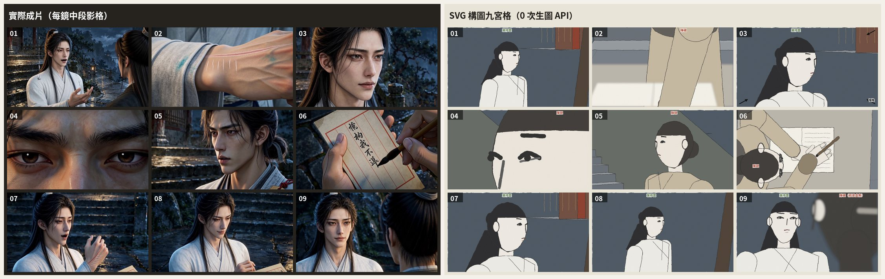
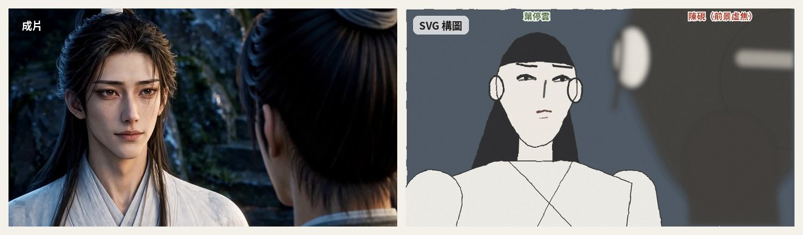
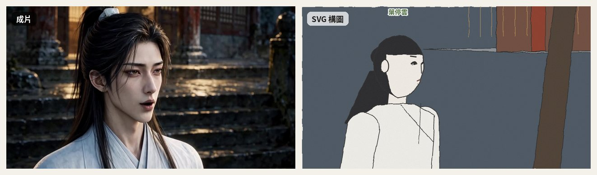
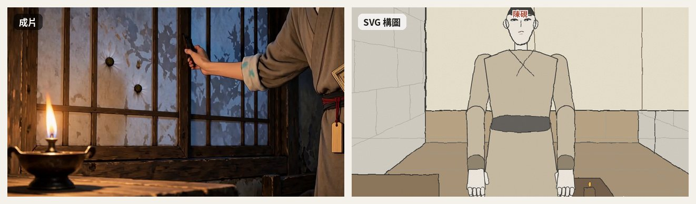
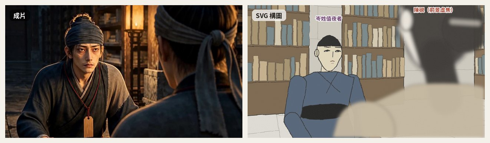
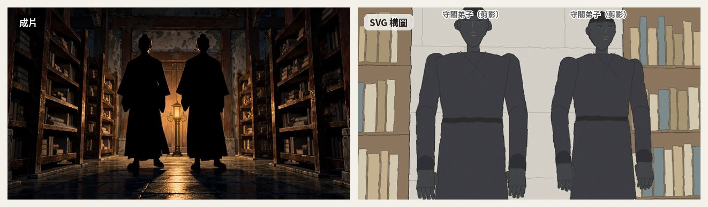

<div align="center">


# 🎬 AI Comic Drama

**一個 Agent Skill：把小說、故事或劇本，端到端做成角色一致的 AI 漫劇／動態漫／短劇。**

依需求交付文字規劃、提示詞或媒體；圖片／影片生成視目前 Agent 與所選後端是否提供相容能力。


[特色](#-特色) · [快速開始](#-快速開始) · [八階段流程](#-八階段流程) · [免生圖構圖](#-免生圖構圖分鏡總覽圖) · [風格鎖定錨](#-漫劇風格鎖定錨) · [角色一致性](#-資產一致性靠登記參考鏈與驗收) · [專案結構](#-專案結構) · [文件索引](#-文件索引)

</div>

---

## ✨ 特色

| | |
|---|---|
| 🧩 **分層工作流程** | 文字規劃可獨立完成；圖片與影片生成依目前 Agent 工具或可用後端，不假設內建影片能力。 |
| 🧭 **單一入口 `h3d`** | `h3d doctor／compile／submit／collect／resume／qa／deps／catalog／ack／status`：一條指令走完產線，`status` 一次看階段門禁、依賴帳本、送件帳本與失敗目錄。 |
| 📑 **小說切章與 6 重清洗** | `extract_chapter.py` 大檔目錄掃描（`--list`）、單章抽取與 Pandoc 6 重自動清洗。 |
| ⏱️ **台詞預算與 H3 實戰審計** | `estimate_duration.py` Unicode P 類別統一計字、`--novel` 體量反推門禁（四大台詞政策試算）與 `--h3` 實戰台詞預算審計（4字/秒、單句 ≤15 字、說話佔比 ≤60%）。 |
| 📝 **劇本 HTML 註解與雙向同步** | `sync_script.py` 支援 Markdown 註解元數據注入、從零建立 handoff、多場景自動擴展與 `--prune-extra` 修剪。 |
| ⚖️ **單章拆多集跨集驗收** | `compare_adaptation.py` 支援 `--episode` 單集過濾與多檔合併總體驗收，連動 `--h3`。 |
| 🎬 **分段級導演分鏡** | 可由約 10s / 3 鏡作為起點；依內容調整，含焦距物距、動作表演與 `INDEPENDENT_REF2VA` 連戲錨點。 |
| 🖼️ **構圖審核** | Qwen 分鏡總覽圖為可用選項；手繪或其他工具輸出的 shot 對應 PNG 也可使用同一審核門。 |
| 🧱 **免生圖構圖分鏡總覽圖** | `h3d sketch` 用 2.5D 相機＋3D 人偶直接算出每鏡構圖，**0 次生圖 API**；依景別取景、過肩貼肩、畫左／畫右跟著 180 度線走，回寫 `sketch_file` 走同一個 stage-4 門禁。 |
| 🔒 **單鏡局部修改與審核鎖** | `patch_shot.py` 單鏡景別秒數修改與自動時間軸重算；`sync_script.py` 場景審核狀態保護防誤改。 |
| ⚡ **H3 官方六段式批次編譯** | `compile_layer2_to_h3.py` 一鍵產出 `prompts-epXX.md` 與 `segments-epXX.json`、防混臉單圖排序、切點時間保護（$D - \text{末切點} \ge 2.05s$）、LoRA 適配與 `--check` 雙重對帳。 |
| 🎯 **切點標記（選用）** | `compile --embed-cut-markers` 在提示詞寫入 `<cutoff>`（段末）與 `<scenetrans>`（跨場景首鏡），並在 `metadata.cut_marker_tokens` 記錄規格；預設關閉，因為那是本專案約定、不是官方語法。 |
| 🚀 **批次送件預檢** | `submit_h3_segments.py` 提供 `--dry-run`、參考圖檢查、可用 GPU 診斷與非同步任務處理；實際需求依模型與後端而異。 |
| 🖼️ **影片四欄對照驗收** | 階段 6 審核頁把同一段的**影片／分鏡總覽圖（階段 4）／角色設定圖（階段 2）／QA 數據**放在一起；缺圖顯示紅框與覆蓋率，但不阻擋核准（擋不擋由 QA 證據決定）。 |
| 🛡️ **批次自動審查門禁** | `verify_video_shot.py` 修復分段總時長精確對齊、支援 `--segments` 批次掃描、防灰階線稿滲透、防分屏線殘留，並輸出**證據分級**（`VERIFIED／PARTIAL／UNVERIFIED`）串聯 `color_qa.py` 匯總 `qa-report.json`。 |
| 🎬 **配音字幕與成片組裝** | `assemble_episode.py` 可選字幕／配音與 FFmpeg 組裝；**旁白／畫外音走外部 TTS**（引擎由 `tts_doctor.py` 盤點：VoiceStudio／Fish Audio／自帶 API），畫內對白保留 H3 口型。外部 narration Markdown 需先轉成支援的 inline 欄位或交給剪輯工具。 |
| ⚖️ **多維程式對帳（P0）** | `audit_refs_and_segments.py` 嚴查參考圖陣列、主體定義、說話者代號與台詞字數預算（模式 A 序對 + 模式 B 17 條自檢）。 |
| 🎨 **11 種風格鎖定錨** | 主流漫劇風格蒸餾成可貼的錨定詞，每種附同角色樣圖。 |
| 🎭 **資產一致性規範** | 以資產 ID、參考圖與風格描述維持一致；依使用者已選擇且當前可用的圖片工具製作。 |
| 🎞️ **主力定案獨立 Ref2VA** | 確立每段獨立 Ref2VA（四大連戲錨點與收尾交接格），一段一張角色圖防平均化，避開尾幀續接 422 互斥。 |
| 🛑 **先算先定再動工** | 階段 0 台詞政策門禁（4選1）、體量反推秒數公式；確認後才動工，絕不假裝生成。 |

## 🚀 快速開始

把本 repo 放進 Claude 的 skills 目錄即可：

```bash
git clone https://github.com/ayase0307/ai-comic-drama.git ~/.claude/skills/ai-comic-drama
# 或用 skills CLI（支援 Claude Code / Codex / OpenClaw 等）
npx skills add ayase0307/ai-comic-drama
```

> 需求：**Python 3.10+**；影片 QA／組裝另需 FFmpeg。純文字規劃與提示詞編譯只需要標準庫。

裝好後先跑一次自檢，確認這台機器能做什麼：

```bash
python scripts/h3d.py doctor          # GPU 顯存、ffmpeg（含 -vsync 回歸）、服務 port
python scripts/h3d.py status --root . # 階段門禁／依賴帳本／送件帳本／失敗目錄
```

把要處理的原稿放入新專案的 `source/` 後，再對 Agent 說：

> 「幫我把這篇小說改編成 12 集、每集 90 秒的漫劇，畫風 3D 國漫，9:16，台詞只留重點句，到分鏡圖。」

Agent 會依你指定的交付範圍開始工作，沿用已提供的 brief、工具與參數；只詢問會阻礙當前工作的必要缺項。純文字劇本或分鏡可獨立交付，不必生成圖片或影片。

也可單獨使用命令列工具。先檢查本機支援的能力，再跑可離線驗證的流程：

下面是各階段命令索引，不可整段連跑。先依 `init_project.py` 產生的 `FLOW_HINT.md` 按目標完成階段 0–3 的 review 與人工核准；只有需要 H3 編譯時，才進入 stage 4。

```powershell
# 1. 建立專案骨架（自動產生 adapt/source.json 與 adapt/bible.json）
python scripts/init_project.py my-drama --title "我的漫劇" --episodes 12
# 在 repo 根目錄執行；init_project 只建立專案資料夾，不會把 scripts 複製進去
$skillRoot = (Resolve-Path .).Path
Set-Location my-drama
python "$skillRoot/scripts/check_environment.py"
python "$skillRoot/scripts/run_offline_checks.py"
# 先把原稿放入專案 source/；再掃描目錄並抽取所需章節
python "$skillRoot/scripts/adapt/extract_chapter.py" --input source/novel.txt --list
python "$skillRoot/scripts/adapt/extract_chapter.py" --input source/novel.txt --volume 1 --chapter 1 --output source/ch01.txt
python "$skillRoot/scripts/adapt/estimate_duration.py" --novel --novel-file source/ch01.txt --target-seconds 90

# 2. 劇本 HTML 註解同步回寫 handoff 與 H3 台詞審計
python "$skillRoot/scripts/adapt/sync_script.py" --handoff handoff-ep01.json --script script-ep01.md --prune-extra
python "$skillRoot/scripts/adapt/estimate_duration.py" --script script-ep01.md --genre xuanhuan_revenge --h3
python "$skillRoot/scripts/adapt/compare_adaptation.py" --source adapt/source.json --script script-ep01.md --handoff handoff-ep01.json --episode 1 --h3

# 3. 交接 JSON → 分鏡 Layer 2 骨架（預設 10s/3 鏡、動作力學模板），再轉表格與時間線
python "$skillRoot/scripts/storyboard/handoff_to_skeleton.py" handoff-ep01.json --out-dir layer2/
python "$skillRoot/scripts/storyboard/validate_storyboard.py" --file layer2/layer2-EP01-*.json --handoff handoff-ep01.json
python "$skillRoot/scripts/storyboard/layer2_to_table.py" layer2/layer2-EP01-*.json --check --md storyboard-ep01.md --timeline timeline-ep01.csv

# 4. 生成 Qwen 黑白鉛筆分鏡 分鏡總覽圖圖（支援 --no-arrows 生成純淨底稿）
python "$skillRoot/scripts/storyboard/qwen_storyboard_grid.py" --layer2 layer2/layer2-EP01-S01-a.json --generate-all --assemble-grid

# 5. 人工審核與單鏡局部修改（調整景別時長並由相鄰鏡頭吸收，零污染單格局部重抽）
python "$skillRoot/scripts/storyboard/patch_shot.py" --file layer2/layer2-EP01-S01-a.json --shot SH03 --shot-size CU --duration 3.5 --absorb-from SH04
python "$skillRoot/scripts/storyboard/qwen_storyboard_grid.py" --layer2 layer2/layer2-EP01-S01-a.json --redraw-shot SH03 --assemble-grid

# 6. 若需 H3 編譯，先審核 stage 4 構圖圖（Qwen、手繪或其他工具皆可）
python "$skillRoot/scripts/build_stage_review.py" --project-dir . --stage 4
# 使用者審核通過後才記錄核准，之後才能編譯
python "$skillRoot/scripts/build_stage_review.py" --project-dir . --approve-stage 4
# 編譯為 H3 官方六段式提示詞與 segments
python "$skillRoot/scripts/storyboard/compile_layer2_to_h3.py" --layer2 layer2/ --episode EP01 --project-root . --output-md prompts-ep01.md --output-segments segments-ep01.json --assets assets.md --bible adapt/bible.json --check
python "$skillRoot/scripts/build_stage_review.py" --project-dir . --stage 5
# 使用者審核通過後才記錄核准
python "$skillRoot/scripts/build_stage_review.py" --project-dir . --approve-stage 5

# 7. 僅在使用者要求生成且 FreeVideo adapter 當前可用時乾跑
python "$skillRoot/scripts/storyboard/submit_h3_segments.py" --segments segments-ep01.json --root-dir . --output-dir videos/ --dry-run
# 真正送件需有效 stage 5 核准且使用者要求生成；FreeVideo 只在本機 adapter 可用時使用
python "$skillRoot/scripts/storyboard/submit_h3_segments.py" --segments segments-ep01.json --root-dir . --output-dir videos/


# 8. 階段 6 批次影片審查（分段總時長精確比對、黑白防漏、分鏡總覽圖邊框檢驗、串聯 color_qa.py 輸出報告）
python "$skillRoot/scripts/storyboard/verify_video_shot.py" --segments segments-ep01.json --videos-dir videos/ --out-report videos/qa-report.md --out-json videos/qa-report.json

# 9. 階段 7 選用組裝（需實際可用的影片／音訊工具）（外部 TTS 盤點與配音、Windows 冒號轉義、多軌混音、Concat 拼接）
python "$skillRoot/scripts/storyboard/tts_doctor.py"
python "$skillRoot/scripts/storyboard/layer2_to_table.py" segments-ep01.json --check --timeline timeline-ep01.csv
python "$skillRoot/scripts/storyboard/assemble_episode.py" --segments segments-ep01.json --videos-dir videos/ --output final/ep01_final.mp4 --audio-mode auto --tts-engine auto --tts-config config/tts.json --target-lufs -23 --delivery-report final/delivery-ep01.md
# 外部 narration-ep01.md 不會由組裝器解析；將旁白轉為支援的 inline 欄位，或交由剪輯工具處理
```

`review/project-state.json` 是唯一階段狀態來源；核准會綁定輸入 hash，內容變更後須重審。Compiler 要求 stage 4 核准，實際提交要求 stage 5 核准；dry-run 可用於預檢。影片 QA 的技術通過結果不會自動成為人工核准。

> 上面這串長指令都有單一入口版本：`h3d compile／submit／collect／resume／qa／assemble／deps／catalog／status`，對照表與錯誤訊息處置見 [`references/tooling.md`](references/tooling.md)。

### 依賴能力

| 工作 | 需要的能力 |
|---|---|
| 文字規劃、JSON/提示詞檢查 | Python 標準庫 |
| review 頁與分鏡總覽圖 | Python；圖片操作需 Pillow |
| 免生圖 SVG 構圖（選用） | Pillow、numpy、resvg-py；不需 GPU、不呼叫生圖 API |
| 影片 QA 與組裝 | FFmpeg、ffprobe；部分輸入檢查使用 Python/Pillow |
| 圖片/影片生成 | Agent 當前可用的相容工具或連線後端；FreeVideo 是可選 adapter |

`scripts/check_environment.py` 檢查本機依賴，不探測 provider、帳戶或模型；`scripts/run_offline_checks.py` 執行離線測試。生成能力仍需依當前工具介面確認。

## 🧭 八階段流程

<div align="center">

</div>

| 階段 | 做什麼 | 產出 |
|---|---|---|
| 0 定調 | 依交付範圍確認題材、比例、聲音與必要片長；沿用已提供資料 | `project.md`、選用的規劃文件 |
| 1 改編 | 小說目錄掃描與單章清洗抽取（`extract_chapter.py`）、保留分級、A/B/C 方案、分集架構、跨集驗收（`compare_adaptation.py --episode`） | 故事地圖、分集大綱 |
| 2 資產與設定圖 | 若目標包含設定圖，使用實際可用且已選擇的工具；維護資產參考 | `assets.md`、可選設定板 |
| 3 漫劇劇本 | 場景化改寫、時長與台詞預算審計（`estimate_duration.py --h3`）、HTML 註解元數據注入、交接 JSON、人工審核鎖（`sync_script.py`） | `script-ep01.md`、`handoff-ep01.json`、`adaptation-diff.md` |
| 4 導演分鏡 | **分段級分鏡（預設 10s/3 鏡，`handoff_to_skeleton.py`）**、焦距物距、**動作力學三要素**、`INDEPENDENT_REF2VA` 四大錨點、構圖審核（免生圖 SVG／Qwen 鉛筆分鏡總覽圖／手繪） | `layer2/*.json`、`storyboard-ep01.md`、`grid-*.png` |
| 5 提示詞包 | **H3 官方六段式批次編譯（`compile_layer2_to_h3.py`）**、防混臉單圖排序、切點時間保護、LoRA 適配、`--check` 雙重對帳 | `prompts-ep01.md`、`segments-ep01.json` |
| 6 生成 | **主力定案：獨立 Ref2VA（四錨點連戲、一段一張角色圖）**；`submit_h3_segments.py` 批次送件；`verify_video_shot.py` 批次審查 | `images/`、`videos/`、`qa-report.json` |
| 7 組裝交付（選用） | 依可用素材與依賴進行組裝；**旁白／畫外音由外部 TTS 產生**（H3 這段只出環境音床），畫內對白保留 H3 口型；旁白稿可另行交付，實際時間線由 compiled segments 匯出 | `final/ep01_final.mp4`、`narration-ep01.md`、`timeline-ep01.csv` |

詳細模板與每階段檢查點見 [`references/pipeline.md`](references/pipeline.md)。

## 🎨 漫劇風格鎖定錨

十一種主流風格各蒸餾成一組可貼在每個圖像提示詞結尾的**風格鎖定錨**（含負面錨、色盤、翻車點）。風格錨的用途就是先鎖定**角色設定板**，所以下表樣圖都是**同一位角色**（紅衣漢服女主）套用各自的錨生成的設定板：左為面部特寫，右為正／側／背全身，單色平光背景，這樣差異只來自風格。完整錨定詞見 [`references/styles.md`](references/styles.md)。

| # | 風格 | 樣圖 | 適合題材 | 錨定重點 |
|---|---|---|---|---|
| 1 | 3D 國漫 |  | 玄幻、仙俠、霸總 | 平滑 3D 模型表面、光澤皮膚、髮絲絲綢高光 |
| 2 | 2D 動態漫 |  | 霸總、甜寵、逆襲 | 向量線稿、平塗色塊、背景極簡、單一動作 |
| 3 | 日系賽璐璐 |  | 校園、熱血、日常 | 硬邊陰影、固定線寬、平塗 |
| 4 | 日系電影感 |  | 治癒、青春、情感 | 黃金時刻逆光、細緻雲天與街景 |
| 5 | 韓漫條漫 |  | 都市、財閥、復仇 | 細線柔和賽璐璐、大眼、粉彩高光 |
| 6 | 新國風水墨 |  | 古風、文化題材 | 宣紙肌理、墨色濃淡、留白、朱砂印 |
| 7 | 仙俠古風厚塗 |  | 仙俠、修真、穿越 | 厚重筆觸、飄帶、雲海山門 |
| 8 | 都市霸總半寫實 |  | 霸總、豪門、甜寵 | 近真人比例、香檳金輪廓光、頂層公寓 |
| 9 | Q 版喜劇 |  | 沙雕、搞笑 | 二頭身、粗描邊、高彩度色塊 |
| 10 | 美漫硬派線稿 |  | 動作、末世、懸疑 | 粗墨線、網點陰影、強對比 |
| 11 | 賽博霓虹 |  | 末世、科幻、機甲 | 平面霓虹色塊、硬邊陰影、雨夜招牌 |

> 誠實聲明：「主流」是依題材與工具選項歸納，沒有找到各平台公開占比；錨定詞與色盤為推斷，僅以上方設定板在 ChatGPT 網頁版校準過，換成即夢、可靈、Midjourney 等模型請先出 3–5 張測試圖。

## 🧬 資產一致性：靠登記、參考鏈與驗收

<div align="center">

<br><sub>角色設定板：面部特寫 + 正／側／背全身，平光純色背景，作為後續所有鏡頭的參考圖。</sub>
</div>

1. 每個資產有 ID 與版本（`C-` 角色、`W-` 服裝、`S-` 場景、`P-` 道具、`V-` 音色）。
2. 角色設定板必備：面部特寫、正／側／背、6 表情、五色色票、身高對照、每套服裝一張、3 個辨識錨。
3. 參考鏈：設定板＋場景主圖 → 分鏡圖 → 影片首幀；有參考圖時外觀只在首次出現寫一次。
4. 每鏡生成後跑漂移清單，fail 不得當下一鏡參考；修復依階梯逐級處理。
5. 每種資產都有驗收門，沒通過不進下一階段。

規格全文見 [`references/consistency.md`](references/consistency.md)。

## 🎞️ 先分鏡，後生成

<div align="center">

<br><sub>分鏡表未驗證通過不出圖；出圖後先確認角色長相，再拿去生成影片。</sub>
</div>

分鏡走[導演分鏡體系](references/storyboard/cinematic-director.md)：台詞一字不改、焦距與物距成對寫、同場連續與時空跳躍二選一握手、武戲接觸瞬間 90° 無遮擋。逐鏡生成、逐鏡檢查，不要一次丟十幾鏡。

## 🧱 免生圖構圖分鏡總覽圖

階段 4 審走位不必燒圖片額度。`svg_storyboard_grid.py` 讀 Layer 2，用程式算出每一鏡的機位、景別與站位，畫成鉛筆風構圖：**只要有 Layer 2 就能跑，不呼叫任何生圖 API**。下圖左邊是同一段實際生成的影片（每鏡取中段影格），右邊是只靠 Layer 2 算出來的構圖。

<div align="center">

<br><sub>同一段 9 鏡：左為成片中段影格，右為 SVG 構圖分鏡總覽圖。景別、人物在畫面哪一側、朝哪邊看、過肩前景位置都由 Layer 2 推算。</sub>
</div>

<br>

<div align="center">

<br><sub><b>過肩鏡頭</b>：相機貼在前景肩後，前景後腦佔畫面約三分之一，不遮主體的臉。</sub>
</div>

<div align="center">

<br><sub><b>3/4 側臉方向</b>：「畫左、面向畫右」照 180 度線換算機位，不會左右顛倒。</sub>
</div>

<details>
<summary><b>更多對照：背影、零設定場景、逆光剪影</b></summary>
<br>

<div align="center">

<br><sub><b>側後背影</b>：窗前背影用約 145° 的側後機位，房間門窗位置來自 staging 設定。</sub>
</div>

<div align="center">

<br><sub><b>零設定場景</b>：沒寫任何場景檔，書架、矮案、兩人對坐與過肩都從 Layer 2 文字自動搭出。</sub>
</div>

<div align="center">

<br><sub><b>逆光剪影</b>：「兩道守閣弟子的剪影」自動複製成兩個暗色人形，低角度取景。</sub>
</div>

</details>

```bash
pip install numpy resvg-py Pillow              # 選用依賴，只有這個工具需要
python scripts/h3d.py sketch --root <專案> --episode EP04
python scripts/build_stage_review.py --project-dir <專案> --stage 4
```

每鏡輸出到 `panels/panel-NN-<shot_id>.png`、每段分鏡總覽圖到 `images/grid-<segment_id>.png`，並回寫 `sketch_file`／`sketch_sha256`／`sketch_generation`。鎖定或手繪替換過的格子不會被覆蓋。角色外觀、場景與站位都可以用 `staging/` 的 JSON 補強，程式內不含任何專案的角色或場景。完整說明見 [`references/storyboard/svg-rig-grid.md`](references/storyboard/svg-rig-grid.md)；最小範例在 [`examples/svg-grid-minimal/`](examples/svg-grid-minimal/)。

> 構圖圖只用來審走位，**不送 H3**。臉部是簡筆，要看光影、表情、服裝細節時仍用 Qwen 分鏡總覽圖或手繪。

## 📁 專案結構

Skill 本身：

```
ai-comic-drama/
├── SKILL.md                 # 技能入口（Agent 讀這個）
├── references/
│   ├── adapt/               # 小說改編（novel-to-manju）
│   ├── storyboard/          # 導演分鏡（cinematic-director-storyboard）
│   ├── h3/                  # MiniMax H3 影片提示詞（同步自上游）
│   ├── consistency.md       # 資產一致性規範
│   └── styles.md            # 風格鎖定錨
└── scripts/
    ├── init_project.py      # 建立專案骨架（自動初始化 adapt/source.json、adapt/bible.json 與門禁欄位）
    ├── color_qa.py          # 跨鏡頭色彩連貫性檢查
    ├── adapt/               # 小說抽取清洗（extract_chapter.py）、劇本驗證、時長台詞審計（estimate_duration.py）、連戲、改編比對（compare_adaptation.py）與人工審核鎖定（sync_script.py）
    └── storyboard/          # Layer 2 骨架（handoff_to_skeleton.py）、表格時間線、分鏡驗證、局部修改（patch_shot.py）、Qwen 分鏡總覽圖與轉彩（qwen_storyboard_grid.py）、免生圖 SVG 構圖分鏡總覽圖（svg_storyboard_grid.py）、H3 官方六段式批次編譯（compile_layer2_to_h3.py）、H3 批次提交與顯存保護（submit_h3_segments.py）、影片審查與報告匯總（verify_video_shot.py）、後期智慧配音字幕成片拼接（assemble_episode.py）、TTS 後端封裝與能力盤點（tts_engine.py、tts_doctor.py）、多維程式對帳（audit_refs_and_segments.py）
```

用本技能產出的專案：

```
<專案名>/
├── project.md              # 定調 + 分集規劃
├── source/  adapt/         # 原著與改編中間產物（source.json、bible.json、故事地圖）
├── assets.md               # 風格錨 + 角色 / 場景 / 道具 / 音色聖經
├── script-ep01.md          # 漫劇劇本
├── handoff-ep01.json       # 劇本→分鏡交接
├── layer2/                 # 分鏡 Layer 2 JSON
├── storyboard-ep01.md      # 分鏡表（人可讀）
├── prompts-ep01.md         # 逐鏡圖像 / 影片提示詞
├── segments-ep01.json       # FreeVideo 批次分段檔（H3 官方六段式結構）
├── staging/                # 選用：SVG 構圖的角色外觀、場景與站位設定（cast.json、<場景>.json）
├── panels/                 # 逐鏡構圖（SVG 構圖或 Qwen 鉛筆草圖，panel-*.png）
├── keyframes/              # Qwen 轉繪全彩關鍵幀首幀（keyframe-*.png，去黑箭頭）
├── narration-ep01.md       # 旁白與字幕稿
├── timeline-ep01.csv       # 剪輯時間線
├── images/                 # 角色參考圖、分鏡圖、分鏡總覽圖（grid-*.png）
└── videos/                 # 影片片段與自動審查報告
```

## 📚 文件索引

| 文件 | 內容 |
|---|---|
| [`SKILL.md`](SKILL.md) | 核心原則、工作紀律鐵律與八階段總覽 |
| [`references/tooling.md`](references/tooling.md) | **產線工具 `h3d`**：量子、證據分級、依賴帳本、失敗目錄與 ack、能力表、錯誤訊息處置 |
| [`references/pipeline.md`](references/pipeline.md) | 各階段詳細流程、台詞政策門禁（4選1）、體量反推秒數公式、模板；階段 7 聲音三層決策、外部 TTS 與響度交付標準 |
| [`references/model-profiles.md`](references/model-profiles.md) | 生成前必問清單、各模型提示詞風格對照 |
| [`references/prompt-playbook.md`](references/prompt-playbook.md) | 景別、運鏡、光線、負面提示詞 |
| [`references/adapt/novel-to-manju.md`](references/adapt/novel-to-manju.md) | 小說改編總規範（10 階段、題材模式、退稿閘門）與 `adapt/` 各篇 |
| [`references/storyboard/cinematic-director.md`](references/storyboard/cinematic-director.md) | 導演分鏡總規範與 `storyboard/` 各篇、Layer 2 JSON Schema |
| [`references/storyboard/svg-rig-grid.md`](references/storyboard/svg-rig-grid.md) | 免生圖 SVG 構圖分鏡總覽圖：用法、回寫欄位、零設定搭景規則、cast／staging 格式、已知限制 |
| [`references/storyboard/combat-and-vfx-library.md`](references/storyboard/combat-and-vfx-library.md) | 冷兵器武學連招、玄幻大招五段鏈與 11 大戰場拓撲庫 |
| [`references/storyboard/acting-and-emotion-library.md`](references/storyboard/acting-and-emotion-library.md) | 邁斯納壓力行為表演法、潛台詞言行反差、10 大景別句型與 4D 配音詞庫 |
| [`references/consistency.md`](references/consistency.md) | 資產 ID、生物純底三視圖（Creature Sheet）、防角色平均化、多模態素材職責表、首幀畫風並排對照驗收門 |
| [`references/styles.md`](references/styles.md) | 11 種風格鎖定錨與樣圖 |
| [`references/freevideo.md`](references/freevideo.md) | 搭配 FreeVideo 出片：連線、規則、階段對應 |
| [`agent.md`](agent.md) / [`memory.md`](memory.md) | 給維護本技能的 Agent：進場規範與跨 agent 交接記憶 |
| [`references/minimax-h3.md`](references/minimax-h3.md) | MiniMax H3 專章入口、負面轉正面詞表、8GB VRAM OOM 拆段公式、Windows 工程坑速查（1–11）、官方 Ref2VA 格式合規速查 |
| [`references/h3/lora-guide.md`](references/h3/lora-guide.md) | MiniMax H3 專用 LoRA 矩陣校準（停用 camera_motion、驗證速度滑桿與 Bunny）、疊加預算與 FreeVideo 掛載合約 |
| [`references/h3/`](references/h3/) | 官方格式、皮膚段骨架、動作節奏、失敗診斷、情境庫（人物／視覺／商業）、運鏡轉場、音訊對白、長片分段、10 秒打鬥範例 |

## 🎥 建議搭配 FreeVideo

**[FreeVideo](https://github.com/FlashML-org/FreeVideo)** 是跑在你自己電腦上的 AI 影片生成工具，內建 MiniMax H3，並提供 Agent 專用接口（含 MCP）。

**它能做什麼**
- 文字生影片，也能帶首幀圖、首尾幀或參考圖（人物、影片、音檔）
- 角色庫：建立角色／場景卡片，跨鏡頭沿用同一張臉
- 多鏡影片：先預覽劇本與鏡數，逐鏡看畫面、選片、重拍，最後自動拼接成片
- 單段最長約 60 秒，更長的自動接續；也能生成圖片、抽影格、問視覺模型畫面內容

**為什麼要搭配它**
- 本技能負責「想清楚」：分集、角色、分鏡、提示詞；FreeVideo 負責「做出來」。接上之後 Agent 能從分鏡一路做到成片，不必你手動搬提示詞、下載、剪接。
- 吃官方 H3 提示詞格式，`prompts-ep01.md` 寫好就能直接送，不用再轉寫。
- 在本機跑，沒有額度與排隊費用，素材不離開你的電腦。
- 角色卡讓「角色一致」從靠貼描述片段，升級成直接沿用角色圖。

連線與用法見 [`references/freevideo.md`](references/freevideo.md)；FreeVideo 沒開時，技能會退回「先問模型再生成」的流程。

## 🔗 搭配的專案

小說改編與導演分鏡兩個子體系分別整併自作者另開發的 novel-to-manju、cinematic-director-storyboard。本技能的影片提示詞（MiniMax H3）部分，以 **[ayase0307/h3-video-prompting](https://github.com/ayase0307/h3-video-prompting)**（MIT）為準：動作品質、節奏卡點、光影配色、音訊流程、失敗分診與情境 playbook 都在那邊持續更新。`references/h3/` 是該 repo `references/` 的同步副本（釘在 commit `1db923b`，逐檔紀錄在 [`references/h3/UPSTREAM.json`](references/h3/UPSTREAM.json)）；本專案只額外加了 `lora-guide.md` 與幾個 ★ 標註。兩邊有出入時以該 repo 為主，並跑 `python scripts/sync_h3_reference.py --check` 找出漂移。

## 📄 授權

[MIT](LICENSE)

## 🤝 貢獻

歡迎 Issue 與 PR：新增情境庫、其他模型的提示詞對照、更多範例都很有價值。

---

<div align="center">
<sub>橫幅、角色設定圖、分鏡圖由 Codex（imagegen）生成；八階段流程圖與 11 張風格設定板由 ChatGPT 網頁版生成。</sub>
</div>
