<div align="center">


# 🎬 AI Comic Drama

**一個 Agent Skill：把小說、故事或劇本，端到端做成角色一致的 AI 漫劇／動態漫／短劇。**

小說 → 改編分集 → 資產設定圖 → 漫劇劇本 → 導演分鏡 → 提示詞 → 圖 → 片，全程在 Agent 內完成。


[特色](#-特色) · [快速開始](#-快速開始) · [八階段流程](#-八階段流程) · [風格鎖定錨](#-漫劇風格鎖定錨) · [角色一致性](#-資產一致性靠登記參考鏈與驗收) · [專案結構](#-專案結構) · [文件索引](#-文件索引)

</div>

---

## ✨ 特色

| | |
|---|---|
| 🧩 **零外部依賴** | 不需要自託管平台、MCP、資料庫。寫作與分鏡由 Agent 完成，出圖出片用內建生成能力。 |
| 📖 **小說先改編** | 小說不直接當劇本：保留分級、A/B/C 方案、分集因果、可拍劇本，附四道退稿閘門與腳本驗證。 |
| 🎬 **導演級分鏡** | 三步法、焦距×物距、連戲握手、武戲 90° 無遮擋，輸出三層產物並靜態驗證。 |
| 🖼️ **視覺化九宮格審核** | Qwen 黑白鉛筆草圖 3x3 九宮格預覽，人工審核直觀清晰，單鏡重繪零污染保護。 |
| 🔒 **單鏡局部修改與審核鎖** | `sync_script.py` 劇本改動防覆蓋同步；`patch_shot.py` 單鏡景別秒數修改與自動時間軸重算。 |
| 🎨 **11 種風格鎖定錨** | 主流漫劇風格蒸餾成可貼的錨定詞，每種附同角色樣圖。 |
| 🎭 **資產一致** | 角色／服裝／場景／道具／音色有 ID、設定板規格、參考鏈、漂移清單與驗收門。 |
| 🎞️ **MiniMax H3 專章** | 官方三段式骨架、情境庫、失敗診斷表，附完整 10 秒打鬥範例。 |
| 🛡️ **自動審查門禁** | `verify_video_shot.py` 自動檢測時長、防灰階線稿滲透、防九宮格分屏線殘留、色彩連貫性。 |
| 🗂️ **全程落檔** | 每個階段的產物都是檔案，隨時續做、改稿、交接。 |
| 🛑 **生成前先確認** | 工具、參數、提示詞語言與鏡數，確認後才動工；絕不假裝生成。 |

## 🚀 快速開始

把本 repo 放進 Claude 的 skills 目錄即可：

```bash
git clone https://github.com/ayase0307/ai-comic-drama.git ~/.claude/skills/ai-comic-drama
```

然後對 Agent 說：

> 「幫我把這篇小說改編成 12 集、每集 90 秒的漫劇，畫風 3D 國漫，9:16，到分鏡圖。」

Agent 會先一次問完定調項目（集數與時長、題材與載體、畫風錨、比例、語言、聲音形式、交付深度），小說會先走改編再寫劇本。

也可單獨使用全套命令列工具鏈：

```bash
# 1. 建立專案骨架
python scripts/init_project.py my-drama --title "我的漫劇" --episodes 12

# 2. 劇本驗證與人工審核鎖定（結構、時長、連戲、改編差異）
python scripts/adapt/validate_structure.py --script script-ep01.md --handoff handoff-ep01.json
python scripts/adapt/sync_script.py --handoff handoff-ep01.json --scene EP01-S01 --set-status approved

# 3. 交接 JSON → 分鏡 Layer 2 骨架，再轉表格與時間線
python scripts/storyboard/handoff_to_skeleton.py handoff-ep01.json --out-dir layer2/
python scripts/storyboard/validate_storyboard.py --file layer2/layer2-EP01-*.json --handoff handoff-ep01.json
python scripts/storyboard/layer2_to_table.py layer2/layer2-EP01-*.json --check --md storyboard-ep01.md --timeline timeline-ep01.csv

# 4. 生成 Qwen 黑白鉛筆分鏡 3x3 九宮格總覽圖（支援 --no-arrows 生成純淨底稿）
python scripts/storyboard/qwen_storyboard_grid.py --layer2 layer2/layer2-EP01-S01-a.json --generate-all --assemble-grid

# 5. 人工審核與單鏡局部修改（調整景別時長並由相鄰鏡頭吸收，零污染單格局部重抽）
python scripts/storyboard/patch_shot.py --file layer2/layer2-EP01-S01-a.json --shot SH03 --shot-size CU --duration 3.5 --absorb-from SH04
python scripts/storyboard/qwen_storyboard_grid.py --layer2 layer2/layer2-EP01-S01-a.json --redraw-shot SH03 --assemble-grid

# 6. 轉繪全彩關鍵幀首幀（自動注入屬性解耦擦除指令，清除手繪黑箭頭與透視輔助線）
python scripts/storyboard/qwen_storyboard_grid.py --layer2 layer2/layer2-EP01-S01-a.json --to-color-keyframe all

# 7. AI 影片自動審查門禁（時長、彩度防黑白污染、九宮格分屏殘留、色彩連貫性檢驗並回寫 Layer 2）
python scripts/storyboard/verify_video_shot.py --video videos/EP01-S01-SH01.mp4 --layer2 layer2/layer2-EP01-S01-a.json --shot SH01 --write-back
```

## 🧭 八階段流程

<div align="center">

</div>

| 階段 | 做什麼 | 產出 |
|---|---|---|
| 0 定調 | 題材、載體、畫風錨、比例等設定 | `project.md` |
| 1 改編 | 小說解析、保留分級、A/B/C 方案、分集架構 | 故事地圖、分集大綱 |
| 2 資產與設定圖 | 故事聖經 → `assets.md`（ID、風格錨、色票、固定片段）、設定板 | `assets.md`、設定板 |
| 3 漫劇劇本 | 場景化改寫、時長與可製作性審計、交接 JSON、人工審核鎖（`sync_script.py`） | `script-ep01.md`、`handoff-ep01.json` |
| 4 導演分鏡 | 三步法、焦距物距、連戲握手、單鏡局部修改（`patch_shot.py`）、鉛筆九宮格（`qwen_storyboard_grid.py`） | `layer2/*.json`、`storyboard-ep01.md`、`grid-*.png` |
| 5 提示詞包 | Layer 3 編譯成目標模型語法 | `prompts-ep01.md` |
| 6 生成 | 兩段式轉換：鉛筆九宮格審核 → 轉全彩關鍵幀首幀（去黑箭頭） → H3 逐鏡生成 → 影片審查（`verify_video_shot.py`） | `keyframes/`、`images/`、`videos/`、審查報告 |
| 7 組裝交付 | 旁白稿、字幕、剪輯時間線、交付清單 | `narration-ep01.md`、`timeline-ep01.csv` |

詳細模板與每階段檢查點見 [`references/pipeline.md`](references/pipeline.md)。

## 🎨 漫劇風格鎖定錨

十一種主流風格各蒸餾成一組可貼在每個圖像提示詞結尾的**風格鎖定錨**（含負面錨、色盤、翻車點）。風格錨的用途就是先鎖定**角色設定板**，所以下表樣圖都是**同一位角色**（紅衣漢服女主）套用各自的錨生成的設定板：左為面部特寫，右為正／側／背全身，單色平光背景，這樣差異只來自風格。完整錨定詞見 [`references/styles.md`](references/styles.md)。

| # | 風格 | 樣圖 | 適合題材 | 錨定重點 |
|---|---|---|---|---|
| 1 | 3D 國漫 | 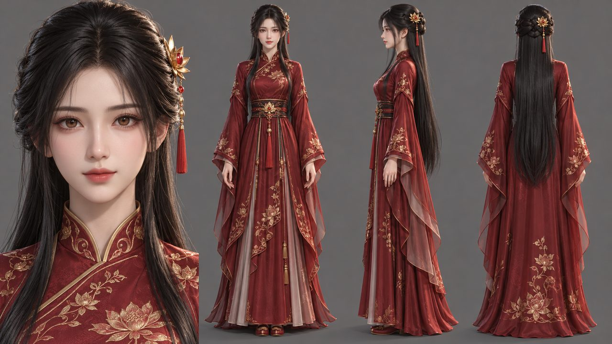 | 玄幻、仙俠、霸總 | 平滑 3D 模型表面、光澤皮膚、髮絲絲綢高光 |
| 2 | 2D 動態漫 | 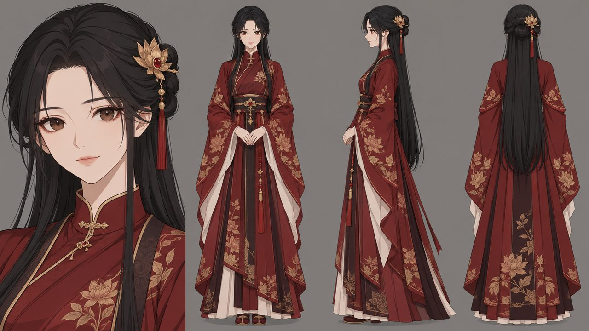 | 霸總、甜寵、逆襲 | 向量線稿、平塗色塊、背景極簡、單一動作 |
| 3 | 日系賽璐璐 | 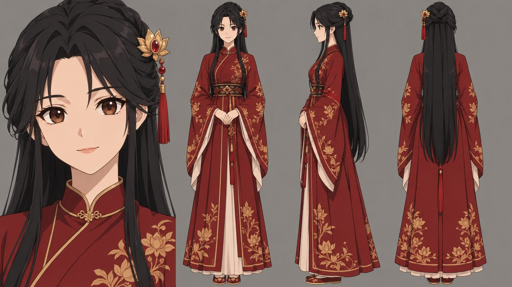 | 校園、熱血、日常 | 硬邊陰影、固定線寬、平塗 |
| 4 | 日系電影感 | 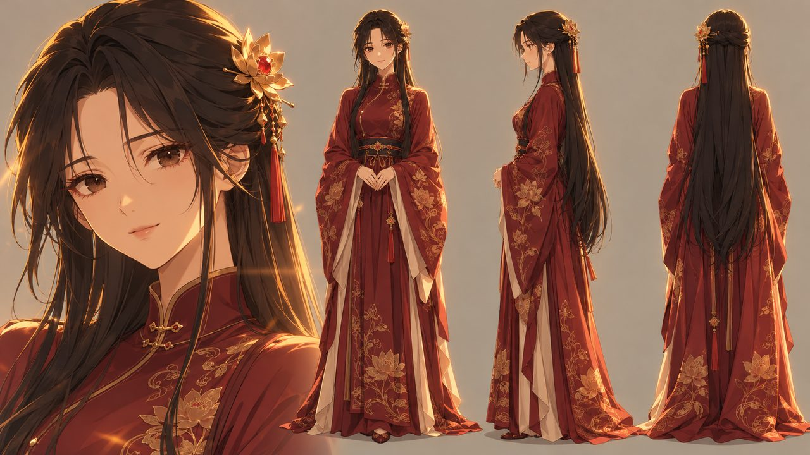 | 治癒、青春、情感 | 黃金時刻逆光、細緻雲天與街景 |
| 5 | 韓漫條漫 | 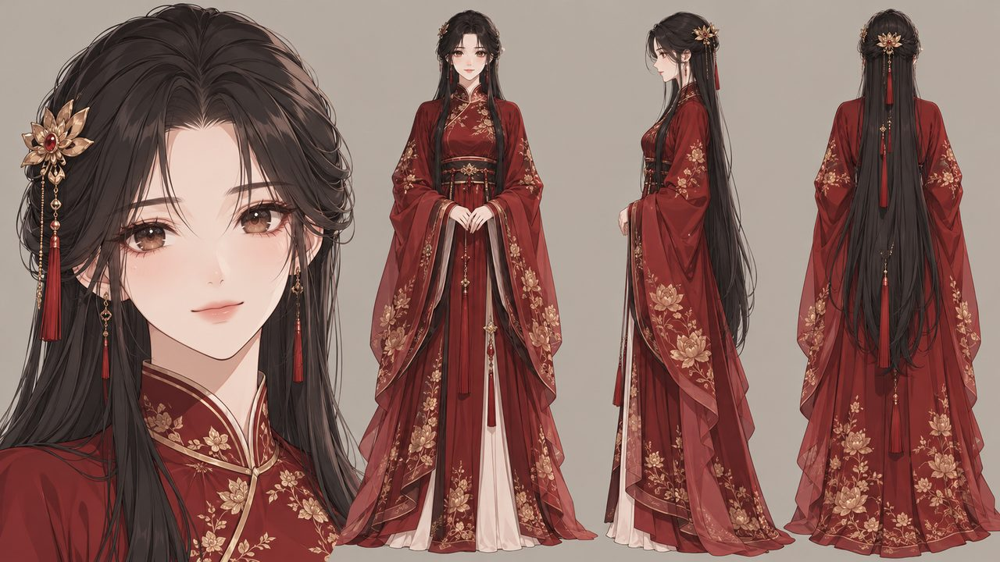 | 都市、財閥、復仇 | 細線柔和賽璐璐、大眼、粉彩高光 |
| 6 | 新國風水墨 | 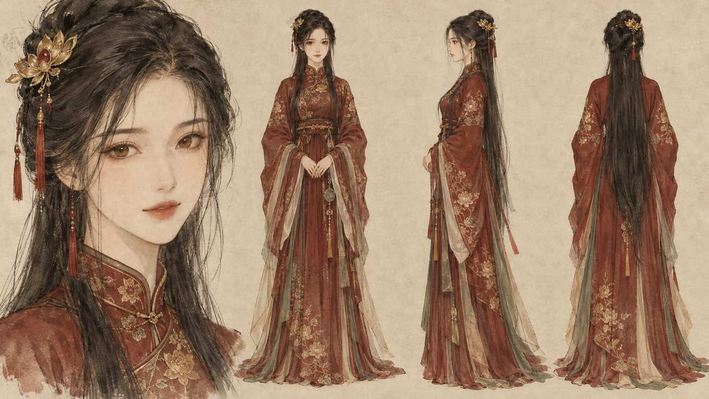 | 古風、文化題材 | 宣紙肌理、墨色濃淡、留白、朱砂印 |
| 7 | 仙俠古風厚塗 | 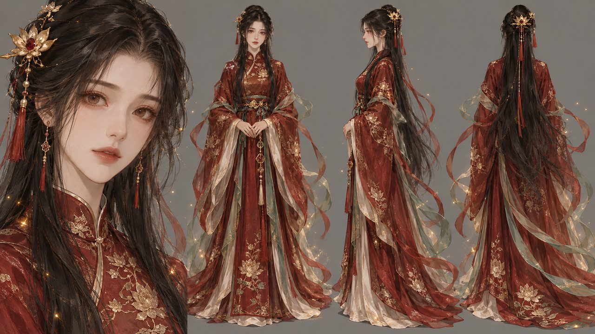 | 仙俠、修真、穿越 | 厚重筆觸、飄帶、雲海山門 |
| 8 | 都市霸總半寫實 | 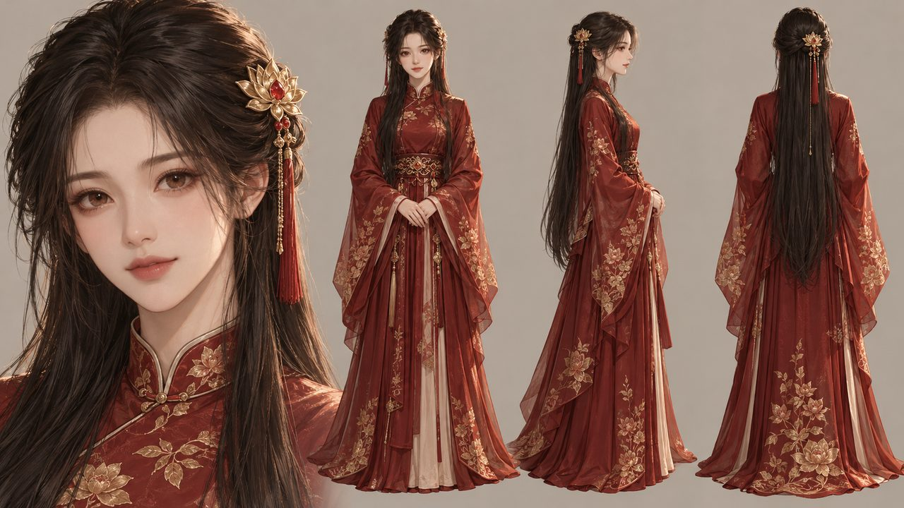 | 霸總、豪門、甜寵 | 近真人比例、香檳金輪廓光、頂層公寓 |
| 9 | Q 版喜劇 | 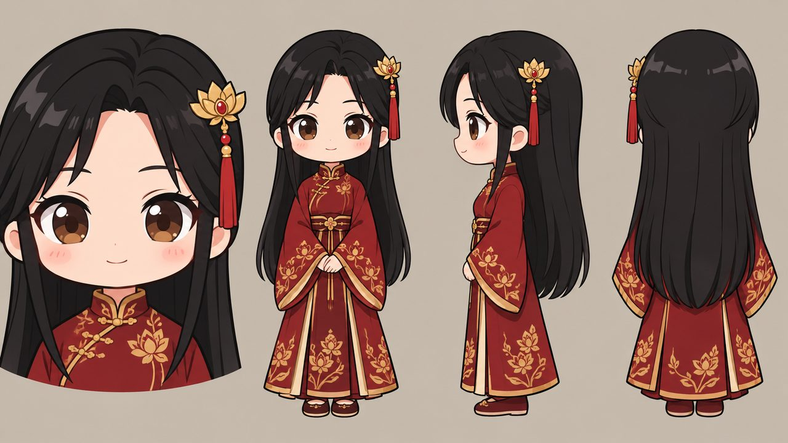 | 沙雕、搞笑 | 二頭身、粗描邊、高彩度色塊 |
| 10 | 美漫硬派線稿 | 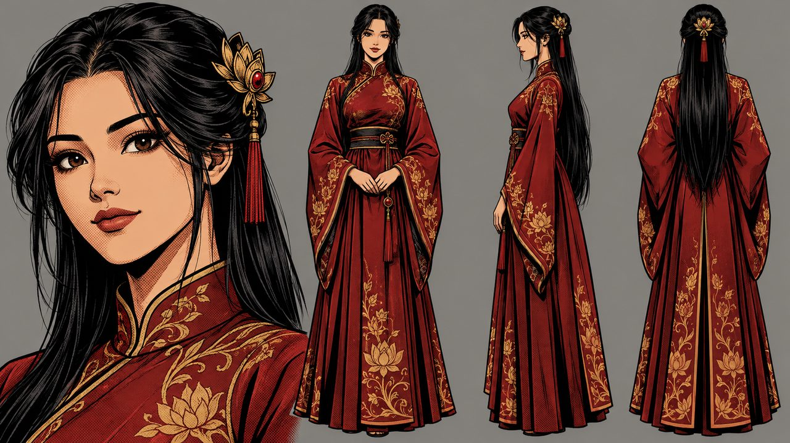 | 動作、末世、懸疑 | 粗墨線、網點陰影、強對比 |
| 11 | 賽博霓虹 | 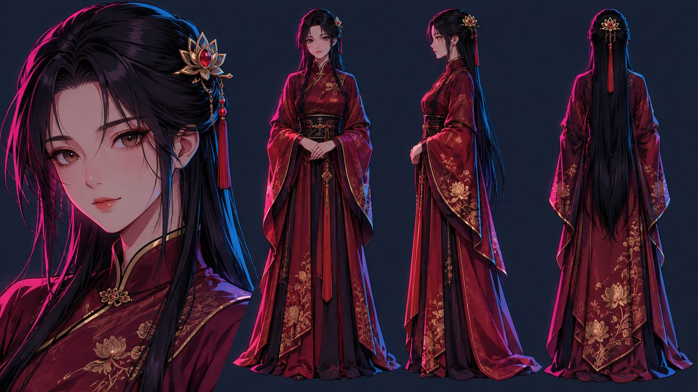 | 末世、科幻、機甲 | 平面霓虹色塊、硬邊陰影、雨夜招牌 |

> 誠實聲明：「主流」是依題材與工具選項歸納，沒有找到各平台公開占比；錨定詞與色盤為推斷，僅以上方設定板在 ChatGPT 網頁版校準過，換成即夢、可靈、Midjourney 等模型請先出 3–5 張測試圖。

## 🧬 資產一致性：靠登記、參考鏈與驗收

<div align="center">
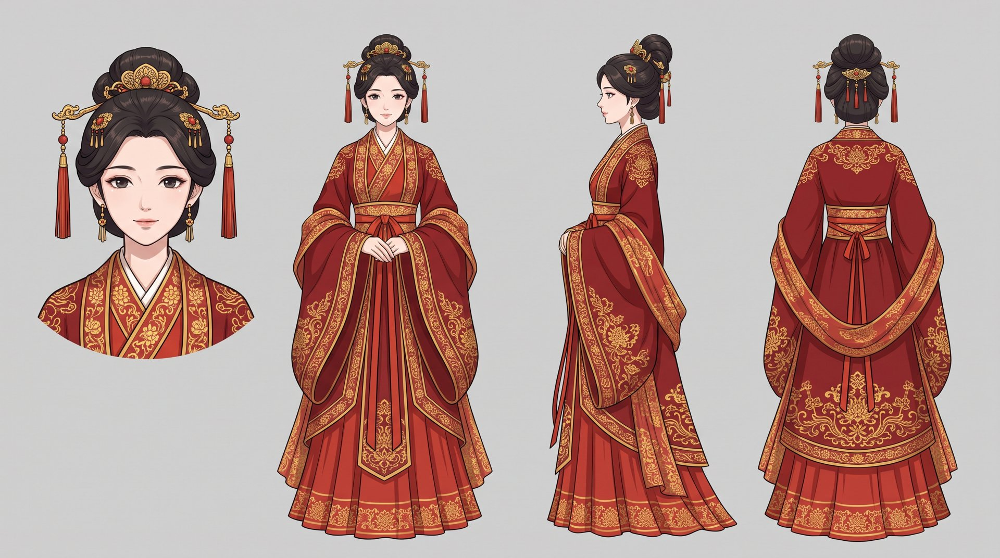
<br><sub>角色設定板：面部特寫 + 正／側／背全身，平光純色背景，作為後續所有鏡頭的參考圖。</sub>
</div>

1. 每個資產有 ID 與版本（`C-` 角色、`W-` 服裝、`S-` 場景、`P-` 道具、`V-` 音色）。
2. 角色設定板必備：面部特寫、正／側／背、6 表情、五色色票、身高對照、每套服裝一張、3 個辨識錨。
3. 參考鏈：設定板＋場景主圖 → 分鏡圖 → 影片首幀；有參考圖時外觀只在首次出現寫一次。
4. 每鏡生成後跑漂移清單，fail 不得當下一鏡參考；修復依階梯逐級處理。
5. 每種資產都有驗收門，沒通過不進下一階段。

規格全文見 [`references/consistency.md`](references/consistency.md)。

## 🎞️ 先分鏡，後生成

<div align="center">
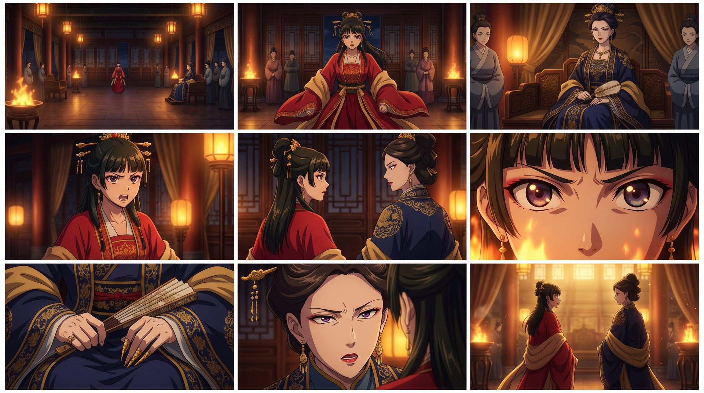
<br><sub>分鏡表未驗證通過不出圖；出圖後先確認角色長相，再拿去生成影片。</sub>
</div>

分鏡走[導演分鏡體系](references/storyboard/cinematic-director.md)：台詞一字不改、焦距與物距成對寫、同場連續與時空跳躍二選一握手、武戲接觸瞬間 90° 無遮擋。逐鏡生成、逐鏡檢查，不要一次丟十幾鏡。

## 📁 專案結構

Skill 本身：

```
ai-comic-drama/
├── SKILL.md                 # 技能入口（Agent 讀這個）
├── references/
│   ├── adapt/               # 小說改編（novel-to-manju）
│   ├── storyboard/          # 導演分鏡（cinematic-director-storyboard）
│   ├── h3/                  # MiniMax H3 影片提示詞（同步自上游）
│   ├── consistency.md       # 資產一致性規範
│   └── styles.md            # 風格鎖定錨
└── scripts/
    ├── init_project.py      # 建立專案骨架
    ├── color_qa.py          # 跨鏡頭色彩連貫性檢查
    ├── adapt/               # 劇本驗證、時長估計、連戲與人工審核鎖定（sync_script.py）
    └── storyboard/          # Layer 2 骨架、表格時間線、分鏡驗證、局部修改（patch_shot.py）、Qwen 九宮格與轉彩（qwen_storyboard_grid.py）、影片審查（verify_video_shot.py）
```

用本技能產出的專案：

```
<專案名>/
├── project.md              # 定調 + 分集規劃
├── source/  adapt/         # 原著與改編中間產物
├── assets.md               # 風格錨 + 角色 / 場景 / 道具 / 音色聖經
├── script-ep01.md          # 漫劇劇本
├── handoff-ep01.json       # 劇本→分鏡交接
├── layer2/                 # 分鏡 Layer 2 JSON
├── storyboard-ep01.md      # 分鏡表（人可讀）
├── prompts-ep01.md         # 逐鏡圖像 / 影片提示詞
├── panels/                 # Qwen 單格黑白鉛筆手繪草圖（panel-*.png）
├── keyframes/              # Qwen 轉繪全彩關鍵幀首幀（keyframe-*.png，去黑箭頭）
├── narration-ep01.md       # 旁白與字幕稿
├── timeline-ep01.csv       # 剪輯時間線
├── images/                 # 角色參考圖、分鏡圖、九宮格總覽（grid-*.png）
└── videos/                 # 影片片段與自動審查報告
```

## 📚 文件索引

| 文件 | 內容 |
|---|---|
| [`SKILL.md`](SKILL.md) | 核心原則與八階段總覽 |
| [`references/pipeline.md`](references/pipeline.md) | 各階段詳細流程、提問清單、模板 |
| [`references/model-profiles.md`](references/model-profiles.md) | 生成前必問清單、各模型提示詞風格對照 |
| [`references/prompt-playbook.md`](references/prompt-playbook.md) | 景別、運鏡、光線、負面提示詞 |
| [`references/adapt/novel-to-manju.md`](references/adapt/novel-to-manju.md) | 小說改編總規範（10 階段、題材模式、退稿閘門）與 `adapt/` 各篇 |
| [`references/storyboard/cinematic-director.md`](references/storyboard/cinematic-director.md) | 導演分鏡總規範與 `storyboard/` 各篇、Layer 2 JSON Schema |
| [`references/storyboard/combat-and-vfx-library.md`](references/storyboard/combat-and-vfx-library.md) | 冷兵器武學連招、玄幻大招五段鏈與 11 大戰場拓撲庫 |
| [`references/storyboard/acting-and-emotion-library.md`](references/storyboard/acting-and-emotion-library.md) | 邁斯納壓力行為表演法、潛台詞言行反差、10 大景別句型與 4D 配音詞庫 |
| [`references/consistency.md`](references/consistency.md) | 資產 ID、設定板（洋子鎖臉規範）、多模態素材職責表、漂移修復、驗收門 |
| [`references/styles.md`](references/styles.md) | 11 種風格鎖定錨與樣圖 |
| [`references/freevideo.md`](references/freevideo.md) | 搭配 FreeVideo 出片：連線、規則、階段對應 |
| [`agent.md`](agent.md) / [`memory.md`](memory.md) | 給維護本技能的 Agent：進場規範與跨 agent 交接記憶 |
| [`references/minimax-h3.md`](references/minimax-h3.md) | MiniMax H3 專章入口 |
| [`references/h3/lora-guide.md`](references/h3/lora-guide.md) | MiniMax H3 專用 LoRA 矩陣、正負權重滑塊、疊加預算與 FreeVideo API 自動掛載合約 |
| [`references/h3/`](references/h3/) | 官方格式、皮膚段骨架、動作節奏、失敗診斷、情境庫（人物／視覺／商業）、運鏡轉場、音訊對白、長片分段、10 秒打鬥範例 |

## 🎥 建議搭配 FreeVideo

**[FreeVideo](https://github.com/FlashML-org/FreeVideo)** 是跑在你自己電腦上的 AI 影片生成工具，內建 MiniMax H3，並提供 Agent 專用接口（含 MCP）。

**它能做什麼**
- 文字生影片，也能帶首幀圖、首尾幀或參考圖（人物、影片、音檔）
- 角色庫：建立角色／場景卡片，跨鏡頭沿用同一張臉
- 多鏡影片：先預覽劇本與鏡數，逐鏡看畫面、選片、重拍，最後自動拼接成片
- 單段最長約 60 秒，更長的自動接續；也能生成圖片、抽影格、問視覺模型畫面內容

**為什麼要搭配它**
- 本技能負責「想清楚」：分集、角色、分鏡、提示詞；FreeVideo 負責「做出來」。接上之後 Agent 能從分鏡一路做到成片，不必你手動搬提示詞、下載、剪接。
- 吃官方 H3 提示詞格式，`prompts-ep01.md` 寫好就能直接送，不用再轉寫。
- 在本機跑，沒有額度與排隊費用，素材不離開你的電腦。
- 角色卡讓「角色一致」從靠貼描述片段，升級成直接沿用角色圖。

連線與用法見 [`references/freevideo.md`](references/freevideo.md)；FreeVideo 沒開時，技能會退回「先問模型再生成」的流程。

## 🔗 搭配的專案

小說改編與導演分鏡兩個子體系分別整併自作者另開發的 novel-to-manju、cinematic-director-storyboard。本技能的影片提示詞（MiniMax H3）部分，以 **[ayase0307/h3-video-prompting](https://github.com/ayase0307/h3-video-prompting)**（MIT）為準：動作品質、節奏卡點、光影配色、音訊流程、失敗分診與情境 playbook 都在那邊持續更新。`references/h3/` 是本技能內的整合版，兩邊有出入時以該 repo 為主。

## 📄 授權

[MIT](LICENSE)

## 🤝 貢獻

歡迎 Issue 與 PR：新增情境庫、其他模型的提示詞對照、更多範例都很有價值。

---

<div align="center">
<sub>橫幅、角色設定圖、分鏡圖由 Codex（imagegen）生成；八階段流程圖與 11 張風格設定板由 ChatGPT 網頁版生成。</sub>
</div>
