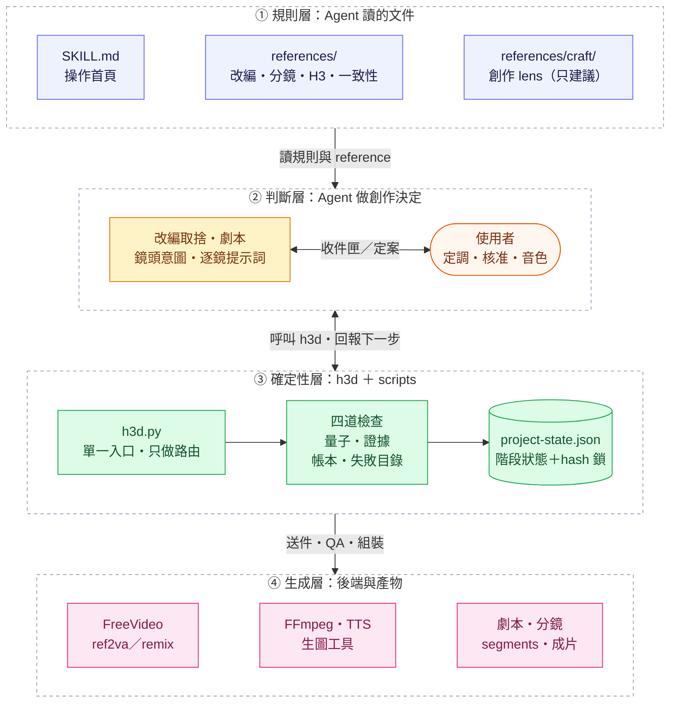
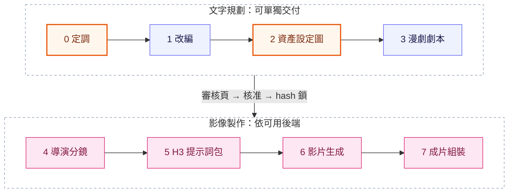
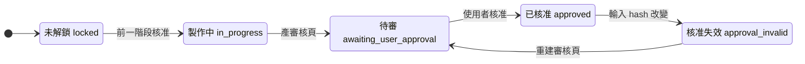
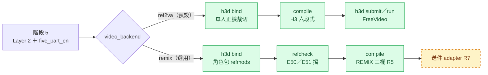

<div align="center">


# AI Comic Drama

**給 AI Agent 用的漫劇製作技能：把小說一路做成角色一致、有導演思維的 AI 漫劇。**

*An agent skill that turns novels into consistent, director-grade AI comic dramas.*

[](https://github.com/ayase0307/ai-comic-drama/actions/workflows/offline-checks.yml)


[](LICENSE)

[特色](#-特色) · [架構](#-架構) · [快速開始](#-快速開始) · [八階段](#-八階段流水線) · [h3d 指令](#-h3d單一入口) · [環境變數](#-環境變數) · [Roadmap](#-roadmap) · [文件](#-文件索引)

</div>

> [!NOTE]
> 這不是一個按一下就出片的 App，而是一套 **Agent 技能**：Agent 讀規則文件做創作判斷，Python 腳本做確定性檢查，你在每個階段的審核點拍板。純文字的改編、劇本、分鏡與提示詞可以獨立交付；圖片與影片生成取決於 Agent 當下能用的工具或已連線的後端（例如 FreeVideo），本技能不假設 Agent 內建影片能力。

## 目錄

- [為什麼需要它](#-為什麼需要它)
- [特色](#-特色)
- [架構](#-架構)
- [快速開始](#-快速開始)
- [八階段流水線](#-八階段流水線)
- [h3d：單一入口](#-h3d單一入口)
- [風格鎖定錨](#-風格鎖定錨)
- [專案結構](#-專案結構)
- [環境變數](#-環境變數)
- [Roadmap](#-roadmap)
- [文件索引](#-文件索引)
- [搭配專案](#-搭配專案)

## 💡 為什麼需要它

把小說交給 AI 做成影片，最常壞在三個地方：**事件被秒數壓掉、角色每鏡長得不一樣、改了一處卻不知道哪些要重做。** 這個技能的做法是把「需要判斷的事」和「可以驗證的事」分開：

| 交給 Agent（讀規則做判斷） | 交給腳本（確定性、可重跑） | 交給你（拍板） |
|---|---|---|
| 改編取捨、劇本、鏡頭意圖、逐鏡提示詞 | 時長量子、證據分級、依賴帳本、失敗目錄、站位 lint | 定調、角色設定圖、音色、每階段核准 |

## ✨ 特色

| | |
|---|---|
| 🧠 **純 Agent 技能** | `SKILL.md` 與 `references/` 是 Agent 的工作規則；`scripts/` 只做確定性檢查與檔案轉換，不替 Agent 寫創作內容（例如階段 5 的五小節提示詞必須逐鏡親手寫，`h3d author` 會擋套句與偷懶）。 |
| 🧭 **八階段＋審核鎖** | 階段 0–7 每段都有審核頁、人工核准與輸入 hash 鎖；**上游一改，下游核准自動失效**。不知道下一步就跑 `h3d next`，它只給你一條指令。 |
| 🎛️ **`h3d` 單一入口** | 29 個子命令一個入口：`next` 指路、`decide` 記定案、`sketch` 出構圖、`compile` 編譯、`qa` 驗收、`status` 看全局。只做路由，規則留在各自模組。 |
| 🔒 **四道確定性檢查** | **時長量子** 17n+5 影格、**證據分級** `VERIFIED／PARTIAL／UNVERIFIED`、segment 級**依賴帳本**、**失敗目錄**＋ack 憑證（綁定提示詞 hash，改稿即失效）。 |
| 🎞️ **雙影片後端** | 預設 **ref2va**（FreeVideo，獨立 Ref2VA、一段一張角色圖）；可選 **remix**（家機 REMIX 角色包）。remix 的綁定、refcheck、站位閘門、**REMIX 三欄提示詞輸出（R5）**已接上，**送件 adapter（R7）尚未完成**。 |
| 🎬 **導演級分鏡** | 每鏡先寫 `shot_intent` 再定技術值，焦距與物距成對寫；站位／視線／運鏡 lint **D06–D14**；`h3d sketch` 用 2.5D 相機算出 **免生圖 SVG 構圖**，0 次生圖 API。 |
| 🎨 **創作 lens（只建議、不擋關）** | AI 漫劇爆款方法論、荒木飛呂彥、Robert McKee、Scott McCloud，另有 Murch／Hamilton 剪輯 lens；報告寫進 `review/craft/`，不改任何門禁。 |
| 🧪 **實測驅動** | 規則標 `measured`／`sourced`／`inferred`；外部方法未經 H3 實測前**只警告不擋**。 |

## 🏗️ 架構

四層各管一件事：規則寫在文件裡、判斷交給 Agent、檢查交給腳本、生成交給後端。



## 🚀 快速開始

> 需求：**Python 3.10+**（CI 測 3.10／3.11／3.12，另跑 Windows）。純文字規劃與提示詞編譯只需標準庫；影片 QA／組裝需 FFmpeg。

**1. 安裝成 Agent 技能**

```bash
git clone https://github.com/ayase0307/ai-comic-drama.git ~/.claude/skills/ai-comic-drama
# 或用 skills CLI（支援 Claude Code / Codex / OpenClaw 等）
npx skills add ayase0307/ai-comic-drama
```

**2. 自檢這台機器能做什麼**

```bash
python scripts/check_environment.py   # 本機依賴（不探測 provider、帳戶或模型）
python scripts/h3d.py doctor          # GPU 顯存、ffmpeg（含 -vsync 回歸）、服務 port
```

**3. 建立專案，讓 `h3d next` 帶路**

```bash
python scripts/init_project.py my-drama --title "我的漫劇"   # 預設長篇漫劇；短劇要明講 --format short
cd my-drama
python ../scripts/h3d.py next --root .                          # 目前階段、卡在哪、下一步唯一一條指令
```

**4. 對 Agent 說人話**

> 「幫我把這篇小說改編成長篇漫劇，每個事件都要講清楚，畫風古風寫實厚塗，16:9，台詞只留重點句，做到分鏡圖。」

Agent 會照 `h3d next` 一步步推進，在需要你拍板的地方用 `h3d inbox` 產出決策收件匣；你的定案由 `h3d decide <id> <值> --quote "<你的原話>"` 寫進 `decisions.json`。想只拿文字稿，就定 `delivery_scope`（`script-only`／`storyboard-only`／`prompts-only`／`full`）。

<details>
<summary><b>依賴分層與執行測試</b></summary>
<br>

| 工作 | 需要的能力 |
|---|---|
| 文字規劃、JSON／提示詞檢查 | Python 標準庫 |
| 審核頁與分鏡總覽圖 | Python；圖片操作需 Pillow |
| 免生圖 SVG 構圖（選用） | Pillow、numpy、resvg-py；不需 GPU、不呼叫生圖 API |
| 影片 QA 與組裝 | FFmpeg、ffprobe |
| 圖片／影片生成 | Agent 當前可用的相容工具或連線後端；FreeVideo 是可選 adapter |

```bash
pip install Pillow numpy resvg-py
python -m unittest discover -s tests -q   # 全套離線測試
python scripts/run_offline_checks.py      # CI 用的離線回歸
```

逐階段的完整命令列範例（含 Windows PowerShell 寫法）見 [`docs/cli-walkthrough.md`](docs/cli-walkthrough.md)。

</details>

## 🧭 八階段流水線

<div align="center">

</div>



<sub>橘框＝永遠由使用者本人核准（階段 0 定調、階段 2 角色設定圖；每個角色的音色也是）。階段 6 的閘門另外要求 QA 證據為 `VERIFIED`。</sub>

| 階段 | 做什麼 | 關鍵工具 | 主要產出 |
|---|---|---|---|
| **0 定調** | 一次問完題材、畫風、比例、台詞政策；成片形式預設長篇漫劇 | `init_project.py`、`h3d decide` | `project.md`、`decisions.json` |
| **1 改編** | 保留分級、事件交代完整性（起因→經過→結果）、A/B/C 方案、依事件估總長 | `event_coverage.py`、`estimate_duration.py --events` | 故事地圖、`adapt/source.json` |
| **2 資產設定圖** | 主角優先出圖、自檢重生；引擎定案後全集鎖定 | `h3d decide design_engine` | `assets.md`、角色設定板 |
| **3 漫劇劇本** | 場景化改寫、台詞預算（4 字/秒、說話 ≤ 60%）、交接 JSON | `estimate_duration.py --h3`、`sync_script.py` | `script-ep01.md`、`handoff-ep01.json` |
| **4 導演分鏡** | `shot_intent`＋`choice_why`、焦距物距、運鏡預設、人物賬與段縫末態 | `h3d sketch`、`validate_storyboard.py` | `layer2/*.json`、構圖圖 |
| **5 提示詞包** | 逐鏡親手寫五小節，編譯成 H3 官方六段式；段級核准 | `h3d bind／author／compile --check／refcheck／staging` | `prompts-ep01.md`、`segments-ep01.json` |
| **6 影片生成** | 送件→收件→QA→動態 QA→交界連續性 QA→逐段結論 | `h3d run --plan／qa／motion／verdict／inbox` | `videos/`、`qa-report.json` |
| **7 成片組裝** | 動作段後製變速、ASR 對位、響度、全集單一剪輯專案 | `h3d ramp／voice align／concat／assemble` | `final/*.mp4`、時間線 |

### 核准與失效

每次核准都會記下輸入的指紋與前置階段的指紋。之後只要輸入（含圖片）變了，`h3d next` 就回報 `approval_invalid`，要求重建審核頁再核准。階段 5 另有**段級核准**：只改了某幾段，就只有那幾段要重審。



<sub>產審核頁＝`build_stage_review.py --stage N`；使用者核准＝`--approve-stage N --user-note "<原話>"`（或使用者授權過的階段用 `h3d approve --auto`）。</sub>

### 影片後端分叉



<sub>綠＝已完成；黃色虛線＝開發中。站位／視線閘門 `h3d staging`（D06–D14）兩個後端都適用。</sub>

## 🎛️ h3d：單一入口

```bash
python scripts/h3d.py --list           # 所有子命令
python scripts/h3d.py next --root .    # 每次開工、每做完一步
python scripts/h3d.py status --root .  # 階段門禁＋依賴帳本＋送件帳本＋失敗目錄
```

| 類別 | 子命令 | 做什麼 |
|---|---|---|
| **流程** | `next`・`status`・`decide`・`inbox`・`approve` | 下一步唯一指令、綜合狀態、寫入使用者定案、決策收件匣、自動／段級核准 |
| **分鏡與綁定** | `sketch`・`crop`・`bind` | 免生圖 SVG 構圖、裁設定板頭像、產生階段 5 參考圖綁定 |
| **提示詞檢查** | `compile`・`author`・`audit`・`refcheck`・`staging` | Layer 2 → 六段式、逐鏡撰寫審查（E30–E38、W41–W45）、對帳、參考包涵蓋、站位視線閘門 |
| **送件** | `probe`・`submit`・`run`・`collect`・`resume` | 查 API 與 LoRA、送件、單例 runner（暫停／續跑）、只收件、續送 |
| **驗收** | `qa`・`motion`・`verdict` | 時長／色彩／證據分級、光流量凍結偵測、逐段目視結論 |
| **後製** | `ramp`・`voice`・`concat`・`assemble` | 動作段變速、ASR 對位與響度、全集剪輯專案、配音字幕組裝 |
| **帳本** | `deps`・`catalog`・`ack`・`doctor` | 依賴帳本、失敗目錄、ack 憑證、本機環境自檢 |

每個子命令保留原本的 `--help`；完整說明與錯誤訊息處置見 [`references/tooling.md`](references/tooling.md)。

<details>
<summary><b>四道確定性檢查在擋什麼</b></summary>
<br>

| 檢查 | 規則 | 看到它代表 |
|---|---|---|
| **時長量子** | FreeVideo 把秒數取到 `17n+5` 影格，送件用 `metadata.frames` 的精確值；回讀 ffprobe 不符就隔離成 `.drift.mp4` | `duration_drift`：不要拿去 QA，先查是不是手改過 segments |
| **證據分級** | `measured`／`sourced`／`inferred` → 報告結論 `VERIFIED`／`PARTIAL`／`UNVERIFIED`；階段 6 閘門要 `VERIFIED` | `PARTIAL`：停下回報，不要繞過 |
| **依賴帳本** | 每段記 layer2／prompt／video 的指紋與時間 | `prompt_stale`、`video_older_than_prompt`：哪幾段要重跑（不會自動重簽核准） |
| **失敗目錄** | 每條失敗有症狀、根因、最小修法、證據與 regex detector；`enforce=error` 直接擋 | 警告也要處置：改稿，或 `h3d ack` 明確接受 |

</details>

## 🎨 風格鎖定錨

主流漫劇畫風各蒸餾成一組可貼在圖像提示詞結尾的錨定詞（含負面錨、色盤、翻車點），用來先鎖定角色設定板。

<table>
  <tr>
    <td width="46%"></td>
    <td>
      <b>預設：14 號「古風寫實厚塗・電影感」</b><br><br>
      真人骨相＋厚塗質地、冷灰低對比、玉青硃砂。它是唯一有整部片實證的風格（10 集 115 段，<code>measured</code>）。<br><br>
      <sub>樣圖上＝主角設定圖（Codex 內建生圖），下＝同一套配方的 H3 Ref2VA 成片截圖。</sub>
    </td>
  </tr>
</table>

其他風格的樣圖是**同一位角色**（紅衣漢服女主）套用各自的錨生成的設定板，差異只來自風格：

<table>
  <tr>
    <td align="center"><br><sub>1 3D 國漫</sub></td>
    <td align="center"><br><sub>2 2D 動態漫</sub></td>
    <td align="center"><br><sub>5 韓漫條漫</sub></td>
  </tr>
  <tr>
    <td align="center"><br><sub>6 新國風水墨</sub></td>
    <td align="center"><br><sub>7 仙俠古風厚塗</sub></td>
    <td align="center"><br><sub>8 都市霸總半寫實</sub></td>
  </tr>
</table>

<details>
<summary><b>其餘風格與誠實聲明</b></summary>
<br>

| # | 風格 | 樣圖 | 適合題材 |
|---|---|---|---|
| 3 | 日系賽璐璐 |  | 校園、熱血、日常 |
| 4 | 日系電影感 |  | 治癒、青春、情感 |
| 9 | Q 版喜劇 |  | 沙雕、搞笑 |
| 10 | 美漫硬派線稿 |  | 動作、末世、懸疑 |
| 11 | 賽博霓虹 |  | 末世、科幻、機甲 |

> 「主流」是依題材與工具選項歸納，沒有找到各平台公開占比。除 14 號外，錨定詞與色盤為推斷，只以設定板在 ChatGPT 網頁版校準過；換成即夢、可靈、Midjourney 等模型請先出 3–5 張測試圖。完整錨定詞見 [`references/styles.md`](references/styles.md)。

</details>

<details>
<summary><b>資產一致性：靠登記、參考鏈與驗收</b></summary>
<br>

<div align="center">

<br><sub>角色設定板：面部特寫＋正／側／背全身，平光純色背景，作為後續所有鏡頭的參考圖。</sub>
</div>

1. 每個資產有 ID 與版本（`C-` 角色、`W-` 服裝、`S-` 場景、`P-` 道具、`V-` 音色）。
2. 角色設定板必備：面部特寫、正／側／背、6 表情、五色色票、身高對照、每套服裝一張、3 個辨識錨。
3. 參考鏈：設定板＋場景主圖 → 分鏡圖 → 影片首幀；有參考圖時外觀只在首次出現寫一次。
4. 每鏡生成後跑漂移清單，fail 不得當下一鏡參考；修復依階梯逐級處理。
5. 每種資產都有驗收門，沒通過不進下一階段。

規格全文見 [`references/consistency.md`](references/consistency.md)。

</details>

### 免生圖構圖：審走位不燒額度

`h3d sketch` 讀 Layer 2，用程式算出每一鏡的機位、景別與站位，畫成鉛筆風構圖，**不呼叫任何生圖 API**。下圖左為同一段實際生成的影片（每鏡取中段影格），右為只靠 Layer 2 算出的構圖。

<div align="center">

</div>

```bash
pip install numpy resvg-py Pillow
python scripts/h3d.py sketch --root <專案> --episode EP04
```

構圖只用來審走位，**不送 H3**。用法、零設定搭景、cast／staging 格式見 [`references/storyboard/svg-rig-grid.md`](references/storyboard/svg-rig-grid.md)，最小範例在 [`examples/svg-grid-minimal/`](examples/svg-grid-minimal/)。

## 📁 專案結構

```text
ai-comic-drama/
├── SKILL.md                  # 技能入口：開工規則與每階段操作首頁（Agent 讀這個）
├── AGENTS.md                 # 給 Agent 的硬規則（做專案／改 repo）
├── references/
│   ├── tooling.md            # h3d 全部指令、四道檢查、環境變數
│   ├── pipeline.md           # 八階段詳細流程與模板
│   ├── adapt/                # 小說改編
│   ├── storyboard/           # 導演分鏡、SVG 構圖、連戲帳
│   ├── h3/                   # MiniMax H3 提示詞（同步自上游 h3-video-prompting）
│   ├── craft/                # 創作 lens（只建議）
│   ├── edit/                 # 階段 7 剪輯手冊
│   └── schemas/              # decisions／verdicts JSON Schema
├── scripts/
│   ├── h3d.py                # 單一入口（只做路由）
│   ├── init_project.py       # 建立專案骨架
│   ├── project_state.py      # 階段狀態與 hash 鎖
│   ├── build_stage_review.py # 審核頁與核准
│   ├── adapt/  storyboard/   # 改編與分鏡／編譯／QA／組裝工具
│   ├── runner/  voice/       # 送件 runner、配音對位
│   └── craft/  review/       # 創作 lens 與審核頁
├── assets/  examples/        # 樣圖與最小範例
├── docs/                     # 研究、回顧、命令列逐步範例
└── tests/                    # 離線單元測試
```

<details>
<summary><b>用本技能產出的專案長這樣</b></summary>
<br>

```text
<專案名>/
├── project.md              # 定調＋成片形式＋事件清單
├── decisions.json          # 使用者定案（附原話）
├── source/  adapt/         # 原著與改編中間產物（source.json、bible.json）
├── assets.md               # 風格錨＋角色／場景／道具／音色聖經
├── script-ep01.md          # 漫劇劇本
├── handoff-ep01.json       # 劇本→分鏡交接
├── layer2/                 # 分鏡 Layer 2 JSON
├── panels/  images/        # 逐鏡構圖、分鏡總覽圖、角色參考圖
├── prompts-ep01.md         # H3 提示詞
├── segments-ep01.json      # 送件分段檔
├── review/                 # project-state.json、verdicts.json、inbox.html、craft/
├── videos/                 # 影片片段與 QA 報告
└── final/                  # 成片
```

</details>

## 🔧 環境變數

預設值不變，換機器時才需要設定。

| 變數 | 作用 | 預設 |
|---|---|---|
| `FREEVIDEO_API_URL` | submit／collect／resume／run／probe 的 API 位址；`h3d doctor` 也用它探測 | `http://127.0.0.1:8189/freevideo/agent/v1` |
| `FREEVIDEO_TOKEN`／`FREEVIDEO_TOKEN_FILE` | FreeVideo 令牌本身／令牌檔路徑 | 依序找 `E:\FreeVideo\agent\token`、`~/.freevideo/agent/token`、`C:\FreeVideo\agent\token` |
| `AICD_FFMPEG`／`AICD_FFPROBE` | ffmpeg／ffprobe 完整路徑（只設 ffmpeg 時 ffprobe 取同目錄） | PATH |
| `AICD_H3_UPSTREAM` | `sync_h3_reference.py` 的上游 clone | `E:\MinimaxH3\h3-video-prompting`，再找同層 `../h3-video-prompting` |
| `AICD_RUNNER_LOCK` | 影片 runner 單例鎖檔位置 | `~/.ai-comic-drama/video-runner.lock` |
| `AICD_OMNIVOICE_LAUNCHER` | tts_doctor 提示的 OmniVoice 啟動檔 | `E:\OmniVoice\啟動-OmniVoice.bat` |
| `COMFYUI_URL`／`VOICESTUDIO_URL` | `h3d doctor` 探測的服務位址 | `127.0.0.1:8188`／`127.0.0.1:8001` |

本機服務（127.x／localhost）的 HTTP 請求一律不走系統代理。詳見 [`references/tooling.md`](references/tooling.md) §2.7。

## 🗺️ Roadmap

- [x] 八階段流水線、審核頁、hash 鎖與核准失效
- [x] `h3d` 單一入口與 `h3d next` 導航
- [x] 四道確定性檢查（時長量子、證據分級、依賴帳本、失敗目錄＋ack）
- [x] 階段 5 段級核准（只重審改過的段）
- [x] 免生圖 SVG 構圖（`h3d sketch`）
- [x] 站位／視線／運鏡閘門 D06–D14、參考包涵蓋 `h3d refcheck`
- [x] 創作 lens：爆款方法論、荒木、McKee、McCloud、Murch、Hamilton
- [x] 撰寫警告 W41–W45（只警告，未經 H3 實測）
- [x] 換機器友善：寫死路徑改為環境變數
- [x] remix 後端：角色包綁定、refcheck E50／E51、站位閘門
- [x] remix：REMIX 三欄提示詞輸出（R5）
- [ ] remix：送件 adapter，含送件前自動跑 refcheck（R7）
- [ ] remix：`h3d pack` 建包（R8）、single480 抽卡（R9）、verdict／失敗目錄（R10）

## 📚 文件索引

| 文件 | 內容 |
|---|---|
| [`SKILL.md`](SKILL.md) | 開工規則、每階段做什麼／不准做什麼／跑哪個指令 |
| [`AGENTS.md`](AGENTS.md) | 給 Agent 的硬規則（做專案與改 repo） |
| [`references/tooling.md`](references/tooling.md) | **h3d 全部指令**、四道檢查、能力表、環境變數、錯誤訊息處置 |
| [`references/skill-guide.md`](references/skill-guide.md) | 核心原則、八階段與審核頁對照、完整腳本清單 |
| [`references/pipeline.md`](references/pipeline.md) | 各階段詳細流程、台詞政策門禁、體量反推公式、聲音三層決策 |
| [`references/review-page-spec.md`](references/review-page-spec.md) | 決策收件匣規格 |
| [`references/prompt-authoring.md`](references/prompt-authoring.md) | 逐鏡撰寫規範（E30–E38、W41–W45） |
| [`references/adapt/novel-to-manju.md`](references/adapt/novel-to-manju.md) | 小說改編總規範 |
| [`references/storyboard/cinematic-director.md`](references/storyboard/cinematic-director.md) | 導演分鏡總規範與 Layer 2 |
| [`references/storyboard/shot-intent.md`](references/storyboard/shot-intent.md) | 鏡頭意圖 `shot_intent`／`choice_why` |
| [`references/storyboard/continuity-ledger.md`](references/storyboard/continuity-ledger.md) | 人物賬、站位、正反打、段縫末態 |
| [`references/storyboard/svg-rig-grid.md`](references/storyboard/svg-rig-grid.md) | 免生圖 SVG 構圖 |
| [`references/camera-moves-guide.md`](references/camera-moves-guide.md) | 依 beat 情緒選運鏡預設 |
| [`references/consistency.md`](references/consistency.md) | 資產 ID、參考鏈、防角色平均化 |
| [`references/styles.md`](references/styles.md) | 風格鎖定錨與樣圖 |
| [`references/minimax-h3.md`](references/minimax-h3.md)・[`references/h3/`](references/h3/) | MiniMax H3 專章與細部參考 |
| [`references/craft/README.md`](references/craft/README.md) | 創作 lens 總覽 |
| [`references/edit/manju-editing-playbook.md`](references/edit/manju-editing-playbook.md) | 漫劇剪輯手冊 |
| [`references/freevideo.md`](references/freevideo.md) | 搭配 FreeVideo 出片 |
| [`docs/cli-walkthrough.md`](docs/cli-walkthrough.md) | 逐階段命令列範例（原 README 內容） |

## 🤝 搭配專案

- **[FreeVideo](https://github.com/FlashML-org/FreeVideo)**：在你自己電腦上跑的 AI 影片生成工具，內建 MiniMax H3，提供 Agent 接口與角色庫。本技能負責「想清楚」，FreeVideo 負責「做出來」；沒開時技能會退回「先問模型再生成」的流程。連線見 [`references/freevideo.md`](references/freevideo.md)。
- **[ayase0307/h3-video-prompting](https://github.com/ayase0307/h3-video-prompting)**（MIT）：H3 提示詞的上游。`references/h3/` 是它的同步副本，逐檔紀錄在 [`references/h3/UPSTREAM.json`](references/h3/UPSTREAM.json)；跑 `python scripts/sync_h3_reference.py --check` 找漂移。
- **ayase0307/h3-combat-impact**：打鬥／招式／特效段同時載入的外部技能（見 `SKILL.md`）。
**貢獻**：歡迎 Issue 與 PR。改 repo 前請讀 [`AGENTS.md`](AGENTS.md)：`python -m unittest discover -s tests -q` 必須全過、新功能附測試、格式改動同步 `references/schemas/` 與 `references/tooling.md`。全程使用繁體中文。

**授權**：[MIT](LICENSE)

---

<div align="center">
<sub>頂部橫幅與八階段插畫由 Codex（imagegen）生成；風格設定板由 ChatGPT 網頁版生成；構圖對照圖由 <code>h3d sketch</code> 產生。</sub>
</div>
