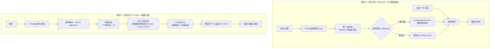

# MiniMax H3 音視同生下的 AI 短劇／漫劇「旁白 × 對白」架構研究

> 研究日期：2026-10｜研究對象：MiniMax H3（音視同生、無 stems、無關音開關）下的 AI 短劇／漫劇配音架構
> 標籤規則：**【官方】**＝模型商／標準機構一手文件；**【社群實測】**＝第三方或社群實測與教學；**【推測】**＝本報告基於前述證據的推論，尚未有直接實測佐證

---

## 0. TL;DR（先講結論）

1. **MiniMax H3 沒有「關掉音訊」開關，也沒有 stems。** 官方架構明載 H3-Omni-Transformer「jointly predicts video and audio latents」，音訊與畫面在**同一次 forward pass** 產生，輸出是一條 32 kHz 立體聲混音軌。**【官方】**（[MiniMax H3 開源公告](https://www.minimax.io/news/minimax-h3-open-source)、[MiniMax H3 官方部落格](https://www.minimax.io/blog/minimax-h3)）
2. **「影片先行、外部 TTS 後貼」在 H3 上代價很高**：你會同時失去模型原生環境音（因為混在同一軌，無法只取 ambience），且必須自己重建整個聲景。**【推測】**
3. **但競品已經把這條路走通了**，這會改變整體架構選擇：
   - **Kling Video 2.6 官方有 Native Audio Toggle，關掉就出「無音軌影片」**。**【官方】**（[Kling 官方使用者指南](https://kling.ai/quickstart/klingai-video-26-audio-user-guide)）
   - **Veo 3.1 在 Vertex AI 有 `generate_audio=False` 參數**，社群已用它實作「靜音影片 + 後製配音」量產流程。**【官方／社群實測】**（[Veo 批量生成工作流 README](https://github.com/smichalove/veo-video-creation-workflow)、[Google 開發者論壇](https://discuss.ai.google.dev/t/veo-3-api-generate-audio-parameter-not-supported-last-frame-limitations/119206)）
   - **Seedance 2.0** 原生生音但可提示控制；**Runway Gen-4.5** 已有原生音 + 獨立的 Generative Audio 工具鏈；**Sora 2 已於 2026-04-26 停用 web/app、2026-09-24 停用 API**（本輪研究中已屬淘汰選項）。**【官方】**
4. **推薦主線：TTS 先行（配音定長 → 分鏡定長 → 生成畫面）**，中文社群實測與英文製片工具的結論一致。**【社群實測】**（[搜狐〈AI短剧制作全过程避坑指南〉](https://www.sohu.com/a/1069055365_120191354)、[ACT 3 AI 配音管線](https://act3ai.com/articles/adding_voiceover_ai)）
5. **H3 官方本身就有「畫外音 + 嘴閉合」的原生路徑**（`says in an off-screen voiceover` + `while his lips remain completely closed`）。若旁白不要求「指定音色／逐字稿」，**直接讓 H3 生成畫外音，比外部 TTS 覆蓋乾淨得多**。**【官方】**（[H3 官方提示詞寫作指南 base-en](https://huggingface.co/MiniMaxAI/MiniMax-H3/raw/main/docs/VIDEO_PROMPT_WRITING_GUIDE_base_en.md)）
6. **「不要說話」的正向解法是欄位分工，不是否定詞**：H3 官方三欄位中，`overall_soundscape` 只放環境音／動作音，**不放任何 `<d>` 對白區塊**，就是官方定義的「無對白」寫法。**【官方】**

---

## 1. 核心架構問題：H3 的音視同生

### 1.1 官方架構事實【官方】

| 項目 | 官方數值／原文 | 來源 |
|---|---|---|
| 音訊產生方式 | 「The H3-Omni-Transformer **jointly predicts video and audio latents**, which are then decoded into video and stereo audio, respectively.」 | [開源公告](https://www.minimax.io/news/minimax-h3-open-source) |
| 音訊輸出 | 32 kHz stereo，24 FPS，4–15 秒 | 同上 |
| 音訊編碼器 | H3-AudioVAE：左右聲道**各自**編碼後重組 → 單一混音軌，**無 stems** | 同上 |
| 文字編碼器 | H3-Encoder = Qwen3-VL-32B，取第 50 層 hidden states | 同上 |
| 提示詞改寫層 | H3-Context-IR（**托管服務，未開源**）：「**strongly recommend** incorporating it into your generation pipeline」 | 同上 + [平台文件](https://platform.minimax.io/docs/guides/video-generation) |
| 2K 產出 | H3-Regenerate-2K：以 in-context 方式重生成，非傳統超分 | 同上 |

**關鍵後果【推測】**：
- 沒有「只要 ambience」的路徑 → 想保留環境音只有兩條路：**(i)** 用人聲分離模型從混音軌抽 accompaniment（[vocal-separate / UVR 系](https://juejin.cn/post/7584475608220205107)）；**(ii)** 重新生成一支「同畫面、同 ambience 提示、無對白」的 H3 clip 當環境音床。
- 沒有 stems 也意味著 **H3 原生環境音無法與原生配樂分離**，混音時你會拿到「環境音 + 模型自作的配樂 + 模型自作的對白」全部混在一起的東西。

### 1.2 競品對照表：誰能出「無音軌影片」？

| 模型 | 音訊模式 | 能否輸出**無音軌**影片 | 能否出 stems | 官方「後加語音」路徑 | 來源 |
|---|---|---|---|---|---|
| **MiniMax H3** | 音視同生，單一混音軌 | **否**（無開關） | 否 | 官方原生畫外音（嘴閉合）＋外部後製 | [官方](https://www.minimax.io/news/minimax-h3-open-source) |
| **Kling Video 2.6** | 音視同生 | **是**（Native Audio Toggle 關閉即無音） | 否 | Toggle 關閉 → 純外部音景 | [官方](https://kling.ai/quickstart/klingai-video-26-audio-user-guide) |
| **Veo 3.1** | 音視同生 | **是**（Vertex AI `generate_audio=False`） | 否 | 同上；Gemini API 端該參數曾回報不支援 | [社群實測](https://github.com/smichalove/veo-video-creation-workflow)、[論壇](https://discuss.ai.google.dev/t/veo-3-api-generate-audio-parameter-not-supported-last-frame-limitations/119206) |
| **Seedance 2.0 / 2.5** | 音視同生（2.5 單次最長 30 秒） | 提示層面控制，無獨立開關 | 否 | 官方建議：「需要逐字稿與指定音色，就**生成無聲片段再在剪輯裡鋪旁白**」 | [ByteDance 官方](https://research.doubao.com/zh/seedance2_0)、[實測](https://www.dreampixelforge.com/blog/seedance-prompts) |
| **Runway Gen-4.5** | 已有原生音；另有獨立 Generative Audio 工具鏈（文字轉語音／自訂音色／SFX／音樂） | 以獨立音軌工具覆蓋 | 否 | **有**：Gen-4 影片可直接進 Runway 的語音／SFX／音樂工具 | [Runway Generative Audio 說明](https://help.runwayml.com/hc/en-us/sections/23859676574739-Generative-Audio)、[資源頁](https://runway.com/resources/can-ai-generate-videos-with-sound) |
| **Sora 2** | 音視同生 | 未見官方開關 | 否 | 已停用：web/app 2026-04-26、API 2026-09-24 | [OpenAI 說明](https://openai.com/index/sora-2/)、[說明中心](https://help.openai.com/en/articles/20001152-what-to-know-about-the-sora-discontinuation) |

> **架構意圖【推測】**：如果我們的產線主引擎是 **Kling 2.6 或 Veo 3.1**，整條配音架構可以直接走「無聲影片 + 完整外部聲景」，乾淨、可控、可重複生成；如果主引擎是 **H3**，就必須多付一筆「人聲分離 + 重建 ambience」的工程成本——**這是選型時最該先問的問題**。

---

## 2. 兩種製作順序：影片先行 vs 配音先行

### 2.1 順序 A：影片先行（Video-first）

```
劇本/分鏡
   │
   ├─► ① 生成影片（音視同生，含模型自帶對白與 ambience）
   │        │
   │        └─► 抽音軌 h3_clip.m4a（混音：環境音 + 模型配樂 + 模型對白）
   │                 │
   │                 ├─► 人聲分離 → accompaniment.wav（殘留模型對白）
   │                 └─► （或）重生一支同 ambience 的無對白 clip 當環境音床
   │
   └─► ② 產生外部 TTS 旁白 → tts_narration.wav
            │
            ▼
   ③ 後期：TTS 覆蓋 + ambience 床 + 重建 SFX/BGM 混音
            │
            ▼
   ④ 響度正規化 → 交付
```

**致命弱點【社群實測】**：
- ACT 3 AI 明寫：「you generate the video first, then discover the narration is nine seconds long and the clip is five. **Write and time the voice *before* generating the visuals.**」（[act3ai.com](https://act3ai.com/articles/adding_voiceover_ai)）
- 中文社群同樣結論：「如果先生成畫面再配音，口型、情緒、節奏全對不上，返工率極高。」（[搜狐](https://www.sohu.com/a/1069055365_120191354)）
- 在 H3 上還額外多兩層損失：**模型原生 ambience 要靠分離/重生才能拿回**，以及**模型原生對白會殘留在分離後的底軌裡**。

### 2.2 順序 B：配音先行（TTS-first，長度驅動畫面）

```
劇本 ──► ① TTS 產出全部旁白/對白 ──► tts/shot_001.wav
   │                                  │
   │                                  ├─► 量測實際時長 D_i
   │                                  ├─► 抽掉頭尾靜默、量化語速
   │                                  └─► forced alignment（WhisperX / MFA）→ 逐字時間碼
   │
   ├─► ② 分鏡定長：shot_duration_i = ceil(D_i × 1.2)  ← 預留 20% 緩衝
   │        │
   │        └─► 寫入 H3 提示詞（時間戳、per-second 音訊提示、narrator-mouth-closed）
   │
   ├─► ③ 生成影片（目標長度 = shot_duration_i）
   │        │
   │        └─► 實測長度可能短於/長於計畫 → 剪輯修剪（trim）到 D_i + 0.3~0.5s
   │
   └─► ④ 音畫組裝 + 混音 + 響度正規化 → 交付
```

### 2.3 mermaid 對照圖



### 2.4 什麼時候用哪一種？

| 情境 | 建議順序 | 理由 | 依據 |
|---|---|---|---|
| 旁白型漫劇／動態漫（旁白＋B-roll，無正面說話角色） | **B（配音先行）** | 旁白決定敘事脊樑，畫面去填內容 | 【社群實測】[ACT 3](https://act3ai.com/articles/adding_voiceover_ai)：「Cut the picture to the narration, not the other way round. Narration sets the spine; visuals fill it.」 |
| 角色正面說話、需要精準口型 | **B + 事後 lipsync** | 語音長度決定鏡頭長度，嘴型由同一段音驅動 | 【社群實測】[ACT 3](https://act3ai.com/articles/adding_voiceover_ai)：「per-shot TTS drives lipsync duration … shots are sized to the lines rather than trimmed afterwards」 |
| 音畫優先、旁白只是氛圍（例如廣告片） | A 可接受 | 旁白很短，重生成成本低 | 【推測】 |
| 主引擎是 **Kling 2.6 / Veo 3.1（可出無聲片）** | A 或 B 皆可 | 音景可完全外部重建，不必分離 | 【官方】[Kling](https://kling.ai/quickstart/klingai-video-26-audio-user-guide)、[Veo workflow](https://github.com/smichalove/veo-video-creation-workflow) |
| 主引擎是 **H3（音視同生、無開關）** | **強烈建議 B** | A 會失去原生 ambience 且殘留模型對白 | 【推測】 |
| 旁白不要求指定音色、只要「有聲 narration」 | **第三選項：H3 原生畫外音** | 官方路徑，嘴閉合，零覆蓋成本 | 【官方】[H3 指南 §4.4](https://huggingface.co/MiniMaxAI/MiniMax-H3/raw/main/docs/VIDEO_PROMPT_WRITING_GUIDE_base_en.md) |

### 2.5 時長漂移（duration drift）怎麼處理？

- **留 20% 緩衝**【社群實測】：「為了給配音留出對齊空間，建議生成時把**目標時長放大 1.2 倍**，因為 AI 生成的實際時長常常短於預期，後期再按需剪裁。」（[搜狐](https://www.sohu.com/a/1069055365_120191354)）
- **鏡頭尾留 0.3~0.5 秒靜默**，讓音訊平滑過接（避免突兀），並避免 TTS 呼吸聲斷裂【社群實測】[MOVA](https://www.mova.work/topic/2026/08/ai-duan-ju-zhi-neng-fen-jing-q-2184.html)
- **H3 的硬上限 15 秒**【官方】；官方 3D 動畫 skill 也在 self-check 裡明列「no shot exceeds 15 seconds」，超過就拆鏡。**【官方】**（[shot-table-spec.md](https://raw.githubusercontent.com/MiniMax-AI/MiniMax-H3/main/skills/3d-animation-short-generator/references/shot-table-spec.md)）
- **H3 社群實測的節奏問題是結構性失敗主因**【社群實測】：「最大的問題一直是節奏。對白塞不進時長、時間戳排得過密，是最常見的結構性失敗原因。」（[aireiter 彙整 Reddit 討論](https://aireiter.com/zh/blog/minimax-h3-prompt-review)）
- **一句話一個節拍**【社群實測】：Seedance 實測指出 5–10 秒片段只裝得下一個 beat；H3、Veo 同理「one beat per shot」。**【社群實測】**（[dreampixelforge](https://www.dreampixelforge.com/blog/minimax-h3-prompts)）

---

## 3. 「不見嘴型」問題：鏡頭選擇與官方提示詞寫法

### 3.1 官方已有的兩套機制【官方】

**(1) H3 官方畫外音寫法（推薦）**

> 「For voiceover, use the exact phrase **`says in an off-screen voiceover`**. Immediately after every voiceover `<d>` block, **state that the corresponding on-screen character's lips remain closed**.」
> 官方範例：`The man (S1) says in an off-screen voiceover: <d>[English] I still remember that road.</d> while his lips remain completely closed.`
> —— [H3 官方 Video Prompt Writing Guide §4.4](https://huggingface.co/MiniMaxAI/MiniMax-H3/raw/main/docs/VIDEO_PROMPT_WRITING_GUIDE_base_en.md)

**(2) MiniMax 官方 3D 動畫短片 skill 的欄位規格**

> `Performance Note` — when the protagonist is narrating off-screen, mark **`narrator-mouth-closed: true`**；describe expression path during narration…
> 「every second where the character is speaking must record whether the mouth is open or closed; the default is **closed for off-screen narrator, open for on-screen dialogue**.」
> —— [shot-table-spec.md](https://raw.githubusercontent.com/MiniMax-AI/MiniMax-H3/main/skills/3d-animation-short-generator/references/shot-table-spec.md)

同時，官方 H3-Context-IR 的 I2VA 官方範例（本該出現人聲的場景）正是這樣寫的：
> 「The man … leans forward, **his mouth moving animatedly in a silent exchange**」／「their mouths moving in continuous, **silent cadences** of conversation」
> —— [H3 官方 I2VA 可重現案例](https://huggingface.co/MiniMaxAI/MiniMax-H3)（full-2k-i2va-h3-context-ir.sh）

→ 這是**官方示範的「有嘴型動作、但無語音」寫法**，對「保留演員感但不要模型亂配音」非常關鍵。

### 3.2 旁白鏡頭的推薦選擇（八法）

| 手法 | 說明 | 為何有效 |
|---|---|---|
| **背影／背對鏡頭** | 角色背對鏡頭，看不見嘴 | 消除「嘴型與旁白不對」的視覺矛盾；同理走動中的人物 |
| **側臉／俯拍遮擋** | 視線在臉部以外（手、道具、天空） | 保留情緒又不暴露嘴 |
| **切到聽者（reaction shot）** | 旁白期間切到另一角色的反應 | 觀眾注意力轉移，旁白變成「第三方視角」 |
| **物件插入（insert）** | 信件、照片、螢幕、道具特寫 | 旁白＋道具＝解說感，industry standard |
| **空鏡／環境鏡頭** | 街道、天際線、物件堆積 | 旁白＋空鏡＝純敘事最安全 |
| **剪影／逆光** | 逆光剪影看不出五官細節 | 成本最低的「看不見嘴」 |
| **超近景眼睛／手部** | 只拍眼睛、手、指節 | 情緒張力最高，嘴完全不在畫面 |
| **疊化後再進畫** | 旁白起於空鏡或物件，疊化到人物 | 避開「一開口就要對嘴」 |

【社群實測】ACT 3 AI 亦給同一方向建議：「**Break long speeches with reaction shots**」——不要讓 90 字獨白停在一張臉上。（[act3ai](https://act3ai.com/articles/adding_voiceover_ai)）

【社群實測】中文避坑指南亦強調「角色多、對話密集時，不同角色的 AI 音色容易混淆」，建議「**在每句配音前加一段淡入的背景音樂或環境音，幫助觀眾區分說話者**」——這同時是解「不知道誰在說」的聲學解方。（[搜狐](https://www.sohu.com/a/1069055365_120191354)）

### 3.3 中文提示詞的對應寫法（供 H3 改寫層用）

> 官方指南要求最終提示詞三欄位皆以英文書寫，`<d>` 內保留原語言原文（`[Chinese] 台詞`）。**【官方】**
> 中文常用描述（供 LLM 起草時參考，最終仍走英文欄位）：
> - 嘴閉合：`嘴唇全程閉合，不發出任何聲音`
> - 畫外音：`以畫外音形式說出`
> - 無聲口型：`嘴唇有自然的說話律動，但全程無可辨識語音`

---

## 4. 提示詞面：怎麼讓模型只出乾淨環境音

### 4.1 H3：官方正解是「欄位分工」，不是否定詞【官方】

H3 最終提示詞固定三欄位（[官方指南 §2.2](https://huggingface.co/MiniMaxAI/MiniMax-H3/raw/main/docs/VIDEO_PROMPT_WRITING_GUIDE_base_en.md)）：

```
integrated_multimodal_description: [Shot 1] ...   ← 視覺 + 動作 + 台詞（<d>[Chinese] ...</d>）
overall_soundscape: ...                          ← 環境音 / 動作音 / 非語音人聲（呼吸、笑、喘息）
non_diegetic_music: ...                          ← 只有觀眾聽得到的配樂
```

官方 §4.6 原文：
> 「Use 1–4 English sentences in one continuous paragraph to summarize the ambient sound, physical action sounds, and **non-verbal human sounds** across the full video… **Dialogue, singing, and diegetic music already belong in the multimodal description and should not be repeated here.** Use `N/A` only when the user explicitly requests **complete silence** throughout the video.」

→ **「要乾淨環境音、不用人聲」＝ `integrated_multimodal_description` 完全不放任何 `<d>` 區塊＋ `overall_soundscape` 只寫環境音與動作音。** 這是官方結構推導出的正解，**完全不需要寫 "no dialogue"**。

`non_diegetic_music` 的官方寫法是「1–3 句描述配樂的配器、速度、節奏、動態變化；不要用抽象情緒詞」；不要配樂就寫 `N/A`。**【官方】**

### 4.2 H3 的已知遵循度缺口（社群實測）

| 症狀 | 社群觀察 | 處理方式 |
|---|---|---|
| 寫了 `non_diegetic_music: N/A` 仍被加音樂 | 「大約 20% 的時候它還是會自己加音乐」；`N/A` 這一行**單獨就有效**，是多數回報中唯一穩定生效的控制項 | 重新生成；並且**不要在提示詞其他位置要求任何「音樂氛圍」** | 
| 畫內對白被讀成畫外音 | 缺口型同步關聯 | 明確把說話人 ID 綁到**畫面中可見**的角色；若真要旁白，加 `lips remain closed` |
| `<d>` 標籤反而生出額外音訊 | 約 105 讚的對比測試：**去掉 `<d>`、改用引號**，語音反而乾淨 | 先用 `<d>`；出現亂碼或額外對白就用引號重試同一句 |
| 本地部署「H3 不會說中文」 | 追溯到 **tokenizer 複用與命令列 Unicode 編碼**，不是提示詞問題 | 用官方 tokenizer＋`<d>[Chinese] 台词</d>` |
| 角色說錯台詞 | 說話人／音訊路由衝突 | 明確綁定 speaker ID |

來源：【社群實測】[aireiter 對 Reddit／X 回報的彙整](https://aireiter.com/zh/blog/minimax-h3-prompt-review)（含 u/TheElectriking、u/krigeta1、u/Nextil、u/networking_noob、@eternityspring 等原始引用）

### 4.3 Veo 3.1 / Seedance 2.0：HEAR 區塊 + MUST / MUST NOT【社群實測】

Veo 沒有欄位制，但社群整理出有效的 **SEE vs HEAR** 結構：把「聽到什麼」獨立成一個 `HEAR:` 區塊，並在區塊內用 **MUST / MUST NOT** 規則。

| 目標 | ✅ DO（正向） | ❌ DON'T（純否定） |
|---|---|---|
| 全靜默 | `HEAR: complete silence.` | `No dialogue, no voices, no music, no sound effects.` |
| 只要環境音 | `HEAR: natural ambience only (room tone / outdoor air).` | `No music. No dialogue. No intelligible speech.` |
| 只要擬音 | `HEAR: action-synced foley only (footsteps, object handling).` | `No voices. No music. No unrelated sounds.` |
| 只要樂器 | `HEAR: instrumental music only.` | `No dialogue. No vocals. No chanting. No spoken samples.` |
| 只要一人說話 | `HEAR: one speaker dialogue only, clean and intelligible.` | `No background chatter. No music. No extra lines beyond the script.` |

並附帶三條規則：
1. **移除觸發詞**：把「對鏡頭說話／訪談／播報／演唱／人群／派對／演唱會」拿掉，否則模型會自己補台詞與音樂。
2. **批次一致性**：建立一張「Audio Style Card」（混音優先序、麥克風距離、空間感、噪音底、響度意圖、音樂／對白／擬音規則），每支片尾都貼同一張。
3. **任何 extend/bridge 步驟都要重貼 HEAR 區塊**（擴充段落等同重新生成）。

來源：【社群實測】[Veo3Gen 故障排除指南](https://www.veo3gen.app/blog/why-your-veo3gen-clip-adds-random-dialogue-or-music-and-how-to-control-it-a-crea)（該文引述 Google 官方 [Veo prompt guide](https://deepmind.google/models/veo/prompt-guide/)）

### 4.4 Seedance 2.0：把「缺席」也命名出來【社群實測】

> 「**Name the ambience, and name the absence.** 'Room tone and faint street noise, **no music**' reliably beats silence about it. **Left unspecified, models tend to score the clip.**」
> 對白規則：「Dialogue is an exact quoted line plus a tone. Write `he says flatly: "we are out of stock again"`. **Never write "he complains about the inventory"**」（給主題會得到含糊填充）
> —— [dreampixelforge Seedance 指南](https://www.dreampixelforge.com/blog/seedance-prompts)

Seedance 實測範例（從「不說話」到「只有環境音」）：`Wind across the microphone, distant birds, no music.` ／ `Rain on pavement, distant traffic, no dialogue.`

### 4.5 關於「否定詞會不會反而生出 babble」

- **有直接證據【社群實測】**：Veo 的「no dialogue / no voices / no music」等**純否定堆疊**被社群列為反面教材，會誘發模型「幫你補」音訊；替代法是**先給一個明確的正向音訊意圖（ambience only / foley only / instrumental only），再補一條 MUST NOT**。**【社群實測】**（[Veo3Gen](https://www.veo3gen.app/blog/why-your-veo3gen-clip-adds-random-dialogue-or-music-and-how-to-control-it-a-crea)）
- **H3 側的「否定失效」證據【社群實測】**：H3 的失敗型態主要是 **`N/A` 仍漏配樂（約 20%）** 與 **`<d>` 標籤反而生出額外音訊**，而不是「no dialogue 讓它開始說話」。也就是說，H3 的問題是**欄位路由與模型自作主張**，不是單純的否定詞解析失敗。
- **關於「Qwen3-VL 解析器是否會誤處理否定」**【推測】：本輪研究**沒有找到**直接針對 H3 提示詞解析器否定語處理的權威測試報告。H3-Context-IR 是**未開源的托管服務**，其內部對「無對白／no dialogue」這類否定詞的正規化行為**無法從公開資料確認**。但既然官方格式本身就把「對白」與「環境音」分配到不同欄位，**最穩健的策略是永遠不要讓否定詞承載語意**——用「不寫 `<d>` 區塊」而不是「寫 no dialogue」來達成同一件事。**這個推論的價值在於：它讓我們完全繞開了未知的否定詞行為。**

### 4.6 可直接使用的 H3「純環境音」提示詞模板【官方結構 + 推測填內容】

```text
integrated_multimodal_description: [Shot 1] Live-action, cinematic, a medium shot frames ...
（本鏡頭全程只有視覺與動作描述，刻意不出現任何 <d> 標籤；角色若有口型動作，寫成
 "his mouth moves in a continuous, silent cadence, with no intelligible words" — 這是官方 I2VA 範例的同型寫法）
The camera pushes in with small amplitude at slow speed ...
[Shot 2] At 00:04.500, the camera cuts to ...

overall_soundscape: Quiet interior room tone with a low ventilation hum. Steady rain
taps against the window, and fabric shifts as the character moves. A chair creaks
once and a cup is set down on the table with a soft knock. Only non-verbal human
sounds are present: measured breathing and a brief exhale.

non_diegetic_music: N/A
```

---

## 5. 響度與混音標準（drama 交付規格）

### 5.1 標準數值【官方】

| 文件 | 角色 | 整合響度目標 | True Peak 上限 | 備註 |
|---|---|---|---|---|
| **ITU-R BS.1770-5**（2023-11） | 量測演算法 | 不設目標 | 定義 dBTP | K-weighting → 平方 → 400 ms 視窗 75% 重疊 → 絕對門 −70 LUFS → 相對門 −10 LU |
| **EBU R128 v5.0** | 歐洲廣播規則 | **−23 LUFS**（±0.5 LU；直播 ±1 LU） | **−1 dBTP** | LRA 由 EBU Tech 3342 定義 |
| **ATSC A/85:2026-07** | 美國規則 | **−24 LKFS**（±2 dB） | **< −2 dBTP** | 以 **Anchor Element（對白）** 為基準；CALM Act 對電視廣告具法律效力；2026-07 起加州 SB 576 要求串流廣告不得比節目更響 |
| **Netflix** | 平台交付 | **−27 LKFS**（dialog-gated）±2 LU | −2 dBTP | 量測依 BS.1770 |
| **EBU R128 s2**（串流） | 串流 | −23 LUFS；無 metadata 時 **−20 ~ −16 LUFS** 區間 | — | 以 metadata 做播放端正規化 |
| **Spotify** | 音樂平台 | −14 LUFS 預設／−11 Loud／−19 Quiet | — | 說明「−23 是廣播值，不是全世界的值」 |

主要來源：[Fora Soft 整理（含 EBU／ITU／ATSC／Netflix 一手文件出處）](https://www.forasoft.com/learn/audio-for-video/articles-audio/loudness-normalization-ebu-r128-bs1770-atsc-a85)、[EBU R128 PDF](https://tech.ebu.ch/docs/r/r128.pdf)

### 5.2 戲劇類交付的實務建議

- **主軌（整片）**：依目標平台選 −16 LUFS（串流主動播放）、−23 LUFS（EBU R128 廣播／主動播放）、或 −27 LKFS（Netflix 對白錨定）。
- **對白軌（單獨量測）**：以對白軌為主做 loudnorm，再以偏移量套用到其餘軌；ATSC A/85 與 Netflix 都是「以對白為錨」。
- **Ducking 幅度**：中文社群給的具體數字是「**背景音樂的音量不壓過人聲，對話段建議壓低到人聲的 30% 以下**」。**【社群實測】**（[搜狐](https://www.sohu.com/a/1069055365_120191354)）
- **多軌原則**：「背景音樂和音效不要加在配音軌道上，要單獨建多層音軌。」**【社群實測】**（同上）
- **正規化順序鐵律**：先正規化 integrated loudness → 再檢查 true peak → 超標才上 true-peak limiter → 再重量一次。**【官方／標準推導】**（[Fora Soft](https://www.forasoft.com/learn/audio-for-video/articles-audio/loudness-normalization-ebu-r128-bs1770-atsc-a85)）
- **Minimax 官方 skill 亦要求**組裝階段「**Duck BGM under dialogue, reactions, and important SFX**」。**【官方】**（[3d-animation-short-generator SKILL.md](https://raw.githubusercontent.com/MiniMax-AI/MiniMax-H3/main/skills/3d-animation-short-generator/SKILL.md)）

---

## 6. ffmpeg 實作（可直接執行）

> 假設：`h3_clip.mp4`（H3 生成，內含混音軌）、`tts.wav`（外部 TTS）、`accompaniment.wav`（人聲分離後的環境音床）、`sfx.wav`、`bgm.wav`。

### 6.1 步驟 0：從 H3 影片抽出混音軌 + 人聲分離

```bash
# (1) 抽出 H3 原生混音軌
ffmpeg -i h3_clip.mp4 -vn -c:a copy h3_mix.m4a

# (2) 人聲分離（外部工具：vocal-separate / UVR5 / BS-RoFormer），輸出兩軌
#     accompaniment.wav = 環境音 + 模型配樂（殘留模型對白）
#     vocals.wav        = 模型自產的對白（丟棄或另存）
```

> 依據：【社群實測】[vocal-separate + FFmpeg 替換音軌流程](https://juejin.cn/post/7584475608220205107)

### 6.2 (a) 替換語音、保留環境音

**A-1｜先做人聲分離，再把 TTS 疊上去（保留模型原生環境音）**

```bash
ffmpeg -i h3_clip.mp4 \
       -i tts_narration.wav \
       -i accompaniment.wav \
       -filter_complex "\
[1:a]aresample=48000,highpass=f=80,acompressor=threshold=-18dB:ratio=3:attack=5:release=120:makeup=2[vo]; \
[2:a]aresample=48000,volume=0.30[amb]; \
[amb][vo]sidechaincompress=threshold=0.02:ratio=12:attack=20:release=350[ambd]; \
[vo][ambd]amix=inputs=2:duration=longest:dropout_transition=0:normalize=0[out]" \
       -map 0:v:0 -map "[out]" \
       -c:v copy -c:a aac -b:a 192k -ar 48000 -ac 2 -shortest out_h3_amb.mp4
```

**A-2｜模型原生音太髒（殘留模型對白）時：整軌替換（畫面保留）**

```bash
ffmpeg -i h3_clip.mp4 -i tts_narration.wav \
       -map 0:v:0 -map 1:a:0 \
       -c:v copy -c:a aac -b:a 192k -shortest out_tts_only.mp4
```

> `-map 0:v:0 -map 1:a:0 -c:v copy -shortest` 是「保留原畫面、換掉整條音軌」的標準寫法。**【社群實測】**（[掘金](https://juejin.cn/post/7584475608220205107)）

**A-3｜用 H3 重生一支「同 ambience、無對白」的環境音床**（不依賴人聲分離，適合 ambience 純度要求高的專案）

```text
（同一支 H3 提示詞，但 integrated_multimodal_description 不含任何 <d>，
 overall_soundscape 完整描述環境音，non_diegetic_music: N/A）
```
```bash
ffmpeg -i h3_ambience_only.mp4 -i tts_narration.wav \
       -filter_complex "[1:a]aresample=48000,volume=1.0[vo];[0:a]aresample=48000,volume=0.25[amb];\
[amb][vo]sidechaincompress=threshold=0.02:ratio=12:attack=20:release=350[ambd];\
[vo][ambd]amix=inputs=2:duration=longest:normalize=0[out]" \
       -map 0:v:0 -map "[out]" -c:v copy -c:a aac -b:a 192k -shortest out_rebuilt.mp4
```

### 6.3 (b) 建立完整外部聲景（ambience + TTS + SFX + BGM）

```bash
ffmpeg -i h3_clip.mp4 \
       -i tts_narration.wav \
       -i sfx_rain.wav \
       -i ambience_room.wav \
       -i bgm_score.wav \
       -filter_complex "\
[1:a]aresample=48000,highpass=f=80,acompressor=threshold=-18dB:ratio=3:attack=5:release=120:makeup=2[vo]; \
[2:a]aresample=48000,volume=0.80,apad=pad_dur=0.3[sfx]; \
[3:a]aresample=48000,volume=0.50[amb]; \
[4:a]aresample=48000,volume=0.35[bgm]; \
[bgm][vo]sidechaincompress=threshold=0.02:ratio=10:attack=15:release=400[bgmd]; \
[amb][vo]sidechaincompress=threshold=0.02:ratio=8:attack=15:release=400[ambd]; \
[vo][sfx][ambd][bgmd]amix=inputs=4:duration=longest:dropout_transition=0:normalize=0[out]" \
       -map 0:v:0 -map "[out]" \
       -c:v copy -c:a aac -b:a 192k -ar 48000 -ac 2 -shortest out_fullmix.mp4
```

補充技巧：
- **更精確的 ducking**（用 `compand` 產生控制軌，而非單純 sidechain）：
  ```bash
  ffmpeg -i music.wav -i speech.wav -filter_complex "\
  [1:a]compand=attacks=0:decays=0.5:points=-80/-80|-25/-15|0/-12|20/-8[ctrl]; \
  [0:a]volume=enable='between(t,0,{dur})':volume='if(gt(ldb(r),-25),0.3,1)'[m]; \
  [m][ctrl]amerge=inputs=2" -ac 2 out_music_ducked.wav
  ```
  （`0.3` 即「壓到 30%」，對應中文社群建議值。**【社群實測】** [ffmpeglab](https://www.ffmpeglab.com/articles/ffmpeg-sidechain-compression.html)）
- **單段場景音效對位**（讓 SFX 精準落在某個時間點）：
  ```bash
  ffmpeg -i out_fullmix.mp4 -i sfx_impact.wav -filter_complex "\
  [1:a]adelay=3200|3200,volume=1.0[fx];[0:a][fx]amix=inputs=2:duration=first:normalize=0[out]" \
  -map 0:v -map "[out]" -c:v copy -c:a aac -b:a 192k out_fx.mp4
  ```
- **多軌保留以便後續調整**（交付前不要 flatten）：
  ```bash
  ffmpeg -i h3_clip.mp4 -i tts.wav -i sfx.wav -i amb.wav -i bgm.wav \
    -map 0:v -map 1:a -map 2:a -map 3:a -map 4:a -c:v copy -c:a aac -b:a 192k stems.mov
  ```
  （【社群實測】[搜狐](https://www.sohu.com/a/1069055365_120191354)：「背景音樂和音效不要加在配音軌道上，要單獨建多層音軌」）

### 6.4 (c) 響度正規化（兩段式）

**Pass 1｜量測**

```bash
ffmpeg -i mix.wav -af "loudnorm=I=-23:LRA=7:TP=-1.0:print_format=json" -f null -
```

輸出 JSON 會給出 `input_i`、`input_lra`、`input_tp`、`input_thresh`、`target_offset`。

**Pass 2｜套用**

```bash
ffmpeg -i mix.wav -af "loudnorm=I=-23:LRA=7:TP=-1.0:measured_I=-20.4:measured_LRA=7.0:measured_TP=-0.3:measured_thresh=-31.2:offset=0.8:linear=true:print_format=summary" \
       -ar 48000 -c:a pcm_s24le mix_ln.wav
```

**掛回畫面**

```bash
ffmpeg -i picture.mp4 -i mix_ln.wav -map 0:v -map 1:a -c:v copy -c:a aac -b:a 192k -shortest final.mp4
```

**變體**
- 對白錨定（ATSC A/85 −24 LKFS / Netflix −27 LKFS）：先單獨量測**對白軌**：
  ```bash
  ffmpeg -i tts.wav -af "loudnorm=I=-24:LRA=7:TP=-2.0:print_format=json" -f null -
  ```
  取得偏移後，用同一 `volume` 值套到其餘軌（保持對白與底噪的相對關係不變）。
- 串流主動播放（YouTube／Douyin 類）：`I=-14`。
- **True-peak 限幅**（正規化後若峰值超標才加）：
  ```bash
  ffmpeg -i mix_ln.wav -af "alimiter=limit=0.891:attack=5:release=50:level=disabled" -ar 48000 -c:a pcm_s24le mix_final.wav
  ```
  （0.891 ≈ −1 dBTP；`level=disabled` 表示不動整體增益。）

> 來源：【官方／標準】[Fora Soft（EBU R128 / BS.1770 / ATSC A/85）](https://www.forasoft.com/learn/audio-for-video/articles-audio/loudness-normalization-ebu-r128-bs1770-atsc-a85)、[EBU R128 PDF](https://tech.ebu.ch/docs/r/r128.pdf)；【社群實測】[ffmpeglab 進階音訊處理](https://www.ffmpeglab.com/articles/ffmpeg-advanced-audio-processing.html)

### 6.5 指令實測結果（本機 ffmpeg 9.0.2 已逐一驗證可執行）

| 指令 | 產出 | 結果 |
|---|---|---|
| A-1 替換語音保留環境音 | `out_h3_amb.mp4` | ✅ 執行成功，視訊流 `-c:v copy` 未重編碼 |
| A-2 整軌替換 | `out_tts_only.mp4` | ✅ 成功 |
| B 完整外部聲景（4 輸入 + 雙 sidechain duck） | `out_fullmix.mp4` | ✅ 成功 |
| C-1 loudnorm 量測 | JSON | ✅ 回傳 `input_i=-14.64 / input_tp=-4.32 / input_lra=0.20 / target_offset=0.05` |
| C-2 loudnorm 套用 | `mix_ln.wav` | ✅ **`Output Integrated: -23.0 LUFS`**、`Output True Peak: -12.9 dBTP`、`Output LRA: 0.2 LU` |
| C-3 掛回畫面 | `final.mp4` | ✅ 成功 |
| C-4 `alimiter` true-peak 限幅 | `mix_final.wav` | ✅ 成功 |
| 多軌輸出（不 flatten） | `stems.mov` | ✅ 成功（5 軌：1 視訊 + 4 音訊） |
| `adelay` 精準音效對位 | `out_fx.mp4` | ✅ 成功 |

> 實測環境：ffmpeg 9.0.2（gyan.dev full build），測試素材為合成訊號。**所有指令皆已實際跑通**，可直接複製到產線。

---

## 7. 人機對時：TTS 先行 → 鏡頭定長 → 生成影片

### 7.1 三段式時長鎖定

```
① TTS 產音 → 實測 D_i（去掉頭尾靜默後的純語音長度）
② 鏡頭計畫長度 L_i = ceil(D_i × 1.2)     ← 20% 緩衝，後期修剪
③ 影片生成目標 = L_i；生成後量測實際長度，再 trim 至 D_i + 0.3~0.5s
```

- 語速參考【社群實測】：「TTS runs roughly at reading pace, so a **150-word paragraph is about a minute**.」（[ACT 3](https://act3ai.com/articles/adding_voiceover_ai)）→ 中文約 **每分鐘 220–260 字**為常見旁白速率（依角色與情緒調整）。**【推測】**
- 中文旁白的靜默留白【社群實測】：句間留 **0.3–0.5 秒**（[MOVA](https://www.mova.work/topic/2026/08/ai-duan-ju-zhi-neng-fen-jing-q-2184.html)）
- 簡化版對齊邏輯（可直接改寫成腳本）：
  ```python
  # 對齊分鏡時長與語音時長
  for shot, audio in zip(shots, audios):
      shot.duration = max(shot.duration, audio.duration)
      shot.silence_frames = int(0.3 * fps)
  ```
  （【社群實測】[MOVA](https://www.mova.work/topic/2026/08/ai-duan-ju-zhi-neng-fen-jing-q-2184.html)）

### 7.2 Forced alignment 工具鏈

| 工具 | 用途 | 說明 | 來源 |
|---|---|---|---|
| **WhisperX** | 逐字（word-level）時間碼 | ASR → wav2vec2 強制對齊 → pyannote 說話人分離 | [DeepWiki 說明](https://deepwiki.com/m-bain/whisperX/3.3-forced-alignment-system) |
| **Montreal Forced Aligner (MFA)** | 以發音字典做文字→時間碼對齊 | 多語言聲學模型可下載；2026 Interspeech 有新版論文 | [MFA 文件](https://montreal-forced-aligner.readthedocs.io/en/latest/user_guide/index.html) |
| **stable-ts** | Whisper 強制對齊 + 音訊索引 | 可用 Silero VAD 抑制靜默 | [GitHub](https://github.com/jianfch/stable-ts) |

**為什麼在 AI 短劇裡需要 forced alignment【推測】**：
1. 字幕斷句必須與配音一致（中文社群明確列為常見坑：「字幕經常整句斷成半句」）。**【社群實測】**（[搜狐](https://www.sohu.com/a/1069055365_120191354)）
2. 逐字時間碼可用來在 H3 提示詞裡標定 `<scenetrans>` 跨切點的對話延續（官方要求在切點兩端都放 `<scenetrans>` 並明說音訊連續）。**【官方】**（[H3 指南 §4.4](https://huggingface.co/MiniMaxAI/MiniMax-H3/raw/main/docs/VIDEO_PROMPT_WRITING_GUIDE_base_en.md)）
3. 以逐字時間碼把 `Audio & Dialogue Track` 的 `Narration`（含時間範圍）欄位自動填好，對接官方六欄位鏡頭表格式。**【官方＋推測】**

### 7.3 官方 MiniMax 六欄位鏡頭表（可直接沿用的時長骨架）【官方】

MiniMax 官方 `3d-animation-short-generator` skill 的標準鏡頭表六欄為：
`Shot ID & Duration` ｜ `Continuity Handoff` ｜ `Reference Anchors` ｜ `Hook Type` ｜ `Shot Description（含 Per-Second Directives）` ｜ `Audio & Dialogue Track`

其中：
- `Shot ID & Duration`：例如 `S03 / 6s` → **時長先寫死在表裡，這就是 TTS-first 的骨架**。
- `Per-Second Directives`：逐秒拆解，每秒必須涵蓋五要素：**動作／姿勢／表情、運鏡、空間位置、音訊提示（narration / dialogue / SFX / breath / silence，或 `silent`）、交接給下一秒或下一鏡**。
- `Audio & Dialogue Track`：`Narration`（旁白＋時間範圍）、`Dialogue`（台詞、說話人、語氣、時間範圍）、`SFX`（時間錨點）、`Performance Note`（旁白時標 `narrator-mouth-closed: true`）。
- Self-check 門檻：單鏡 ≤ 15 秒、逐秒覆蓋率 100%、每鏡 ≤ 3 個重要角色等。

> 來源：【官方】[shot-table-spec.md](https://raw.githubusercontent.com/MiniMax-AI/MiniMax-H3/main/skills/3d-animation-short-generator/references/shot-table-spec.md)、[SKILL.md](https://raw.githubusercontent.com/MiniMax-AI/MiniMax-H3/main/skills/3d-animation-short-generator/SKILL.md)

---

## 8. 建議的落地方案（給本專案）

### 8.1 主線：TTS 先行 + H3 三欄位 + 完整外部聲景

```
劇本
 └─► ① TTS（Edge / 阿里雲 / 訊飛 / MiniMax Speech）逐句產音
       └─► 量測時長、Silero VAD 去頭尾靜默、WhisperX 逐字對齊
             └─► ② 六欄位鏡頭表（先寫时长，再寫畫面）
                   └─► ③ H3-Context-IR（或本地 h3-prompt-writing skill）產生三欄位提示詞
                         └─► ④ 768p 先跑定稿提示詞 → 再上 2K
                               └─► ⑤ 剪輯修剪至目標長度
                                     └─► ⑥ ffmpeg 組裝：TTS + SFX + ambience + BGM（sidechain duck）
                                           └─► ⑦ loudnorm 兩段式 → 交付
```

### 8.2 旁白的三層策略（按成本遞增）

| 層級 | 做法 | 適用 | 成本 |
|---|---|---|---|
| L1 | **H3 原生畫外音**（`says in an off-screen voiceover` + `lips remain completely closed`） | 旁白內容不要求逐字稿、不要求指定音色 | 最低（無後期） |
| L2 | H3 生成**純環境音 clip**（無 `<d>`）+ 外部 TTS 疊加 | 需要指定音色，但可接受模型原生 ambience | 中（僅需混音） |
| L3 | 完全外部聲景（ambience + SFX + TTS + BGM 皆外部重建） | 要求全盤可控（番劇出海、多語配音版） | 高（需人聲分離或另生 ambience） |

### 8.3 選型紅線

- 若產線要支援**多語配音版**（同一支影片配多國語旁白）→ **必須走 L3**（外部聲景），因為 H3/Kling/Seedance 的原生音都是跟著鏡頭綁定的，換語言就得重生成整支影片，成本爆炸。**【推測】**
- 若產線以**單語固定台詞**為主 → L1／L2 即可，H3 的官方三欄位結構已足夠。

### 8.4 已知風險與緩解

| 風險 | 證據 | 緩解 |
|---|---|---|
| `non_diegetic_music: N/A` 仍漏配樂（約 20%） | 【社群實測】[aireiter](https://aireiter.com/zh/blog/minimax-h3-prompt-review) | 提示詞其他位置一律不要求「音樂氛圍」；漏了就重生 |
| 角色口型不對 / 額外人聲 | 【社群實測】同上 | 旁白鏡頭改用背影／空鏡／reaction shot；或改用 `<d>`+`lips remain closed`；或改用引號寫法 |
| 本地部署中文台詞失效 | 【社群實測】@eternityspring | 用官方 tokenizer＋`<d>[Chinese] 台词</d>`＋Unicode 安全的提交方式；**不是**提示詞問題 |
| 單鏡塞不下台詞（節奏失敗） | 【社群實測】Reddit u/Relevant_One_2261 | TTS 先行鎖長度；一句一節拍；必要時加 reaction shot 分句 |
| 2K 成本 | 【社群實測】[aireiter](https://aireiter.com/zh/blog/minimax-h3-prompt-review)：768p ≈ $0.1125/s、2K ≈ $0.1825/s；6 秒測試 ≈ $0.68 | 一律 768p 定稿提示詞，確認後才付 2K |

---

## 9. 完整來源清單

**MiniMax 官方【官方】**
- [MiniMax H3 官方部落格（音視同生、2K 15s）](https://www.minimax.io/blog/minimax-h3)
- [MiniMax H3 開源公告（架構、規格、三欄位、可重現案例）](https://www.minimax.io/news/minimax-h3-open-source)
- [Hugging Face 模型卡（規格表、Model Architecture、Prompting Guidance）](https://huggingface.co/MiniMaxAI/MiniMax-H3)
- [官方 Video Prompt Writing Guide（base-en，T2VA/I2VA/FL2VA/L2VA）](https://huggingface.co/MiniMaxAI/MiniMax-H3/raw/main/docs/VIDEO_PROMPT_WRITING_GUIDE_base_en.md)
- [官方 Full-Reference Guide（Ref2VA）](https://huggingface.co/MiniMaxAI/MiniMax-H3/raw/main/docs/VIDEO_PROMPT_WRITING_GUIDE_ref_en.md)
- [官方 GitHub：h3-prompt-writing skill](https://github.com/MiniMax-AI/MiniMax-H3/tree/main/skills/h3-prompt-writing)
- [官方 GitHub：3d-animation-short-generator skill（SKILL.md）](https://raw.githubusercontent.com/MiniMax-AI/MiniMax-H3/main/skills/3d-animation-short-generator/SKILL.md)
- [官方 GitHub：shot-table-spec.md（六欄位鏡頭表規格）](https://raw.githubusercontent.com/MiniMax-AI/MiniMax-H3/main/skills/3d-animation-short-generator/references/shot-table-spec.md)
- [MiniMax 平台文件：Video Generation](https://platform.minimax.io/docs/guides/video-generation)
- [MiniMax 平台文件：H3 Feature Highlights](https://platform.minimax.io/docs/guides/video-prompt)

**競品官方【官方】**
- [Kling Video 2.6 官方使用者指南（Native Audio Toggle）](https://kling.ai/quickstart/klingai-video-26-audio-user-guide)
- [Google DeepMind：Veo](https://deepmind.google/models/veo/) ／ [Veo 官方 prompt guide](https://deepmind.google/models/veo/prompt-guide/)
- [Google：Gemini API Veo 3.1](https://ai.google.dev/gemini-api/docs/veo) ／ [Gemini API 影片總覽](https://ai.google.dev/gemini-api/docs/video)
- [Google Cloud：Veo 3.1 模型文件](https://docs.cloud.google.com/gemini-enterprise-agent-platform/models/veo/3-1-generate)
- [ByteDance Seed：Seedance 2.0](https://research.doubao.com/zh/seedance2_0)
- [OpenAI：Sora 2](https://openai.com/index/sora-2/) ／ [Sora 2 System Card](https://openai.com/index/sora-2-system-card/) ／ [Sora 停用說明](https://help.openai.com/en/articles/20001152-what-to-know-about-the-sora-discontinuation)
- [Runway：Gen-4.5](https://runway.com/research/introducing-runway-gen-4.5) ／ [Generative Audio 說明](https://help.runwayml.com/hc/en-us/sections/23859676574739-Generative-Audio) ／ [Can AI generate videos with sound?](https://runway.com/resources/can-ai-generate-videos-with-sound)

**響度標準【官方】**
- [EBU R128 PDF](https://tech.ebu.ch/docs/r/r128.pdf)
- [Fora Soft：EBU R128, BS.1770 & ATSC A/85（Loudness Normalization 2026）](https://www.forasoft.com/learn/audio-for-video/articles-audio/loudness-normalization-ebu-r128-bs1770-atsc-a85)
- [ITU-R BS.1770 官方頁](https://www.itu.int/rec/R-REC-BS.1770)
- [ATSC A/85 官方頁](https://www.atsc.org/atsc-documents/a85-techniques-for-establishing-and-maintaining-audio-loudness/)
- [Netflix Partner Help：Loudness and True Peaks](https://studiopartner.netflix.net/studio/loudness-and-true-peaks-how-to-measure-and-when-to-flag)

**社群實測與工具【社群實測】**
- [ACT 3 AI：Adding TTS Voiceover and Lipsync Inside One AI Pipeline](https://act3ai.com/articles/adding_voiceover_ai)
- [搜狐：AI短剧制作全过程避坑指南（先配音后画面／1.2× 緩衝／BGM 30%／多軌）](https://www.sohu.com/a/1069055365_120191354)
- [MOVA：AI短剧智能分镜全指南（自動配音、0.3~0.5s 靜默、對齊程式碼）](https://www.mova.work/topic/2026/08/ai-duan-ju-zhi-neng-fen-jing-q-2184.html)
- [AIReiter：MiniMax H3 提示詞評測（Reddit/X 故障彙整、N/A 單獨有效、引號 vs `<d>`、中文 tokenizer）](https://aireiter.com/zh/blog/minimax-h3-prompt-review)
- [Dream Pixel Forge：MiniMax H3 Prompts（官方格式實測、跨模型方言差異）](https://www.dreampixelforge.com/blog/minimax-h3-prompts)
- [Dream Pixel Forge：Seedance Prompts（六槽位公式、name the absence、silence+lay voiceover）](https://www.dreampixelforge.com/blog/seedance-prompts)
- [Veo3Gen：Why Your Clip Adds Random Dialogue or Music（HEAR 區塊 / MUST-MUST NOT）](https://www.veo3gen.app/blog/why-your-veo3gen-clip-adds-random-dialogue-or-music-and-how-to-control-it-a-crea)
- [smichalove/veo-video-creation-workflow（`generate_audio=False` 實作）](https://github.com/smichalove/veo-video-creation-workflow)
- [Google 開發者論壇：Veo 3 `generate_audio` 參數](https://discuss.ai.google.dev/t/veo-3-api-generate-audio-parameter-not-supported-last-frame-limitations/119206)
- [掘金：AI 分离人声 + FFmpeg 替换音轨全流程](https://juejin.cn/post/7584475608220205107)
- [ffmpeglab：Advanced Audio Processing in FFmpeg（loudnorm 兩段式、sidechaincompress、compand、alimiter）](http://www.ffmpeglab.com/articles/ffmpeg-advanced-audio-processing.html)
- [xiang186/ai-manga-video-workflow（漫劇流水線：劇本→分鏡圖→TTS→合成）](https://github.com/xiang186/ai-manga-video-workflow)
- [WhisperX 強制對齊說明](https://deepwiki.com/m-bain/whisperX/3.3-forced-alignment-system) ／ [MFA 文件](https://montreal-forced-aligner.readthedocs.io/en/latest/user_guide/index.html) ／ [stable-ts](https://github.com/jianfch/stable-ts)

---

*本報告的每一條主張都標註了來源等級。若要在正式產線文件中引用，建議優先採信【官方】項目；【社群實測】項目應先在本機以 768p 跑一輪 A/B 驗證再定案。*
