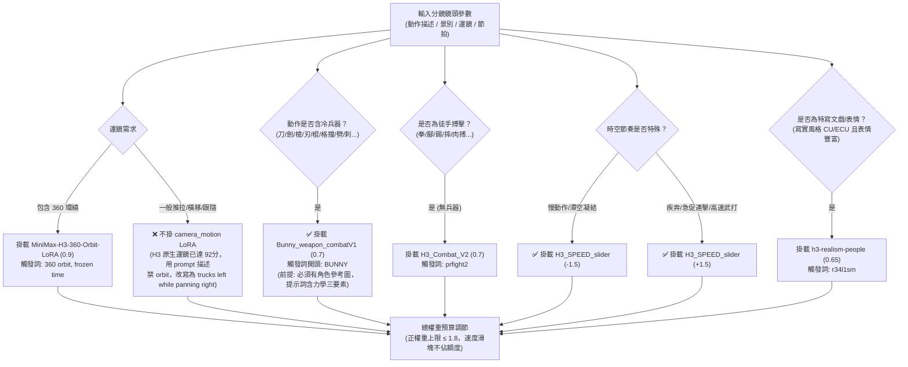

# MiniMax H3 專用 LoRA 實戰與自動適配指南 (LoRA Practical Guide & Auto-Adapter)

> **版本**：v3.3.1 專家整合版  
> **適用標準**：繁體中文（台灣影視工業標準）+ 英文 Prompt 觸發詞規範  
> **相容平台**：FreeVideo (本機 API)、ComfyUI (原生節點)、fal.ai / 雲端推理服務  

---

## §1 核心概述與底層邏輯

MiniMax H3 (Hailuo 3) 作為全模態影視級生成模型，其文字解析器基於 **Qwen3-VL-32B**（非傳統計數型 CLIP 解析器）。在純文字驅動下，極易遇到冷兵器交錯穿模、高難度運鏡漂移、微表情僵硬以及多動作黏滯等物理限制。

透過社群與本機實證驗證，外掛專用 LoRA 能夠在保持 H3 原生光影與時空連貫性的前提下，精確干預特定物理與光學維度。本指南定義了 H3 核心 8 大 LoRA 規格矩陣、疊加預算限制、觸發詞順序鐵律，以及 FreeVideo API 自動掛載合約。

---

## §2 核心 LoRA 規格矩陣（實戰校準版）

| LoRA 檔案名稱 | 核心代號 / 狀態 | 推薦權重 | 觸發詞 (Trigger Words) | 解決痛點與核心功能 | 實戰驗證與約束 |
|---|---|---|---|---|---|
| `H3_SPEED_slider.safetensors` / `motion_speed_slider_mmh3_v1.safetensors` | `Motion-Speed-SLIDER`<br/>**✅ 已驗證有效** | `+1.0 ~ +1.5` (加速)<br/>`-1.0 ~ -1.5` (減速) | 無強制（純權重驅動） | **雙向時空速度滑塊**：實測 `+1.5` 運動量增加 `+37%`（衝刺、武打急促連擊）；`-1.5` 運動量減少 `-16%`（慢動作、刀刃凝結、受擊滯空）。武戲必掛！ | **鐵律**：任何滑桿型 LoRA 上線前**必須先跑 3 支 4 秒測試（`-1.5 / 0 / +1.5`）用幀差確認正負號方向，絕不可盲信檔名！** 不計入 1.8 幾何預算。 |
| `Bunny_weapon_combatV1.safetensors` | `Weapon-Combat`<br/>**✅ 已驗證有效** | `0.5 ~ 0.8` (推薦 0.7) | `BUNNY`（**大寫，動作開頭**） | **冷兵器打鬥專用**：大幅減少武器憑空消失、刀刃穿透身體。強化格擋火花與側向步法。 | 掛武戲段。**實戰兩大教訓**：<br/>1. **畫風走鐘（塑膠卡通臉）的主因是 0 張參考圖，不是缺 LoRA！**<br/>2. **LoRA 是加分不是解方，救不了只寫位移沒寫力學三要素的句子！** |
| `camera_motion_h3_lora_v1_3000_pruned.safetensors` | `camera_motion_h3`<br/>**❌ 實測不必掛** | 預設停用 (0.0) | `camera motion`（若掛載須放首位） | **運鏡軌跡微調**：原用於解決運鏡呆滯。 | **實測結論**：H3 原生運鏡在審查中已能拿到 92 分的高分，多掛反而浪費 8GB VRAM 與特徵預算，**預設停用自動掛載**！注意：H3 規範禁止 `orbit / arc / 360-degree`，應改寫為 `trucks left while panning right`。 |
| `H3_Combat_V2.safetensors` | `H3-Combat-V2`<br/>⚠️ 視情況選用 | `0.6 ~ 0.8` | `prfight2`（重擊加 `prfin1`） | **徒手肉搏格鬥專用**：強化拳腳打擊重心轉移、面部受擊變形。 | 徒手時使用；與 `Bunny` 互斥。 |
| `Motion_Repair.safetensors` | `Motion-Repair`<br/>⚠️ 輔助選用 | `0.3 ~ 0.4` | `bunny_crisp_motion` (選用) | **防定格與動作黏滯修復**：修復複合動作中途凍結、關節融化。 | 輔助型 LoRA，多掛時壓低權重。 |
| `h3-realism-people-t2v-i2v-r2v.safetensors` | `Realism-People`<br/>⚠️ 寫實特寫用 | `0.5 ~ 0.7` | `r34l1sm` | **人物皮膚肌理與特寫微表情**：提升毛孔、微血管透光、唇部紋理。 | 僅適用於寫實/半寫實 CU/ECU 特寫，2D 動畫漫劇嚴禁使用。 |
| `Minimax_H3_CinematicRealism_V0.1.safetensors` | `Cinematic-Realism`<br/>⚠️ 輔助選用 | `0.5 ~ 0.7` | 無強制 | **電影鏡頭光影質感**：強化 HDR 陰影過渡、膠片顆粒質感。 | 視覺美化型。 |
| `minimax_h3_flf2v_lora_v1.safetensors` | `360-Orbit-BulletTime`<br/>⚠️ 特殊獨佔 | `0.8 ~ 1.0` | `360 orbit, frozen time` | **360 度環繞子彈時間**：強制主體定格，攝影機 360 度環繞。 | 獨佔型，不可與一般運鏡詞混用。 |

---

## §3 多 LoRA 疊加預算與觸發詞順序鐵律

### 3.1 總權重預算上限（$\sum \le 1.8$）
AI 生成模型的潛在特徵空間疊加多個 LoRA 時，權重過高會產生色彩過飽和、肢體高頻抖動、黑洞噪點（Black Artifacts）或幾何崩解。

- **單掛 LoRA**：可給予 `0.70 ~ 0.80` 完整權重。
- **雙掛 LoRA**：各自自動降權為 `0.60 + 0.60`（總和 1.20）。
- **三掛 LoRA（極限組合）**：自動分配為 `0.60 (武打) + 0.40 (風格) + 0.30 (修復)`，總和 1.30 $\le 1.80$。
- **速度滑桿特別規則（✅ 已驗證有效）**：`H3_SPEED_slider` 作用於時空步長嵌入層，**其權重（不論正負）不計入 1.8 的幾何特徵預算**！實測即使掛載武戲 LoRA，仍可疊加 `+1.5`（加速打鬥）或 `-1.5`（滯空凝結）。

> [!IMPORTANT]
> **滑桿 LoRA 上線鐵律**：任何速度或滑桿型 LoRA，上線前**必須先以同一種子跑 3 支 4 秒測試（`-1.5 / 0 / +1.5`）**，透過影格差分確實驗證運動量變化方向（確認 `+` 是加速、`-` 是減速），絕不能盲目信任檔名！

---

### 3.2 觸發詞（Trigger Words）注入嚴格順序

Qwen3-VL-32B 解析提示詞具有強烈的先導位置偏差（Prefix Attention Bias）：

```
【Prompt 開頭觸發詞順序鏈】：
1. [選用] camera motion (若有掛運鏡LoRA) ➔ 2. BUNNY (若為冷兵器武戲) ➔ 3. r34l1sm / prfight2
```

1. **若未掛載 `camera_motion_h3`（推薦）**：武戲直接以 `BUNNY, ` 作為動作段開頭！
2. **若有掛載運鏡 LoRA**：`camera motion` 必須置於整個 Prompt 的最開頭第 1 個詞。
3. **武戲兩大實戰軍規**：
   - **畫風走鐘（塑膠卡通臉）的主因是 0 張參考圖，不是缺 LoRA！** 若 FreeVideo 生成時無角色參考圖，掛任何 LoRA 都無法挽救臉部坍塌。
   - **LoRA 是加分不是解方，救不了只寫位移沒寫力學三要素的句子！** 分鏡提示詞必須先寫清「施力點 → 傳導路徑 → 受擊反饋與環境特效」，LoRA 才能發揮碰撞與軌跡增強作用。

---

## §4 FreeVideo API 掛載合約與呼叫格式

在 FreeVideo API（`http://127.0.0.1:8189`）呼叫時，透過 `"loras"` 陣列攜帶參數：

```json
{
  "model": "minimax-h3",
  "prompt": "BUNNY,\nGlobal palette and lighting locked to...",
  "loras": [
    {
      "name": "Bunny_weapon_combatV1.safetensors",
      "strength": 0.70
    },
    {
      "name": "H3_SPEED_slider.safetensors",
      "strength": 1.50
    }
  ],
  "duration": 8.0,
  "aspect_ratio": "9:16"
}
```

---

## §5 自動場景適配決策樹 (Auto-Adaptation Engine)

依據分鏡特徵進行自動適配推導：



---

## §6 常見翻車現象與 LoRA 救治清單

| 翻車症狀 | 根本病因 | 救治方案 |
|---|---|---|
| 角色臉部退化成通用塑料卡通臉、五官完全不對 | **根本原因是 0 張角色參考圖**（如尾幀續接段被清空 references），並非缺少 LoRA | 每一段獨立走 `Ref2VA`，必須攜帶角色設定圖；LoRA 救不了無參考圖的臉部坍塌 |
| 武器在揮動過程中變成兩把、消失或穿透軀幹 | 模型空間注意力對細長物體拓撲遺失 | 掛載 `Bunny_weapon_combatV1`（權重 0.7），注入前綴 `BUNNY`，並在動作描述中補足力學三要素（握緊、反光、受擊火花） |
| 打鬥動作像玩具擺弄、軟綿無力缺乏打擊感 | 提示詞只寫位移（A走向B），缺乏力學三要素與環境特效 | 分鏡動作欄補齊「①施力點 → ②傳導路徑 → ③受擊反應與環境反饋（揚塵/氣浪/震退）」，並掛載 `H3_SPEED_slider` (+1.5) 加速 |
| 鏡頭完全固定不動，無視 push-in / pan 提示 | 提示詞中主體權重過大，運鏡詞被稀釋 | 強化 prompt 運鏡落點句，改寫為客觀位移動作；如需掛載 `camera_motion_h3` 權重給 0.75，且 `camera motion` 必須放最前頭 |
| 慢動作產生詭異的肢體抖動與果凍效應 | 純文字寫 slow motion 導致幀差內插混亂 | 改用 `H3_SPEED_slider` 設定權重 `-1.5`（先測過方向），文字中拿掉所有形容詞 slow |
| 動作在中途突然定格，角色變成蠟像 | 連續動作缺乏微物理，模型陷入局域最優解 | 可選用 `Motion_Repair`（權重 0.35；A/B 實測耗時 +31–68%、打擊感變弱，非預設建議，先靠 prompt 微動態），並在 Prompt 結尾加上衣角/髮絲微動態 |
