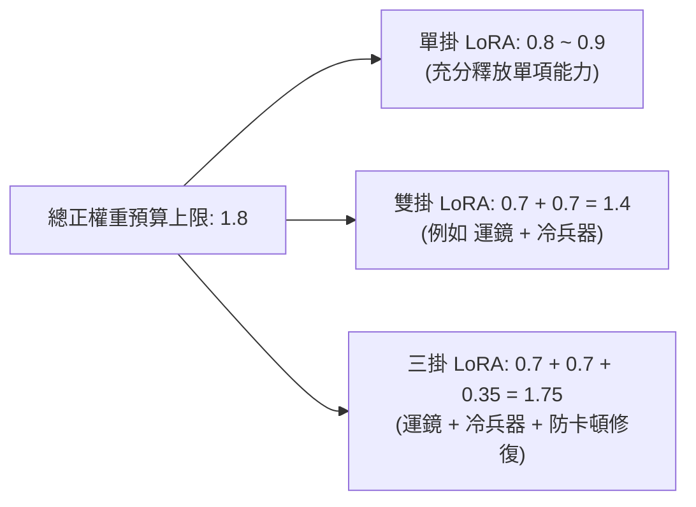
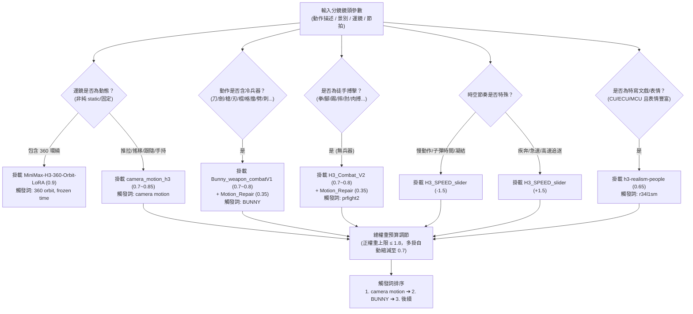

# MiniMax H3 專用 LoRA 實戰與自動適配指南 (LoRA Practical Guide & Auto-Adapter)

> **版本**：v3.3.1 專家整合版  
> **適用標準**：繁體中文（台灣影視工業標準）+ 英文 Prompt 觸發詞規範  
> **相容平台**：FreeVideo (本機 API)、ComfyUI (原生節點)、fal.ai / 雲端推理服務  

---

## §1 核心概述與底層邏輯

MiniMax H3 (Hailuo 3) 作為全模態影視級生成模型，其文字解析器基於 **Qwen3-VL-32B**（非傳統計數型 CLIP 解析器）。在純文字驅動下，極易遇到冷兵器交錯穿模、高難度運鏡漂移、微表情僵硬以及多動作黏滯等物理限制。

透過社群與本機實證驗證，外掛專用 LoRA 能夠在保持 H3 原生光影與時空連貫性的前提下，精確干預特定物理與光學維度。本指南定義了 H3 核心 8 大 LoRA 規格矩陣、疊加預算限制、觸發詞順序鐵律，以及 FreeVideo API 自動掛載合約。

---

## §2 核心 LoRA 規格矩陣

| LoRA 檔案名稱 | 核心代號 / 類型 | 推薦權重 | 觸發詞 (Trigger Words) | 解決痛點與核心功能 | 互斥 / 相容約束 |
|---|---|---|---|---|---|
| `H3_SPEED_slider.safetensors` | `Motion-Speed-MMH3-SLIDER` | `+1.0 ~ +2.0` (加速)<br/>`-1.0 ~ -2.0` (慢速) | 無強制（純權重驅動） | **時空速度滑塊**：正權重加速（高速武打、急速連擊、追逐）；負權重子彈時間（慢動作、刀刃交錯定格）。支援 `[-4.0, 4.0]`。 | 與所有 LoRA 100% 相容，獨立調節時空曲率 |
| `Bunny_weapon_combatV1.safetensors` | `Weapon-Combat-LoRA` | `0.7 ~ 0.9` (多掛時降至 0.7) | `BUNNY`（**大寫，動作開頭**） | **冷兵器打鬥專用**：專修武器憑空消失、刀刃穿透身體、格擋無受力反饋。大幅增強碰撞火花與側向閃避步法。 | 與 `H3_Combat_V2` 同源互斥，不可同時開 1.0 |
| `camera_motion_h3_lora_v1_3000_pruned.safetensors` | `camera_motion_h3` | `0.7 ~ 1.0`（**嚴禁 >1.2**） | `camera motion`（**必須置於整個 Prompt 最開頭**） | **運鏡軌跡精確控制**：解決運鏡呆滯或亂晃，精確鎖定 `dynamic handheld`, `push-in`, `pull-back`, `orbit around`, `tracking shot`, `crane reveal`。 | 全局運鏡基底，所有動態鏡頭優先掛載 |
| `H3_Combat_V2.safetensors` | `H3-Combat-V2` | `0.7 ~ 0.9` (多掛時降至 0.7) | `prfight2`（重擊加 `prfin1`） | **徒手肉搏格鬥專用**：強化拳腳打擊重心轉移、摔投摔跌、面部受擊變形與近身纏鬥。 | 徒手時使用；與 `Bunny` 互斥 |
| `Motion_Repair.safetensors` | `Motion-Repair` | `0.3 ~ 0.6` (建議 0.35) | `bunny_crisp_motion` (選用) | **防定格與動作黏滯修復**：修復複合動作中途凍結、關節融化、低速動作黏成幻燈片。 | 輔助型 LoRA，常駐打鬥與複雜動作鏡頭 |
| `h3-realism-people-t2v-i2v-r2v.safetensors` | `Realism-People` | `0.5 ~ 0.8` (建議 0.65) | `r34l1sm` | **人物皮膚肌理與特寫微表情**：提升毛孔、微血管透光、唇部紋理、眼眶微動，消除塑膠面癱。 | 適用於 CU/ECU/MCU 特寫文戲與情感戲 |
| `Minimax_H3_CinematicRealism_V0.1.safetensors` | `Cinematic-Realism` | `0.5 ~ 0.7` | 無強制 | **電影鏡頭光影質感**：強化高動態範圍 (HDR) 陰影過渡、膠片顆粒質感、逆光邊緣色散與層次感。 | 視覺美化型，可與微表情或運鏡疊加 |
| `minimax_h3_flf2v_lora_v1.safetensors` | `360-Orbit-BulletTime` | `0.8 ~ 1.0` | `360 orbit, frozen time` | **360 度環繞子彈時間**：強制主體保持定格或超慢速，攝影機繞主體水平 360 度高速環繞。 | 獨佔型，不可與一般 `camera_motion` 混用 |

---

## §3 多 LoRA 疊加預算與觸發詞順序鐵律

### 3.1 總權重預算上限（$\sum \le 1.8$）
AI 生成模型的潛在特徵空間疊加多個 LoRA 時，權重過高會產生色彩過飽和、肢體高頻抖動、黑洞噪點（Black Artifacts）或幾何崩解。



- **單掛 LoRA**：可給予 `0.80 ~ 0.90` 完整權重。
- **雙掛 LoRA**：各自自動降權為 `0.70 + 0.70`（總和 1.40）。
- **三掛 LoRA（極限黃金組合）**：自動分配為 `0.70 (運鏡) + 0.70 (武打) + 0.35 (防卡頓)`，總和 1.75 $\le 1.80$。
- **速度滑塊特別規則**：`H3_SPEED_slider` 作用於時空步長嵌入層，**其權重（不論正負）不計入 1.8 的幾何特徵預算**！即可以在掛載 1.75 動作組合的同時，疊加 `-1.5` 的慢動作滑塊。

---

### 3.2 觸發詞（Trigger Words）注入嚴格順序

Qwen3-VL-32B 解析提示詞具有強烈的先導位置偏差（Prefix Attention Bias）。各 LoRA 官方規定的觸發詞位置若錯置，將導致 LoRA 無法被權重注意力網絡喚醒！

```
【Prompt 開頭觸發詞絕對順序鏈】：
1. camera motion ➔ 2. BUNNY ➔ 3. r34l1sm / prfight2 / 360 orbit, frozen time
```

1. **第 1 位：`camera motion`（強制最高優先級）**  
   官方規定必須放在整個 Prompt 的**最開頭第一個詞**！若前面有任何形容詞或色調宣告，運鏡 LoRA 效果將衰減 60% 以上。
2. **第 2 位：`BUNNY`（兵器打鬥核心鎖定）**  
   若為冷兵器打鬥，`BUNNY` 緊跟在 `camera motion, ` 之後，作為動作特徵的主觸發詞。
3. **第 3 位：風格與局部微調觸發詞**  
   特寫微表情 `r34l1sm`、徒手格鬥 `prfight2` 或子彈時間 `360 orbit, frozen time` 接在第三位。

#### 官方實戰範例：
```text
integrated_multimodal_description:
camera motion, BUNNY,
Global palette and lighting locked to: 冷鋼夜黑（墨黑夜幕、竹林地面暗青、劍氣青光）.
[Shot 1] (3.5s, 16:9) 50mm standard prime lens placed at eye level, perpendicular side profile with ZERO foreground obstruction. Dynamic handheld tracking shot following the clash. Anchored by 【青石板地面】與【重型合金盾牌】, @角色A performs: BUNNY, lunges forward with a horizontal slash aiming at the shield core, striking perpendicular with brilliant sparks and shockwave recoil. Observable expression: jaw clenched tight, lips remaining completely closed. Follow-through micro-physics: debris and dust blowing outward from the impact zone.

overall_soundscape:
Heavy metal collision bang, sparks fizzing, boots grinding across wet stone.

non_diegetic_music:
Intense low-frequency percussion swell.
```

---

## §4 FreeVideo API 掛載合約與呼叫格式

本技能無縫對接本機 **FreeVideo API**（`http://127.0.0.1:8189`），在發送任務時透過 `"loras"` 陣列攜帶 LoRA 參數。

### 4.1 JSON Payload 結構規格
```json
{
  "model": "minimax-h3",
  "prompt": "camera motion, BUNNY,\nGlobal palette and lighting locked to...",
  "loras": [
    {
      "name": "camera_motion_h3_lora_v1_3000_pruned.safetensors",
      "strength": 0.70
    },
    {
      "name": "Bunny_weapon_combatV1.safetensors",
      "strength": 0.70
    },
    {
      "name": "Motion_Repair.safetensors",
      "strength": 0.35
    },
    {
      "name": "H3_SPEED_slider.safetensors",
      "strength": -1.50
    }
  ],
  "duration": 4.0,
  "aspect_ratio": "16:9"
}
```

---

## §5 自動場景適配決策樹 (Auto-Adaptation Engine)

分鏡輔助工具 `director_storyboard_assistant.py` 與 Layer 2 Schema 整合了自動適配推導邏輯，依據分鏡的五大特徵進行模式識別：



---

## §6 常見翻車現象與 LoRA 救治清單

| 翻車症狀 | 根本病因 | 救治方案 |
|---|---|---|
| 武器在揮動過程中變成兩把、消失或穿透軀幹 | 模型空間注意力對細長物體拓撲遺失 | 掛載 `Bunny_weapon_combatV1`（權重 0.75），注入前綴 `BUNNY`，並在動作描述中補足「握柄手指關節扣緊」 |
| 鏡頭完全固定不動，無視 push-in / pan 提示 | 提示詞中主體權重過大，運鏡詞被稀釋 | 掛載 `camera_motion_h3`（權重 0.85），**將 `camera motion` 移至最開頭第 1 個詞** |
| 動作在中途 2.0s 處突然定格，角色變成蠟像 | 連續動作缺乏微物理，模型陷入局域最優解 | 疊加 `Motion_Repair`（權重 0.35~0.4），並在 Prompt 結尾加上衣角微物理 `micro_physics_tail` |
| 慢動作產生詭異的肢體抖動與果凍效應 | 純文字寫 slow motion 導致幀差內插混亂 | 改用 `H3_SPEED_slider` 設定權重 `-1.5`，文字中拿掉所有形容詞 slow |
| 角色面癱、塑料感假人肌膚、眼神無光 | 模型使用泛化平滑皮膚權重 | 掛載 `h3-realism-people`（權重 0.65），開頭注入 `r34l1sm`，並配合特寫景別 |
