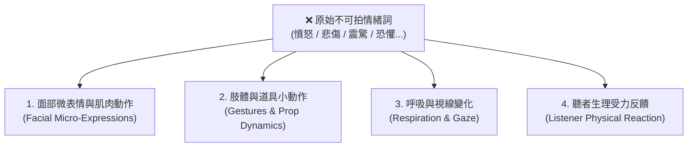
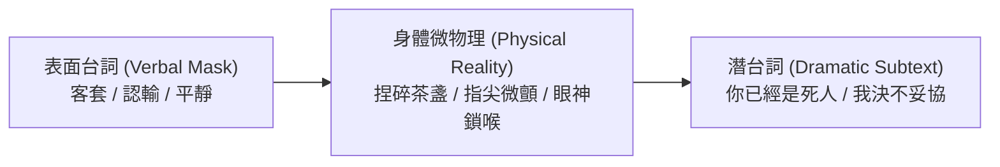
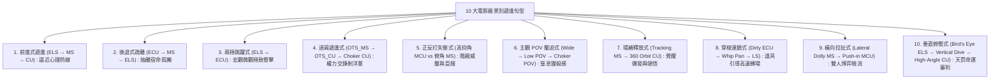
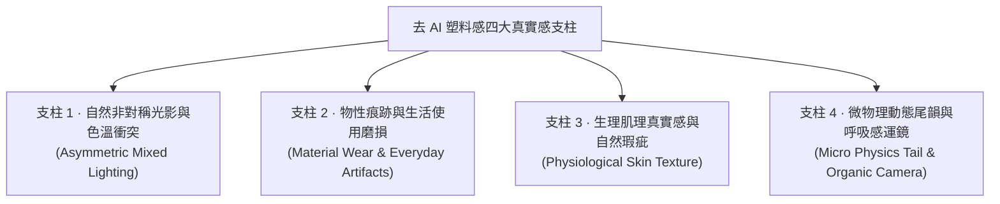
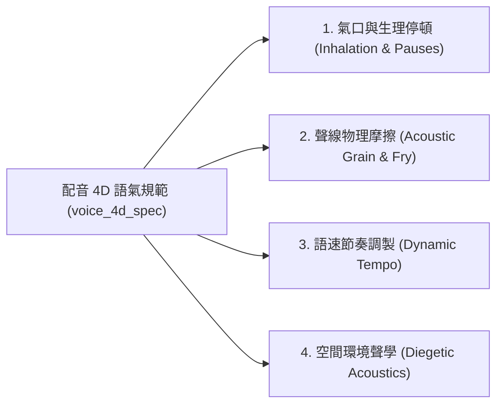

# 邁斯納壓力行為表演法、潛台詞言行反差、十級景別遞進與去 AI 味真實感庫 (Acting and Emotion Library)

> **版本**：v3.3.1 專家整合版  
> **適用標準**：繁體中文（台灣影視工業與教育部標準字）+ 中英雙語 Prompt（MiniMax H3 / Seedance 2.0 / Qwen-Image 2.1）  
> **系統對齊**：Layer 1 導演表、Layer 2 結構化劇本、`voice_4d_spec` 配音規範、`micro_physics_tail` 尾韻微物理。

---

## §0 表演密度與自檢（2026-10 蒸餾併入，先讀這節）

> 來源：外部「人物微表情真實感」技能文字蒸餾（D29–D31）。外部 0 生成驗證。
> **注意**：本庫 §1 以下的替換表每種情緒堆 5 條以上強烈線索（咬肌、青筋、鼻翼、瞳孔等）。外部認為這種堆疊容易壓成誇張定格；**是否把本庫降級為「強度分級」寫法（D28）尚待 H3 A/B 實測**，在那之前把下表當選取規則：從 §1 的線索裡挑，不要全抄。

- **刪情緒詞自檢**：把「憤怒、悲傷、震驚」等情緒詞全部刪掉，仍看得出①什麼時候被觸發 ②在壓住還是放出來 ③程度到哪裡，才算寫完。
- **聽者先寫接收**：多人對話先寫聽者怎麼接收這句話；聽者預設輕度、單一線索（一個視線或呼吸變化），不讓每個在場者同時完整表演。
- **景別決定寫哪裡**：特寫／近景寫視線、眼瞼、嘴角、呼吸；中景寫手、肩頸、軀幹、重心、距離；遠景寫姿態、方向、停頓、間距。觸發瞬間不急著運鏡。
- **時長決定變化數**：3–5 秒＝起始＋觸發＋一個可見變化；6–10 秒可加內部反應與餘韻；超過 10 秒還要多次轉折就拆段。
- 一個節拍挑 2–4 個主要線索、臉部最多 2–3 個通道、一個主要身體動作（外部原文；與本庫現行寫法有落差，屬 D28 待測範圍）。

---

## §1 邁斯納（Meisner）壓力行為表演法則 (Pressure-Driven Behavioral Acting)

### 1.1 核心公理：表演是在壓力下的具體行為，而非情緒形容詞的展示
影視表演與 AI 生成的核心痛點在於：**劇本充斥「憤怒」、「悲傷」、「絕望」等空泛情緒形容詞，導致生成角色呈現面癱、塑料假笑或抽搐抽角**。
根據桑福德·邁斯納（Sanford Meisner）體系：
- **「表演是在真實壓力下的具體物理行為，而非自怨自艾的情緒展覽（Acting is doing under emotional pressure, not showing adjectives）」**。
- 人類在現實中極少直接宣洩純粹情緒，而是在承受心理壓力的同時**試圖隱藏情緒並完成特定任務**。
- AI 影片模型（如 MiniMax H3、Seedance 2.0）的視覺神經網絡不認識抽象詞彙，只對「下頜肌肉緊繃」、「眼眶充血」、「指節發白」、「胸口起伏頻率」產生明確物理幾何回饋。

---

### 1.2 嚴禁形容詞 vs 四維外化替換表 (中英雙語對照)

本表嚴格拆解 10 大常見不可拍情緒，轉譯為四大可見物理維度：



| 原始情緒 (嚴禁使用) | 1. 面部微表情與肌肉動作 | 2. 肢體與道具小動作 | 3. 呼吸與視線變化 | 4. 聽者生理受力反饋 | Layer 3 視覺 Prompt 範例 (中英雙語) |
|---|---|---|---|---|---|
| **1. 憤怒 (Anger)** | 咬肌劇烈鼓起下頜繃直，眉心緊鎖擠出深痕，鼻翼擴張，嘴角緊繃下壓 | 雙拳在袖中捏得指節泛白微顫，手背青筋暴起，右手拇指猛力摳擦劍柄護手皮鞘 | 呼吸轉為粗重鼻息，胸膛劇烈起伏，視線如釘子般死死釘在對方眼眸，瞳孔微微收縮 | 聽者下意識屏住呼吸，喉結上下滑動，後背肌肉瞬間收緊貼住椅背 | `中近景特寫，下頜線條咬緊繃直，腮幫肌肉鼓起微顫，雙拳在袖中緊攥指節泛白，胸膛因粗重呼吸起伏，眼神銳利如刀死盯前方，威壓感 / Medium close-up, jawline clenching tightly with visible muscle twitch, white knuckles trembling in tightened fists, chest heaving with heavy breathing, piercing lethal gaze locked forward` |
| **2. 悲傷 (Grief)** | 下眼眶迅速泛紅，喉部吞咽帶動下巴輕顫，嘴角想要抿起卻控制不住地下墜 | 手指無意識地反覆摩挲亡者遺留的茶杯缺口，手腕脫力垂落，五指虛浮無法握拳 | 倒吸一口短促冷氣隨後屏息，視線失焦散落，眼瞼垂下遮住半個瞳孔，淚水懸在眼眶未落 | 聽者別過頭不敢直視，眉心微微抽動，雙肩下沉嘆出長氣 | `近景微俯拍，下眼眶迅速充血泛紅，嘴角微顫強行抿緊，手指顫抖懸停在破舊木梳上方，喉結艱難吞嚥，深吸冷氣屏息，眼波失焦微顫 / Close-up high angle, lower eyelids reddening rapidly, trembling mouth forcing a flat line, shaky fingers hovering over old wooden comb, swallows hard, holding breath in silence, glossy unfocused eyes` |
| **3. 震驚 (Shock)** | 瞳孔瞬間放大後驟縮，微張的嘴唇僵死在半開狀態，全臉肌肉在半秒內完全凍結 | 手中握著的毛筆或玉珮失控脫手，筆尖砸落白紙炸開墨點，手指保持僵硬抓握姿勢 | 呼吸在一瞬間被徹底掐斷（窒息感），眼神呆滯凝固在特定焦點，眼球微幅震顫 | 聽者整個人後脊骨發涼，汗毛豎立，心跳重擊胸腔的耳鳴感 | `面部特寫瞬間凝固，瞳孔驟然收縮，半張的嘴唇僵硬發白，手中毛筆啪嗒墜地墨汁四濺，呼吸瞬間停滯，面部肌肉完全失去表情，極度震撼 / Extreme close-up facial freeze, pupils contracting violently, parted pale lips frozen stiff, ink brush slipping from limp fingers splattering black ink, breathing completely halted` |
| **4. 恐懼 (Fear)** | 雙側太陽穴血管微跳，下唇內側被牙齒死死咬住甚至咬出白印，面部血色褪去發灰 | 後腳跟不由自主向後微蹭半寸，雙手護在胸口前下意識抓緊衣襟，手掌冰冷出汗 | 呼吸短促且高頻淺浮，視線如驚弓之鳥在左右兩側逃生路徑極速亂跳 | 聽者全身骨骼冷顫，牙齒微不可察地打戰，手心被冷汗浸透 | `近景視角微微晃動，臉色蒼白褪去血色，牙齒死咬發白下唇，雙手下意識死死揪住胸口衣襟，呼吸急促淺浮胸口頻繁起伏，驚恐眼神快速掃視周圍門窗 / Shaky close-up shot, draining facial color to ashen pale, teeth biting hard into trembling lower lip, hands clutching chest tunic white-knuckled, shallow rapid panting, darting paranoid gaze` |
| **5. 心虛 (Guilt / Deceit)** | 假裝微笑但眼角毫無細紋（皮笑肉不笑），喉嚨頻繁吞嚥，鼻尖或頸部輕微泛紅 | 頻繁整理袖口褶皺、摸鼻樑、轉動手指上的扳指，雙腳站姿重心在兩腿間反覆切換 | 視線不敢與對手對視超過一秒，眼神快速游移看向地板、茶几，隨後假裝自然地挪回 | 聽者微微瞇起雙眼，側耳傾聽其言辭中的漏洞，身體前傾形成審訊壓迫姿態 | `中近景，嘴角掛著僵硬客套微笑，眼角毫無笑意，右手反覆摩挲轉動玉扳指，喉結不自然地滑動吞嚥，目光躲閃飄向地面茶杯，重心左右搖擺 / Medium close-up, polite rigid smile with dead unsmiling eyes, right hand nervously rotating jade ring, frequent hard swallows, shifting gaze dodging eye contact toward floor` |
| **6. 隱忍 (Suppressed Agony)** | 牙關緊咬使得太陽穴青筋凸起，眼角肌肉強行抽搐克制，雙唇緊閉壓成一條蒼白橫線 | 雙手自然下垂但指甲深深掐入掌心皮肉中，指縫隱隱泛白，雙腿如鐵樁般釘死在地 | 緩慢而極度深沉地吸氣，鼻翼緊繃，雙目泛著冷冽光芒，視線死死壓低在地面三寸 | 聽者感受到無形煞氣，脊背滲出冷汗，不由自主挪開對峙的視線 | `特寫，下唇緊抿成一條毫無血色的白線，腮幫咬肌高高隆起，指甲深深掐入掌心肉中，鼻腔緩慢吐出灼熱長氣，眼神如深淵寒冰壓低凝視 / Close-up, lips compressed into a bloodless straight line, bulging jaw muscles twitching, fingernails digging deep into palms, slow burning exhale through nose, icy abyss-like downward stare` |
| **7. 算計 (Scheming / Calculation)** | 眉弓微微下壓，左側嘴角勾起極不明顯的冷冽弧度（小於 5 度），眼皮微垂呈遮光態 | 食指在木質扶手上有節奏地緩慢扣擊（每兩秒一下），另一手輕撚茶蓋邊緣 | 呼吸平緩悠長毫無波瀾，視線自下而上像屠夫審視牲口般緩慢打量對手身軀 | 聽者感到寒芒在背，本能地收緊雙臂，坐立難安 | `中景低視角，眉峰微鎖眼皮半耷拉，左嘴角若有似無勾起冷酷弧度，食指在紫檀木椅扶手上有節奏輕叩，眼神冷靜深邃自下而上緩慢審視，老謀深算 / Low-angle medium shot, brow furrowed with hooded eyes, subtle cruel smirk on corner of mouth, index finger tapping rhythmically on mahogany armrest, calculated predatory gaze scanning upward` |
| **8. 絕望 (Despair)** | 全臉肌肉完全鬆垮下墜，眼神失去所有神采與焦點，宛如一具活動的枯骨乾屍 | 雙手無力地自膝蓋滑落懸空，雙肩徹底垮塌塌陷，身軀微微前傾晃盪 | 呼吸輕微到幾乎難以察覺，只有偶爾一聲極度衰竭的長嘆，視線穿透物體看向虛無 | 聽者心頭被沉重巨石壓抑，伸出的手在半空停頓，最終無力垂下 | `半身景，雙肩徹底塌陷垮落，雙手無力懸垂，面部肌肉空洞鬆弛，眼神空洞散焦穿透鏡頭，沒有眼淚只有死寂，胸膛幾乎不見起伏，萬念俱灰 / Half-body shot, slumped collapsed shoulders, lifeless drooping arms, slack hollow face, dead vacant stare piercing through camera, devoid of tears, near-invisible breathing, absolute void` |
| **9. 狂喜 (Ecstasy / Breakthrough)** | 瞳孔猛烈放大，眉毛大幅向上挑起，鼻翼張大吸氣，咧嘴大笑露出兩排牙齒甚至牙齦 | 雙臂猛然向上揮舞展開，雙拳仰天怒砸，隨後雙手用力搓擦臉頰與頭髮，原地來回踱步 | 呼吸劇烈、亢奮喘息、伴隨喉管爆發出的失控短促乾咳與胸腔震顫 | 聽者被狂暴動能震懾後退一步，隨後受其感染睜大雙眼露出驚訝笑容 | `全景切特寫，雙手振臂仰天狂笑，胸腔劇烈起伏喘息，眼中精光爆射淚光閃爍，用力抓撓頭髮隨後大步前踱，狂暴神采飛揚，絕處逢生 / Wide to extreme close-up, throwing arms to sky laughing uncontrollably, chest heaving with ecstatic gasps, sparkling manic eyes, running fingers through hair in wild relief, victorious breakthrough` |
| **10. 疲憊 (Exhaustion)** | 眼皮沉重如灌鉛，每隔三秒極慢地眨動一次，面色青黃晦暗，唇瓣乾裂起皮 | 手臂沉重難以抬起，單手撐在桌案或膝蓋上支撐上半身體重，指關節發軟 | 呼吸沉重且拖沓，伴隨沉重喉音，頭顱隨著坐姿無意識向下微垂點頭又驚醒 | 聽者動作不由自主放輕，說話壓低聲音，放緩語速 | `中景側拍，身軀沉重佝僂靠在斑駁石牆上，雙眼皮極度沉重緩慢耷拉，單手虛弱撐住佩刀，呼吸沙啞厚重帶著喉音，乾裂嘴唇微張，力竭瀕死感 / Profile medium shot, slumping heavily against weathered stone wall, heavy leaden eyelids drooping, trembling hand leaning on sword hilt for support, raspy deep breathing, parched chapped lips` |

---

### 1.3 傾聽與反應的三大鐵律 (The Rules of Listening & Reaction)

1. **反應在對方台詞結束前就已發生 (Pre-emptive Reaction)**：
   - 真實的人在聽對手說話時，**早在關鍵字詞出口的瞬間（如聽到「叛徒」、「退婚」、「殺了你」），面部肌肉與肢體重心就已經產生微動**。
   - 嚴禁設計「A 說完全句 → 停頓 1 秒 → B 突然啟動表情」的機器人程式化反應。
2. **思考先於語言 (Thinking Precedes Speaking)**：
   - 遭遇刁難或震驚消息時，角色開口前必然經歷 **0.5–1.5 秒的思維評估空白期**（眼神焦點短暫飄移、吞嚥、嘴唇微張又閉合）。以勻速立刻接話者，是背誦台詞而非活人。
3. **道具任務中斷法則 (Action Interruption Law)**：
   - 角色必須有正在進行的物理任務（擦刀、斟茶、數銅錢、包紮傷口、修整燭芯）。
   - **全場最高張力的戲劇重音，永遠是「手頭任務的戛然而止」**：例如正在給傷口纏繃帶的手，在對方說出某個名字時，動作瞬間凝固在半空中，三秒鐘一動不動。

---

## §2 潛台詞與「言行反差」設計法 (Subtext & Behavioral Irony)

### 2.1 言言言行分離原則 (Verbal-Physical Dissonance)
影視文學的最高境界是「指桑罵槐」與「借物抒情」。漫劇文戲必須杜絕「心口合一的口水話」。
- **言（對白）**：角色的社交面具，通常極盡客套、平靜、忍讓、冰冷或戲謔。
- **行（動作）**：角色的生理背叛，指關節的捏白、茶水的晃動、刀柄的撫弄洩露其真實殺意或絕望。
- **潛台詞（內心）**：未說出口的真正慾望與命運判決。

---

### 2.2 八大經典言行反差範式表 (The 8 Classic Behavioral Irony Paradigms)



#### 1. 佯裝寬容，暗藏殺機 (False Generosity & Concealed Lethality)
- **情境**：屬下犯下大錯跪地求饒，宗主居高臨下審視。
- **表面台詞**：「無妨，一隻茶盞罷了，何須行此大禮？起來吧。」
- **可見動作**：面帶溫和微笑，右手親自將對方扶起；但左手在袖子暗處將一隻青瓷茶杯硬生生捏成細白粉末，粉末自指縫無聲灑落。
- **隱藏潛台詞**：「今夜子時，我要你全家九族雞犬不留。」
- **Layer 3 視覺 Prompt**：`特寫鏡頭，主角臉上帶著溫潤如玉的平靜微笑，眼神無波；視角微移至袖底暗處，指節發力將青瓷茶杯捏出密密麻麻裂紋隨後崩解為白粉，細膩粉末自指縫無聲飄落，極致反差殺意`

#### 2. 表面輕蔑，內心恐慌 (Arrogant Bravado & Trembling Fear)
- **情境**：紈褲少主被復仇主角逼入死胡同，身邊護衛已全滅。
- **表面台詞**：「你敢動我？你可知我父親是誰？有種你上前一步試試！」
- **可見動作**：揚著下巴大聲嗤笑叫囂，雙手叉腰；但後背緊緊貼死潮濕石牆，右側大腿膝蓋在寬大錦袍下不受控地劇烈發抖，冷汗沿鬢角下淌。
- **隱藏潛台詞**：「求求你別過來……我會死的……」
- **Layer 3 視覺 Prompt**：`中近景仰拍，錦袍紈褲少爺仰頭叫囂狂妄大笑，然而後背緊貼石牆無路可退，華麗錦袍下擺劇烈顫抖打顫，一滴冷汗自泛白的下頜滴落，外強中乾的恐懼`

#### 3. 強顏歡笑，深淵悲慟 (Forced Smile & Crushing Grief)
- **情境**：女主看著青梅竹馬換上大紅吉服迎娶他人。
- **表面台詞**：「林哥哥今日真英武，新娘子必定是極美的人兒，恭喜恭喜。」
- **可見動作**：嘴角大幅上揚擠出燦爛笑容，雙手熱情抱拳賀喜；但在轉身瞬間，笑容在 0.2 秒內如退潮般塌陷，指甲深掐入掌心，下眼眶淚水凝結成珠卻死死不讓其滑落。
- **隱藏潛台詞**：「我的世界在這一刻徹底化為焦土。」
- **Layer 3 視覺 Prompt**：`特寫正面，大紅燈籠光影下，女子臉上綻放著燦爛笑容，隨後轉身背向人群，笑容瞬間塌陷化為死寂，眼眶泛紅滿含淚水卻強行仰頭不讓落下，指節在紅衣上捏出褶皺`

#### 4. 謙卑臣服，伺機反撲 (Submissive Bow & Cold Predator Eye)
- **情境**：忍辱負重的臥底刺客跪拜在大反派王座之下。
- **表面台詞**：「屬下無能，全憑主上責罰，願為主上肝腦塗地。」
- **可見動作**：雙膝跪地，額頭緊緊貼在冰冷金磚地面上，雙手恭敬平鋪；但在深邃的地面陰影中，雙眼如毒蛇般死死鎖定王座扶手下對手的罩門死穴，嘴角浮現冷酷微動。
- **隱藏潛台詞**：「再等三個月，我會親手割下你的頭顱當酒器。」
- **Layer 3 視覺 Prompt**：`超低視角地面貼地機位，刺客額頭貼近反光金磚地面卑微長跪，陰影遮住半張臉，但在陰影中一雙眼睛寒芒爆射，眼神死死鎖定前方靴履，嘴角微不可察地泛起弒君冷笑`

#### 5. 雲淡風輕，心虛掩飾 (Casual Denial & Guilty Fidgeting)
- **情境**：同門被審查密函失竊之事，真正的偷盜者正在場。
- **表面台詞**：「藏經閣失竊？還有這種事？昨夜我一直在丹房煉藥，未曾聽聞動靜。」
- **可見動作**：神色從容地給長老續茶，語速輕快；但茶水倒滿溢出茶杯邊緣卻渾然不知，右手食指神經質地反覆刮擦茶壺提樑上的銅釘。
- **隱藏潛台詞**：「密函此刻就在我懷中，千萬不要看我的衣襟！」
- **Layer 3 視覺 Prompt**：`近景，男子神色坦然微笑搖頭，手中紫砂茶壺傾倒茶水，熱茶溢出杯沿流淌在桌案上，他卻毫無察覺，右手食指死死掐住茶壺提梁，眼神極快地掠過門口守衛`

#### 6. 冷淡推拒，熾烈隱忍 (Chilly Rejection & Lingering Touch)
- **情境**：背負血仇的劍客在動身前推開摯愛之人。
- **表面台詞**：「江姑娘請自重，你我正邪殊途，往後莫要再來尋我。」
- **可見動作**：側過身冷漠甩開女子的衣袖，大步向前走去；但背在身後的右手，指尖卻依戀地虛握空氣，指腹緩慢摩挲著方才女子衣袖殘留的溫度，步伐沉重如負千斤。
- **隱藏潛台詞**：「我若多看你一眼，便再也捨不得提劍赴死。」
- **Layer 3 視覺 Prompt**：`過肩景深切換，黑衣劍客決絕背影走入雨中，前景特寫其背在身後的手掌，手指微微蜷縮留戀地摩挲空氣，指尖微顫，雨滴砸落指縫，冷酷背影與眷戀指尖的極致拉扯`

#### 7. 客套寒暄，權謀威壓 (Courteous Small Talk & Terrifying Intimidation)
- **情境**：權相請刺史喝茶，實則敲詐軍餉。
- **表面台詞**：「這江南明前龍井，香氣清冽，不知大人老家的春汛……可還安好？」
- **可見動作**：語調舒緩如話家常，雙目低垂細嗅茶香；但茶蓋刮擦茶碗邊緣發出刺耳尖銳的金屬尖嘯，動作慢到令人窒息，視線在抬起瞬間化為兩柄重型戰斧。
- **隱藏潛台詞**：「十萬石糧草明天不到，你老家一族三十口就等著被抄家滅門。」
- **Layer 3 視覺 Prompt**：`正面近景，老謀深算的丞相低頭以青花茶蓋緩慢刮擦茶碗，刺耳刮擦聲，室內光影昏暗，慢慢抬起雙眼直視鏡頭，眼神古井無波卻帶著令人窒息的上位者權威，深邃壓迫`

#### 8. 逞強死撐，力竭崩潰 (Brave Front & Trembling Exhaustion)
- **情境**：戰神將軍獨守孤城，身中數箭面對援軍。
- **表面台詞**：「區區宵小，早已被本將斬盡殺絕，本將……無礙。」
- **可見動作**：雙腳戰靴像釘子一樣牢牢扎在地板上，持槍昂首挺胸，聲音洪亮如鐘；但在轉身示意士兵前進時，手中長槍被當作拐杖猛杵地面三寸，整條手臂肌肉因脫水脫力而抽筋劇顫。
- **隱藏潛台詞**：「我快盲了，扶住我……城……保住了……」
- **Layer 3 視覺 Prompt**：`半身逆光仰角，浴血將軍長槍柱地昂首傲立，鎧甲殘破插著箭桿，夕陽勾勒出剛毅剪影，拉近特寫其握槍手臂，整條手臂劇烈痙攣顫抖，鮮血順著指縫滴滴答答落在焦土上`

---

## §3 10 大電影級景別遞進句型公式 (10 Cinematic Shot Progression Formulas)

提供分鏡師在規劃 Layer 1 與 Layer 2 漫劇鏡頭分鏡時的 10 大標準語法句型：



### 1. 前進式遞進句型 (Inward Progression)
- **鏡頭鏈條**：`極大遠景 (ELS / 24mm)` → `中景 (MS / 50mm)` → `特寫 (CU / 85mm)`
- **戲劇張力**：由客觀環境逐步收縮至人物內心世界，步步逼近核心秘密或心理崩潰點。
- **適用場景**：主角回到被屠滅的故鄉村落、走入深宮密室、審訊最後關頭突破心理防線。
- **焦段邏輯**：廣角交代淒涼空間 → 標準鏡頭捕捉二人僵持身姿 → 85mm 長焦壓縮背景，將觀眾視線死死鎖定在眼眶淚水或咬緊的牙關上。

### 2. 後退式疏離句型 (Outward Recession)
- **鏡頭鏈條**：`超特寫 (ECU / 100mm Macro)` → `中景 (MS / 50mm)` → `大遠景 (ELS / 18mm)`
- **戲劇張力**：從極致震撼的微觀細節（滴血的斷刃、凝固的瞳孔）抽離，展現個人的渺小與世界的冷酷無情。
- **適用場景**：大戰結束身亡、愛人離世後的獨白、登上無上王座後的至尊孤獨。

### 3. 兩極跳躍式衝擊句型 (Bipolar Shock)
- **鏡頭鏈條**：`天地大遠景 (ELS / 14mm)` ↔ `局部超特寫 (ECU / 105mm)` 瞬間硬切
- **戲劇張力**：打破常規中景過渡，以空間維度的巨大落差製造觸電般的視覺與心理震懾。
- **適用場景**：萬馬齊喑的遼闊戰場驟切刺客眼眸中的一點寒芒；平靜無波的萬里晴空驟切掌心符文雷暴炸裂。

### 4. 過肩遞進式對峙句型 (OTS Escalation)
- **鏡頭鏈條**：`過肩中景 (OTS_MS / 50mm)` → `過肩近景 (OTS_CU / 85mm)` → `抹去肩膀的切喉特寫 (Choker CU / 135mm)`
- **戲劇張力**：經典談判與爭吵語法。隨著語言衝突升級，畫框內對手的肩膀比例由 30% 逐步被擠壓排出畫面，象徵兩人社交防線徹底撕破，進入零距離精神肉搏。
- **適用場景**：朝堂舌戰、盟友決裂對質、警匪審訊室最後摊牌。

### 5. 正反打失衡式句型 (Asymmetrical Power Dialogue)
- **鏡頭鏈條**：`極低仰拍中近景 (Low-Angle MCU / 35mm)` ⇋ `極高俯拍中景 (High-Angle MS / 50mm)`
- **戲劇張力**：機位高度與構圖權重的不對等，直觀外化權力階級的不平等。
- **適用場景**：帝王俯視階下囚、宗師審視忤逆弟子、成年人欺凌弱小。仰角賦予壓迫威權，俯角呈現渺小無助。

### 6. 主觀 POV 壓迫式句型 (Subjective POV Menace)
- **鏡頭鏈條**：`客觀中景 (MS)` → `主觀晃動低視角 (Low POV / 28mm)` → `逼近眼前的窒息大特寫 (In-Your-Face CU)`
- **戲劇張力**：將鏡頭直接化為受害者的眼睛。沉重的呼吸聲、搖晃的視野、獵手靴履一步步踏入鏡頭，帶來窒息級身臨其境感。
- **適用場景**：被追殺逃入死胡同、受傷倒地看著反派提刀步步走近。

### 7. 環繞釋放式句型 (360° Orbit Reveal)
- **鏡頭鏈條**：`直線跟隨中景 (Tracking MS)` → `360度極速環繞升降特寫 (360 Orbit CU / 35mm Steadicam)`
- **戲劇張力**：打破線性平面維度。當角色在沉重壓迫中突然頓悟或封印解除，攝影機圍繞角色做 360 度立體環繞，光影與背景如跑馬燈流轉。
- **適用場景**：仙俠主角大招覺醒、走投無路時頓悟上古劍道、漫劇名場面爆發。

### 8. 穿梭連鎖式句型 (Through-Object Transition)
- **鏡頭鏈條**：`遮擋物超特寫 (Dirty ECU)` → `快速甩鏡 (Whip Pan)` → `另一個空間全景 (LS)`
- **戲劇張力**：利用刀光劍影的反光、茶碗升騰的白霧、飄落的竹葉或酒罈碎片填滿鏡頭，瞬間切換時空。
- **適用場景**：回憶殺切換、雙線平行敘事（一邊在宴飲，一邊在刺殺）。

### 9. 橫向拉扯式句型 (Lateral Dolly Tension)
- **鏡頭鏈條**：`平移橫軌中景 (Lateral Trucking MS / 40mm)` → `緩慢前推中近景 (Slow Push-in MCU)`
- **戲劇張力**：保持平移節奏，展現兩人並肩前行或長桌隔空對坐的暗流湧動。表面步調一致，內在心懷鬼胎。
- **適用場景**：兩大政敵步入朝堂前的長廊低語、俠客與密探同船渡江。

### 10. 垂直俯衝式句型 (God's Eye Dive)
- **鏡頭鏈條**：`萬米高空垂直鳥瞰 (Bird's Eye ELS / 16mm)` → `極速垂直俯衝 (Vertical Dive Crane)` → `落地仰角特寫 (Ground Low-Angle CU)`
- **戲劇張力**：如天神降世視角，從宇宙天地的宏大尺度極速砸向大地的一粒微塵。
- **適用場景**：天劫天雷降臨、神明法相巨掌下壓、史詩級大戰開場定調。

---

## §4 去 AI 味「四大真實感支柱」與配音 4D 語氣詞庫 (Anti-AI Slop & Voice 4D Spec)

### 4.1 去 AI 味四大真實感支柱 (The 4 Pillars of Visual Authenticity)

專治 AI 影片生成三大死穴：**「塑料陶瓷皮、影棚廣告光、完美無瑕的假人世界」**。



#### 支柱 1 · 自然非對稱光影與色溫衝突 (Asymmetric Mixed Lighting)
- **❌ 嚴禁**：影棚三點柔光箱、均勻全亮打光、磨皮式無陰影正面光（最致命的「一眼 AI / 一眼廣告」特徵）。
- **✅ 強制**：寫清光源的「色溫 + 方向 + 物理遮擋」：
  - 混合光色溫衝突：`左側窗戶透入冷白月光 (5600K)，右側案几搖曳一盞暖黃油燈 (2200K)，面部冷暖色溫自然交錯，鼻樑形成銳利明暗分割陰影`
  - 環境實光源出鏡：畫面內必然可見油燈、火把、窗欞倒影，不打人工補光。

#### 支柱 2 · 物性痕跡與生活使用磨損 (Material Wear & Everyday Artifacts)
- **❌ 嚴禁**：一塵不染的光潔桌面、完美無褶的嶄新衣袍、沒有任何刮痕的寶劍。
- **✅ 強制**：主動塞入「被真實使用過的生活痕跡」：
  - `青瓷茶杯邊緣殘留深色茶漬茶垢、木質案几上有深淺不一的刀刻筆痕與水漬圈印、粗麻長衫領口磨損起毛球、刀鞘黃銅卡榫處有反覆拔插產生的金屬拉絲磨痕`

#### 支柱 3 · 生理肌理真實感與自然瑕疵 (Physiological Skin Texture)
- **❌ 嚴禁**：無毛孔橡皮擦磨皮、陶瓷芭比娃娃肌、毫無紋理的光滑臉頰。
- **✅ 強制**：
  - `真實皮膚微觀質感、可見自然皮脂毛孔、熬夜微紅血絲、眼角自然乾紋、鼻翼兩側輕微泛紅、下眼眶帶有一抹淡淡青色疲倦陰影、嘴唇邊緣有自然微乾唇紋，拒絕塑料質感與過度磨皮`
  - English: `Authentic cinematic skin texture, visible natural pores and micro-blemishes, fine dry lip lines, subtle red capillaries, light dark circles under eyes, devoid of plastic airbrushing, documentary realism`

#### 支柱 4 · 微物理動態尾韻與呼吸感運鏡 (`micro_physics_tail` & Organic Camera)
- **❌ 嚴禁**：機器人般的瞬間完全靜止、機械軌道絕對平滑推拉。
- **✅ 強制**：
  - **微物理尾韻 (`micro_physics_tail`)**：主體動作結束後，其附屬物必須遵循牛頓慣性衰減：`角色說完最後一句話閉嘴，胸口仍有兩下劇烈喘息起伏，耳畔兩縷鬢髮隨慣性輕輕擺動回落，衣擺殘留微弱餘震`
  - **呼吸感運鏡**：提示詞開頭強制加入 `手機手持紀實質感，帶有真人呼吸的自然微幅微晃，輕微動態模糊，構圖微偏不居中，真實電影質感`

---

### 4.2 配音與對白 4D 語氣標準詞庫 (`voice_4d_spec` Audio Standards)

專治 AI 配音工具（如 GPT-SoVITS、CosyVoice、Index-TTS）的**「無感情朗讀腔、廣播員工整念稿、機械勻速無氣口」**四大硬傷。



| 4D 維度 | 聲學現象 | 具體描述詞 (直接套用於配音工具或分鏡提示) | 典型台詞應用範例 |
|---|---|---|---|
| **Dimension 1 · 氣口與生理停頓** | 吸氣聲、氣口、吞嚥、窒息頓挫 | `開口前有輕微倒吸冷氣聲 (inhalation)，話至半句出現吞嚥唾液微聲 (swallowing)，字與字之間帶有壓抑停頓 (hesitation pause)` | 「這封信……（喉結滑動吞嚥聲）……絕不能送去京城。」 |
| **Dimension 2 · 聲線物理摩擦** | 喉音摩擦 (Vocal fry)、氣聲 (Whisper)、音尾顫音 (Tremor) | `壓低氣聲說話 (hushed breathy whisper)，聲帶帶有乾澀喉音顆粒感 (gravelly vocal fry)，尾音因極度隱忍而微幅震顫 (trembling voice)` | 「（極低氣聲，耳邊私語）你若敢回頭，我現在就殺了你。」 |
| **Dimension 3 · 語速節奏調製** | 急促逼問至死寂、一字一頓咬字 | `前段語速極快字句咬合緊密，突遇關鍵詞驟然急煞停頓1.5秒，隨後轉為極緩慢一字一頓沉重咬字 (staccato cadence)` | 「昨夜是你開的城門？是你給胡人帶的路？！……（死寂1.5秒）……說話啊！」 |
| **Dimension 4 · 空間環境聲學** | 殘響混響、乾聲貼耳、風雨破損 | `空曠石殿大廳深沉長殘響 (stone hall reverberation)，或極近距離乾聲無反射 (ultra-dry direct sound)，風雨咆哮中聲嘶力竭破音` | 「（大殿長回聲）傳朕旨意——滿門抄斬！」 / 「（貼耳無混響乾聲）這是最後一次。」 |

---

### 4.3 實戰組裝：漫劇文戲名場面完整標註範例 (Example)

**場景**：暴雨深夜，殘破禪房內。廢太子與前來賜鴆酒的昔日心腹太監對峙。

- **Layer 1 人類導演標註**：
  - 【景別與運鏡】：過肩近景 (OTS_CU) 緩慢推向廢太子面部特寫 (CU)，40mm 鏡頭，微微仰視。
  - 【光學與光影】：左側破窗透入閃電冷光 (6000K)，右側一盞殘油燈 (2200K) 照亮半邊臉，強烈冷暖色溫撕裂感。
  - 【邁斯納行為】：廢太子端著酒盞的手指指甲捏得發白，酒液在盞中泛起細密波紋；嘴角掛著平靜的冷笑，喉結上下滑動。
  - 【言行分離潛台詞】：嘴說「有勞公公特意走這一遭」，手腕青筋暴起，眼神冰冷如釘死盯太監雙眸，潛台詞「這杯酒你先替我喝」。
  - 【去 AI 味細節】：可見鼻翼毛孔、熬夜多日的青黑色眼眶、粗麻囚衣領口的起球磨損、酒盞邊緣的一點陳年豁口。
  - 【`voice_4d_spec`】：開口前一聲沙啞自嘲短笑，氣聲說話，聲線帶有喉音乾澀顆粒感，句尾字音微顫。

- **Layer 3 MiniMax H3 / Seedance 2.0 原生提示詞 (編譯成果)**：
  ```text
  電影級微晃手持機位，40mm鏡頭，由太監黑色肩背過肩緩慢前推至廢太子面部特寫。左側暴雨窗外閃電慘白冷光，右側殘油燈暖黃微光，強烈冷暖明暗分割。廢太子面容枯槁，帶有真實皮脂毛孔與熬夜青黑眼眶，粗麻囚衣領口磨損起毛球。他神色平靜嘴角含笑，雙眼冰冷銳利如刀直刺鏡頭。雙手捧著殘破青瓷酒盞，酒水在盞中因指關節劇烈緊攥而震顫出漣漪圈紋。喉結緩慢吞嚥，胸膛隨深呼吸起伏，微物理動態尾韻。
  ```
