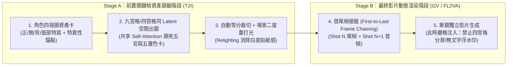
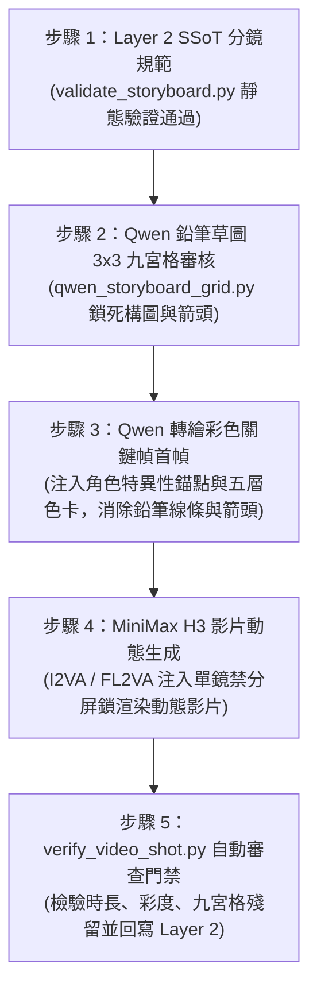

# AI 漫劇九宮格鎖臉、首尾幀接龍與跨片段連戲狀態機 (v2.0)

本手冊融合全網成熟 AI 漫劇/動態漫實戰工程、GitHub 高星專案（`HKUDS/ViMax`、`HVision-NKU/StoryDiffusion`、`ToonCrafter`）與 Lyra 場記清算體系，補齊 `cinematic-director-storyboard` 在**長序列連戲、多宮格資產鎖定與防禦性藏拙調度**上的工業管線。

---

## 一、兩階段資產管線：破解「禁止四宮格」與「多宮格鎖臉」的矛盾

在 AI 影視與漫劇製作中，「多宮格（Grid）」在不同階段具有完全相反的工程意義，必須嚴格區分：



> **本技能裁定**（`../consistency.md` §0）：九宮格只用於階段 2 的關鍵幀鎖臉；階段 6 的分鏡圖與影片一律逐鏡生成，不把九宮格裁切格直接當影片首幀。下文「共享 Self-Attention 鎖死五官」為原作者的推測，未經本 repo 實測；色卡 HEX 僅適用圖像模型，餵 H3 影片時改寫成「色名＋物體」。

### 1. Stage A：九宮格 / 四宮格同空間分鏡鎖定法 (Grid Storyboard Locking)
- **適用場景**：AI 漫劇、動態漫、缺乏獨立角色 LoRA 的多鏡頭連續敘事。
- **物理原理**：逐鏡單獨文生圖時，每次抽卡的初始高斯噪聲獨立，角色五官與衣服褶皺必漂移；而要求生圖模型（Midjourney / 即夢 / Nano Banana / GPT-Image）在**單張大圖中一次性渲染 `2x2 四宮格`（適合強衝突正反打）或 `3x3 九宮格`（適合連續動作推進）**，能強迫模型在同一個 Latent Space 與 Self-Attention 矩陣中共享角色特徵與 `lighting-color-palette-card` 的五層色階。
- **角色特異性視覺錨點（Unique Visual Anchors）**：
  - 禁用泛化詞（如「英俊青年、漂亮女孩」）。
  - 強制綁定 3 個高抗噪幾何/色彩特徵：例如 `銀白高馬尾配暗紅髮帶 + 左眼角下緋紅淚痣 + 玄黑窄袖勁裝鑲嵌青銅雲紋護腕`。
- **標準九宮格生圖 Prompt 結構**：
  > `3x3 grid cinematic storyboard sheet, 9 distinct sequential panels (Panel 1 to Panel 9, reading left-to-right, top-to-bottom), 16:9 panel ratio, thin black borders. Strictly consistent character identity across all 9 panels: [角色特異性視覺錨點]. Global color palette locked to [色卡五層 HEX 錨定]. Panel 1 (Wide, 24mm): ... Panel 2 (Medium, 50mm): ... [至 Panel 9]. No speech bubbles, no text, no watermarks.`

### 2. Stage B：首尾幀接龍與微位移控制 (First-to-Last Frame Chaining)
- **核心操作**：將九宮格裁切出的相鄰兩格（如 Panel 1 與 Panel 2）分別作為 `FL2VA`（首尾幀生影片）的 `first_frame` 與 `last_frame`；或在連續鏡頭中，截取 Shot $N$ **實際生成影片的最後一幀**作為 Shot $N+1$ 的首幀。
- **三大防撕裂鐵律**：
  1. **姿態微位移原則**：首尾兩幀的人物骨架位移不可跨越超過 1 個身位或發生 180° 瞬移翻轉（例如：不可首幀躺在地上、尾幀直接飛在半空），否則中間插幀必出現肢體融化。
  2. **手持道具守恆鎖**：若首幀角色右手持信封或長劍，尾幀必須明確交代該道具的去向（仍在手中或落在地面），否則道具會在第 2 秒半空蒸發。
  3. **單鏡生成禁分屏鎖**：進入 Stage B 生影片時，提示詞必須帶入 `single continuous camera shot, no split screen, no multi-panel grid`，防止影片模型在單鏡內又畫出多宮格。

---

## 二、動態漫與真人短劇「防禦性藏拙調度」（Defensive Cinematography）

當劇本包含長句對白，或目標模型不具備高精準原生對嘴能力時，嚴禁讓角色「正面大特寫（Frontal ECU）長篇大論說話」，必須自動啟動以下四種藏拙調度：

| 藏拙策略代號 | 鏡頭調度手法 | 視覺與心理效果 | 適用時機 |
|---|---|---|---|
| **1. 反應鏡頭借代**<br/>(`Reaction_OTS`) | 說話者背對鏡頭或處於前景虛化過肩位（佔比 25%），焦點鎖定在**聽者的面部微表情反應**（瞳孔收縮、下頜緊繃、指尖收緊）。 | 既完全避開說話者複雜口型，又透過聽者的震驚/隱忍把戲劇張力拉滿。 | 長句威脅、揭露秘密、質問對峙 |
| **2. 器物與光影遮嘴**<br/>(`Prop_Shadow_Mask`) | 利用前景或隨身道具（舉起的茶杯、展開的摺扇、高立領、面具、百葉窗暗部切片陰影）自然遮擋下半張臉，僅露雙眼。 | 眼神殺聚焦度極高，完全免除嘴部渲染風險。 | 密謀、冷笑、古風/懸疑漫劇 |
| **3. 極遠景環境留白**<br/>(`Atmospheric_EWS`) | 採用 24mm/100mm 遠景，人物在畫面中佔比 `<15%`，搭配大面積環境動態（暴雨、飄雪、落葉、車流）。 | 觀眾注意力集中在環境宿命感與底部字幕，無需看清嘴唇開合。 | 孤獨獨白、哲學感嘆、場次收尾 |
| **4. 呼吸感微動態 + 2.5D 運鏡**<br/>(`Micro_Idle_2.5D`) | 限定角色僅做微小生理動態（`胸口隨呼吸微伏、眨眼、髮絲與衣角隨風微動`），依靠攝影機急推（Snap Zoom）、震屏或焦點切換製造動感。 | 根治 AI 漫劇「人物像木頭貼紙」或「大幅度動作崩臉」的兩極病態。 | 動態漫內心獨白、殺氣釋放瞬間 |

> **【同框非主體人物保活鐵律（Background Idle Life Rule）】**：  
> 在雙人或多人同框鏡頭中，未說話或非主動作的角色**嚴禁完全靜止凍結**！必須在提示詞中為其分配一個低強度保活微動作（如：`前景的 A 保持輕微呼吸起伏，目光隨 B 的步伐微移，雙唇完全閉合`）。

---

## 三、ViMax 連戲相依狀態圖與雙模式跨切片握手 (Continuity State Machine)

為解決超過 15 秒的多切片（Multi-Clip）長篇劇本連戲崩潰，本體系整合 `HKUDS/ViMax` 的狀態相依圖與 Lyra 雙模式握手協議：

### 1. 台詞 100% 保真與「四維配音氣口順延法則」
- **台詞零篡改鐵律**：劇本有台詞則 100% 一字不差保留；無台詞則嚴禁捏造，並為畫面內所有角色加上閉唇鎖（`lips remain completely closed`）。
- **氣口順延計算公式**：
  - 常規對話語速上限：$\le 3.8$ 字/秒；壓抑/懸疑慢速（聯動 `four-dimensional-voice-acting`）：$\le 2.5$ 字/秒。
  - 當單切片台詞總字數超出當前秒數容量時，**嚴禁倍速播放或刪減台詞**！系統自動在《四維配音法》定義的**「關鍵詞前窒息停頓點（500ms 氣口）」或標點符號處切斷**，將後半句寫入 `overflow_dialogue_out`，由下一切片首鏡透過 `J-Cut`（聲音先入）無縫接續。

### 2. 雙模式跨組握手協議 (Dual-Mode Handshake)
在每個 10–15 秒切片開頭，系統自動檢測是否存在「時間跳躍（如：三天後）」或「空間跳躍（如：與此同時，另一座城市）」：
- **模式 A：同場無縫續接 (`SEAMLESS_CONTINUATION`)**：
  - **空間錨定**：使用**「實體家具/道具參照物」**（如：`B 停在【紅木辦公桌】右側邊角`）取代抽象的 XYZ 座標。
  - **視覺順接**：首鏡動作、身體朝向、手持道具狀態必須 100% 承接上一切片尾幀。
  - **聽覺橋接**：強制標註 `J-Cut`（下段台詞/音效提前 0.5s 切入上段尾幀）或 `L-Cut`（上段尾音延續至下段首鏡）。
- **模式 B：時空跳躍硬切 (`HARD_CUT_ESTABLISH`)**：
  - **自動解除順接死鎖**：不再順接上一段的肢體動作！
  - **視覺重錨**：首鏡強制使用廣角/遠景建立鏡頭（Establishing Shot）交代新空間的左/中/右與前/中/後景關係。
  - **資產繼承**：重置人物空間座標，但強制繼承角色外觀錨點（`@角色` / `<Subject N>`）與新的場景色卡。

### 3. 連戲相依狀態圖與「實測尾態 > 規劃尾態」覆蓋鐵律 (`Observed > Planned`)
- **不可逆狀態傳遞（Dependency Graph）**：一旦某鏡頭發生不可逆物理改變（如：`SH02 水杯被打翻碎裂`、`SH03 白色信封被捏出折痕`、`SH04 男主左臉受刀傷流血`），該狀態將寫入 `persistent_world_state`，後續同場景所有鏡頭自動繼承「地上有水杯碎片」、「信封帶折痕」，嚴禁道具自動復原！
- **實測觀測覆蓋（Observed End State Override）**：
  - 文字分鏡規劃的 `planned_final_state` 僅為預期值。
  - 當使用者回傳 Clip $N$ 實際生成的影片或尾幀截圖時，必須先觀測實際畫面（例如：規劃寫「A 手距信封 10cm」，但實際生成的影片最後一幀「A 已經抓住信封了」），並以 **`observed_final_state`** 覆蓋原規劃，作為 Clip $N+1$ 的唯一真實起點！

---

## 四、Qwen-Image 2.1 電影級黑白鉛筆分鏡草圖：成熟提示詞手冊與逐格拼版規範

本專節正式收錄經實測驗證（評分 **8.86/10 分**）的「Qwen-Image 2.1 Turbo 電影黑白鉛筆分鏡草圖成熟體系」，解決影視前期「文字分鏡過於抽象、直接抽卡生影片成本過高、角色走位與景別無法低成本預覽」的痛點。

### 1. Qwen-Image 2.1 Turbo 鉛筆草圖萬用骨架（5 段式英文觀察者語法）

針對本機 Qwen-Image 2.1 Turbo 引擎特性（**CFG=1.0、無負向詞、純英文第三人稱現在式客觀描述**），Prompt 必須採用五段式結構化組裝：

```text
[段落 1：媒材錨點 (Medium Anchor)]
A monochrome graphite pencil storyboard sketch on off-white paper, cinematic blocking and composition diagram.

[段落 2：景別焦段光學 (Framing & Optics)]
Cinematic framing: {framing_desc}, {lens_desc}, camera distance: {distance}.

[段落 3：空間透視滅點線 (Perspective Guidelines)]
Camera angle & blocking: {pov_desc}. Camera movement: {movement}. Spatial environment & perspective: Architectural perspective construction lines and visible vanishing point guidelines showing {anchor_objects}. Spatial layout: {blocking_desc}.

[段落 4：主體姿勢與粗黑動勢箭頭 (Kinetic Arrows & Acting)]
Character action & pose: {action_str}. Character expression: {expression}. Directional annotation: Bold black hand-drawn directional arrows indicating subject motion, action trajectory, and camera movement.

[段落 5：排線光影與純淨鎖 (Pencil Hatching & Purity Lock)]
Artistic technique: Pure grayscale pencil cross-hatching, hatching line shading, rough animatic concept art, crisp hand-drawn sketch lines, no speech bubbles, no colored elements, no text overlays, no watermarks.
```

- **焦距透視轉譯表 (Lens Optics Mapping)**：
  - `14mm`：`14mm ultra-wide perspective, strong peripheral barrel expansion and dramatic depth stretch`
  - `24mm`：`24mm wide angle perspective, exaggerated near-to-far spatial scaling and rapid linear convergence`
  - `35mm`：`35mm natural environmental wide perspective, balanced human-to-space spatial relationship`
  - `50mm`：`50mm true-to-life standard prime perspective, zero geometric distortion, human eye natural depth`
  - `85mm`：`85mm portrait telephoto compression, shallow depth of field isolating subject from soft blurred background`
  - `100mm`：`100mm telephoto macro compression, background heavily flattened and stacked against subject profile`
  - `135mm`：`135mm extreme telephoto compression, razor-thin focal plane and monumental background stacking`

---

### 2. 9 大標準分鏡鏡位即抄即用 Prompt 模板庫

本庫收錄 9 種最核心的電影級分鏡鏡位，Agent 為任何新場景建立九宮格分鏡表（`panel-01` 至 `panel-09`）時可直接套用並填入具體走位與角色名：

#### 鏡位 1：大遠景空間建立 (ELS 24mm Establishing Shot)
> **適用**：場景開端、世界觀震撼交代、環境壓迫感。  
> **Prompt 模板**：  
> `A monochrome graphite pencil storyboard sketch on off-white paper, cinematic blocking and composition diagram. Cinematic framing: Extreme Long Shot (ELS), environmental scale establishing shot, 24mm wide angle perspective, exaggerated near-to-far spatial scaling and rapid linear convergence, camera distance: >10m distant overview. Camera angle & blocking: High-angle objective overview looking down at the environment, establishing spatial geometry. Camera movement: Slow drifting crane shot. Spatial environment & perspective: Architectural perspective construction lines and two distinct visible vanishing point guidelines showing the expansive courtyard, fortress gates, and distant mountain ridges. Character action & pose: Tiny silhouettes of characters standing near the central gateway, establishing scale relative to architecture. Character expression: Distant figures without detailed facial features. Directional annotation: Bold black hand-drawn directional arrows indicating the wind vector blowing across the courtyard and the forward marching trajectory of approaching riders. Artistic technique: Pure grayscale pencil cross-hatching, atmospheric perspective shading, rough animatic concept art, crisp hand-drawn sketch lines, no speech bubbles, no colored elements, no text overlays, no watermarks.`

#### 鏡位 2：中景橫移跟拍 (MS 35mm Tracking Shot)
> **適用**：角色行進、空間過渡、自然對白。  
> **Prompt 模板**：  
> `A monochrome graphite pencil storyboard sketch on off-white paper, cinematic blocking and composition diagram. Cinematic framing: Medium Shot (MS), character framed from waist up in spatial context, 35mm natural environmental wide perspective, balanced human-to-space spatial relationship, camera distance: 2.5m medium distance. Camera angle & blocking: Eye-level lateral tracking shot adhering strictly to 180-degree axis line, subject moving parallel to film plane. Camera movement: Dynamic lateral tracking dolly moving synchronously left-to-right. Spatial environment & perspective: One-point perspective corridor guidelines receding towards frame right, vertical columns creating natural depth slats. Spatial layout: Subject moving past recurring structural pillars. Character action & pose: Walking forward with brisk determined stride, cloak trailing backwards, right hand hovering near concealed blade. Character expression: Resolute expression, sharp forward-fixed gaze, tight jawline. Directional annotation: Bold black hand-drawn directional arrows indicating subject's linear walking path from left to right, with double horizontal arrows tracking camera dolly movement. Artistic technique: Pure grayscale pencil cross-hatching, hatching line shading on side shadows, rough animatic concept art, crisp hand-drawn sketch lines, no speech bubbles, no colored elements, no text overlays, no watermarks.`

#### 鏡位 3：過肩對峙 (OTS 50mm Confrontation)
> **適用**：雙人言詞交鋒、談判、壓抑對峙。  
> **Prompt 模板**：  
> `A monochrome graphite pencil storyboard sketch on off-white paper, cinematic blocking and composition diagram. Cinematic framing: Over-The-Shoulder Medium Shot (OTS_MS), 50mm true-to-life standard prime perspective, zero geometric distortion, human eye natural depth, camera distance: 1.8m dialogic distance. Camera angle & blocking: Defensive OTS composition past the dark out-of-focus silhouette of Foreground Speaker A's shoulder occupying 25% of left frame; sharp focal plane locked on Opposite Speaker B positioned on the right third line. Camera movement: Static locked frame maintaining tense standoff. Spatial environment & perspective: Background interior room perspective grid converging behind Speaker B, soft tonal hatching isolating characters. Spatial layout: Strict 180-degree axis placement across a long wooden table. Character action & pose: Foreground A remains rigid in dark silhouette; Background B leans slightly forward, palms flat against table surface. Character expression: Speaker B exhibiting piercing suspicious squint, tight contemptuous mouth posture. Directional annotation: Bold black hand-drawn double-ended directional arrow between both heads indicating intense unbroken eyeline tension; curved arrow showing B's subtle forward torso lean. Artistic technique: Pure grayscale pencil cross-hatching, foreground silhouette shading in dense graphite tone, crisp hand-drawn sketch lines, no speech bubbles, no colored elements, no text overlays, no watermarks.`

#### 鏡位 4：情緒眼神特寫 (CU 85mm Emotional Close-Up)
> **適用**：內心震驚、隱忍咬牙、情感決裂。  
> **Prompt 模板**：  
> `A monochrome graphite pencil storyboard sketch on off-white paper, cinematic blocking and composition diagram. Cinematic framing: Close-Up (CU), tight framing from collarbone to crown, 85mm portrait telephoto compression, shallow depth of field isolating subject from soft blurred background, camera distance: 1.0m intimate distance. Camera angle & blocking: Slight three-quarter angle at subject's eye level, subject placed off-center following rule-of-thirds. Camera movement: Imperceptible micro-creep zoom into subject's eye plane. Spatial environment & perspective: Heavily out-of-focus background with minimal faint perspective hints, emphasizing subject psychological isolation. Character action & pose: Head held upright, throat swallowing in repressed tension, fingers brushing against lower jaw. Character expression: Intense emotional conflict, dilated pupils with pencil highlight reflection, trembling lower eyelids, teeth clenching under closed lips. Directional annotation: Bold black hand-drawn directional arrows indicating slight upward tilt of chin and downward eye dart, small circular arrow highlighting temple tension. Artistic technique: Fine graphite pencil hatching, delicate skin texture cross-hatching, expressive linework around eyes and lips, rough animatic concept art, crisp hand-drawn sketch lines, no speech bubbles, no colored elements, no text overlays, no watermarks.`

#### 鏡位 5：極端特寫局部推進 (ECU 85mm Dramatic Macro Push)
> **適用**：瞳孔收縮、殺氣爆發、秘密線索瞬間聚焦。  
> **Prompt 模板**：  
> `A monochrome graphite pencil storyboard sketch on off-white paper, cinematic blocking and composition diagram. Cinematic framing: Extreme Close-Up (ECU), macro horizontal framing cropped closely across eyes and nose bridge, 85mm portrait telephoto compression with razor-thin depth of field, camera distance: 0.4m macro proximity. Camera angle & blocking: Frontal direct eye level, subject's gaze breaking cinematic tension by piercing into lens axis. Camera movement: Rapid snap push-in towards the right pupil. Spatial environment & perspective: Completely obliterated background bokeh, pure focus on optical textures. Character action & pose: Sudden widening of eyelids revealing shock and sudden realization, faint sweat bead pencil stippling on brow. Character expression: Sudden psychological breakthrough, intense dilated pupil with sharp graphite reflection catchlight. Directional annotation: Bold black hand-drawn converging arrows pointing symmetrically into the pupil center indicating sudden focus snap. Artistic technique: High-contrast graphite pencil rendering, razor-sharp iris linework, soft tonal skin shading, rough animatic concept art, crisp hand-drawn sketch lines, no speech bubbles, no colored elements, no text overlays, no watermarks.`

#### 鏡位 6：武戲 90° 側面無遮擋交鋒 (MS 50mm Perpendicular Impact)
> **適用**：刀劍碰撞、重拳擊中、瞬間打擊（強制 90° 無遮擋，嚴禁 Dirty Frame）。  
> **Prompt 模板**：  
> `A monochrome graphite pencil storyboard sketch on off-white paper, cinematic blocking and composition diagram. Cinematic framing: Medium Shot (MS), two combating figures framed from knees to head, 50mm true-to-life standard prime perspective, zero geometric distortion, camera distance: 3.5m combat safe zone. Camera angle & blocking: Strict 90-degree perpendicular side profile view (clear_impact_90deg), completely unobstructed line of action exposing exact contact point between weapon blade and defensive forearm guard. Camera movement: Dynamic micro-shake at impact instant. Spatial environment & perspective: Horizontal ground line perspective grid with radiating impact shockwave guidelines along the floor. Spatial layout: Left fighter lunging forward, right fighter bracing back in defensive parry. Character action & pose: Left attacker delivering a high overhead diagonal saber strike; right defender crossing bracers to deflect the blow at chest level, muscles taut. Character expression: Straining battle grimaces, bared teeth under breath exertion, focused combat glare. Directional annotation: Bold black hand-drawn high-velocity motion arrows along the saber trajectory path; radiating starburst impact arrows erupting from the contact point; backward recoil vector arrow beneath defender's heel. Artistic technique: Dynamic gestural pencil strokes, aggressive kinetic speed lines, dense graphite hatching on strained musculature, crisp hand-drawn sketch lines, no speech bubbles, no colored elements, no text overlays, no watermarks.`

#### 鏡位 7：低角度壓迫仰拍 (CU 24mm Low-Angle Oppression)
> **適用**：反派登場、絕對支配、威壓恐嚇。  
> **Prompt 模板**：  
> `A monochrome graphite pencil storyboard sketch on off-white paper, cinematic blocking and composition diagram. Cinematic framing: Close-Up (CU), towering torso and head framing, 24mm wide angle perspective, exaggerated upward geometric convergence and dominant near-to-far distortion, camera distance: 0.8m low proximity. Camera angle & blocking: Extreme low-angle worm's-eye perspective looking steeply upwards at the towering antagonist, head framed against the ceiling vault. Camera movement: Slow intimidating upward tilt. Spatial environment & perspective: Vaulted ceiling ribs converging steeply upwards into a high vanishing point, creating an oppressive pyramidal composition. Spatial layout: Dominant figure looming directly over the camera lens. Character action & pose: Shoulders squared, chin tilted downward while looking down upon the viewer with cold condescension, one hand raised clasping a ceremonial token. Character expression: Arrogant ruthless half-smile, heavy lidded eyes looking downwards with supreme disdain. Directional annotation: Bold black hand-drawn upward expansion arrows along the shoulders emphasizing towering dominance; downward pointing gaze arrow bearing down on the viewer. Artistic technique: Bold sculptural graphite pencil shading, strong chiaroscuro contrast between lighted face plane and deep hatched neck shadow, crisp hand-drawn sketch lines, no speech bubbles, no colored elements, no text overlays, no watermarks.`

#### 鏡位 8：微距道具細節 (ECU 100mm Prop Focus)
> **適用**：信封拆封、鑰匙插入、握緊玉佩、微觀物理反應。  
> **Prompt 模板**：  
> `A monochrome graphite pencil storyboard sketch on off-white paper, cinematic blocking and composition diagram. Cinematic framing: Extreme Close-Up (ECU), macro prop detail framing, 100mm telephoto macro compression, paper-thin depth of field, camera distance: 0.3m macro proximity. Camera angle & blocking: High 45-degree top-down angled close view centered on a hand interacting with a critical narrative object. Camera movement: Static locked macro shot with minute focus rack. Spatial environment & perspective: Blurred desktop wood grain receding in shallow diagonal lines. Spatial layout: An ancient stamped wax seal on a folded parchment letter held by trembling gloved fingers. Character action & pose: Right gloved thumb peeling back the cracked red wax seal, paper fiber tearing along the crease line. Character expression: Non-facial shot; performance expressed entirely through the trembling hesitation of finger knuckles. Directional annotation: Bold black hand-drawn curved arrow indicating the upward peeling motion of the thumb; dashed circle highlighting the fractured seal emblem. Artistic technique: Highly detailed graphite pencil texturing, delicate paper crease shading, sharp tactile cross-hatching on wax fragments, crisp hand-drawn sketch lines, no speech bubbles, no colored elements, no text overlays, no watermarks.`

#### 鏡位 9：遠景背影留白收尾 (LS 35mm Lingering Outro)
> **適用**：片段結尾、轉場空鏡、餘韻收尾。  
> **Prompt 模板**：  
> `A monochrome graphite pencil storyboard sketch on off-white paper, cinematic blocking and composition diagram. Cinematic framing: Long Shot (LS), full solitary figure framed from behind in vast environment, 35mm natural environmental wide perspective, balanced human-to-space spatial relationship, camera distance: 7.0m distant framing. Camera angle & blocking: Eye-level central back-view perspective (subject back to camera), strictly centered along the vanishing perspective line. Camera movement: Slow pulling-back dolly lingering as distance increases. Spatial environment & perspective: Single central vanishing point grid on an endless desolate road extending to the horizon; barren trees framing the left and right borders. Spatial layout: Solitary figure walking directly away from camera into the distant horizon. Character action & pose: Solitary figure walking away with slow measured paces, long coat billowing gently in the wind, hands buried in pockets. Character expression: Back to camera; posture conveying profound solitude, weight of consequence, and quiet acceptance. Directional annotation: Bold black hand-drawn straight directional arrow pointing directly forward along the road towards the horizon vanishing point; subtle wavy arrows showing coat hem movement. Artistic technique: Atmospheric graphite pencil wash shading, soft horizon blending, textured pencil strokes on road ruts, crisp hand-drawn sketch lines, no speech bubbles, no colored elements, no text overlays, no watermarks.`

---

### 3. 「分鏡 Layer 2 → Qwen 鉛筆草圖審核 → Qwen 彩色關鍵幀首幀 → H3 影片提示詞」四步無損轉換鐵律

在 AI 動態漫與影視工業管線中，分鏡至影片的生成**嚴禁跨步跳躍**，必須嚴格執行以下四步確定性轉換：



1. **步驟 1：Layer 2 SSoT 規格鎖定**：
   - 導演編寫並通過 `scripts/storyboard/validate_storyboard.py` 檢查，確認時長守恆、台詞零篡改、無醫學解剖黑名單、無遮擋衝突。
2. **步驟 2：Qwen 鉛筆草圖逐格生成與九宮格審核**：
   - 使用 `scripts/storyboard/qwen_storyboard_grid.py` 逐格生成 `panel-0{1..9}-{shot_id}.png`，拼合成 `grid-{segment_id}.png`。
   - 導演/人工審查員（HITL）簽核走位、焦距透視滅點與動態粗黑箭頭。
3. **步驟 3：Qwen 彩色關鍵幀首幀轉繪（消除黑白線條與動勢箭頭）**：
   - 審核通過後，生圖引擎根據通過的草圖構圖，重新以「彩色正片風格」出圖。
   - 注入角色特異性視覺錨點（`Unique Visual Anchors`）與 `lighting-color-palette-card` 的五層色卡。
   - **關鍵操作**：移除草圖中的鉛筆排線、透視輔助線與黑色粗箭頭，輸出純淨、高解析度的單張彩色關鍵幀首幀（`first_frame.png`）。
4. **步驟 4：MiniMax H3 影片動態生成（注入單鏡禁分屏鎖）**：
   - 將彩色關鍵幀作為 `first_frame` 輸入 H3 `I2VA` 或首尾幀輸入 `FL2VA`。
   - H3 提示詞中**必須強制加入禁分屏鎖定詞**：`single continuous shot, no split screen, no multi-panel grid, no watermark, no text overlay`。
   - 輸出標準 MP4 動態影片。
5. **步驟 5：影片自動審查門禁 (`verify_video_shot.py`)**：
   - 自動檢驗影片時長（誤差 $\le 0.5\text{s}$）、平均彩度（$C^* \ge 10.0$）、九宮格邊界殘留（$1/3, 2/3$ 無暗黑格線）。
   - 檢驗通過自動寫入 `shots[].review` 並鎖定；檢驗未通過自動退稿拒絕進入下階段！

> [!CAUTION]
> #### ⛔ 工業管線絕對禁忌：嚴禁黑白鉛筆九宮格直餵 H3！
> 絕對禁止將「黑白鉛筆草圖」或「3x3 九宮格拼版圖」直接作為參考圖或首幀餵入 MiniMax H3（`I2VA` / `Ref2VA`）！
> 1. **黑白污染慘劇**：直接餵黑白草圖會導致 H3 生成全片灰階褪色，平均彩度 $C^* < 10.0$，喪失全部色彩動態。
> 2. **分屏魔幻動畫**：直接餵九宮格會導致 H3 將九宮格當作分屏畫布，在畫面中留下明顯的 $1/3, 2/3$ 黑線隔線，並在各小格子內獨立跳動。
> 
> 此兩種違規行為均已被 `verify_video_shot.py` 納入確定性攔截規則（`STYLE_BLEED_GRAYSCALE` 與 `GRID_PANEL_BORDER_DETECTED`），一旦檢出將立即自動觸發退稿！

