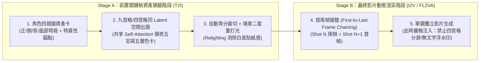

# AI 漫劇九宮格鎖臉、首尾幀接龍與跨片段連戲狀態機 (v2.0)

本手冊融合全網成熟 AI 漫劇/動態漫實戰工程、GitHub 高星專案（`HKUDS/ViMax`、`HVision-NKU/StoryDiffusion`、`ToonCrafter`）與 Lyra 場記清算體系，補齊 `cinematic-director-storyboard` 在**長序列連戲、多宮格資產鎖定與防禦性藏拙調度**上的工業管線。

---

## 一、兩階段資產管線：破解「禁止四宮格」與「多宮格鎖臉」的矛盾

在 AI 影視與漫劇製作中，「多宮格（Grid）」在不同階段具有完全相反的工程意義，必須嚴格區分：

> **本技能裁定**（`../consistency.md` §0）：九宮格只用於階段 2 的關鍵幀鎖臉；階段 6 的分鏡圖與影片一律逐鏡生成，不把九宮格裁切格直接當影片首幀。下文「共享 Self-Attention 鎖死五官」為原作者的推測，未經本 repo 實測；色卡 HEX 僅適用圖像模型，餵 H3 影片時改寫成「色名＋物體」。

### 1. Stage A：九宮格 / 四宮格同空間分鏡鎖定法 (Grid Storyboard Locking)
- **適用場景**：AI 漫劇、動態漫、缺乏獨立角色 LoRA 的多鏡頭連續敘事。
- **物理原理**：逐鏡單獨文生圖時，每次抽卡的初始高斯噪聲獨立，角色五官與衣服褶皺必漂移；而要求生圖模型（Midjourney / 即夢 / Nano Banana / GPT-Image）在**單張大圖中一次性渲染 `2x2 四宮格`（適合強衝突正反打）或 `3x3 九宮格`（適合連續動作推進）**，能強迫模型在同一個 Latent Space 與 Self-Attention 矩陣中共享角色特徵與 `lighting-color-palette-card` 的五層色階。
- **角色特異性視覺錨點（Unique Visual Anchors）**：
  - 禁用泛化詞（如「英俊青年、漂亮女孩」）。
  - 強制綁定 3 個高抗噪幾何/色彩特徵：例如 `銀白高馬尾配暗紅髮帶 + 左眼角下緋紅淚痣 + 玄黑窄袖勁裝鑲嵌青銅雲紋護腕`。
- **標準九宮格生圖 Prompt 結構**：
  > `3x3 grid cinematic storyboard sheet, 9 distinct sequential panels (Panel 1 to Panel 9, reading left-to-right, top-to-bottom), 16:9 panel ratio, thin black borders. Strictly consistent character identity across all 9 panels: [角色特異性視覺錨點]. Global color palette locked to [色卡五層 HEX 錨定]. Panel 1 (Wide, 24mm): ... Panel 2 (Medium, 50mm): ... [至 Panel 9]. No speech bubbles, no text, no watermarks.`

### 2. Stage B：首尾幀接龍與微位移控制 (First-to-Last Frame Chaining)
- **核心操作**：將九宮格裁切出的相鄰兩格（如 Panel 1 與 Panel 2）分別作為 `FL2VA`（首尾幀生影片）的 `first_frame` 與 `last_frame`；或在連續鏡頭中，截取 Shot $N$ **實際生成影片的最後一幀**作為 Shot $N+1$ 的首幀。
- **三大防撕裂鐵律**：
  1. **姿態微位移原則**：首尾兩幀的人物骨架位移不可跨越超過 1 個身位或發生 180° 瞬移翻轉（例如：不可首幀躺在地上、尾幀直接飛在半空），否則中間插幀必出現肢體融化。
  2. **手持道具守恆鎖**：若首幀角色右手持信封或長劍，尾幀必須明確交代該道具的去向（仍在手中或落在地面），否則道具會在第 2 秒半空蒸發。
  3. **單鏡生成禁分屏鎖**：進入 Stage B 生影片時，提示詞必須帶入 `single continuous camera shot, no split screen, no multi-panel grid`，防止影片模型在單鏡內又畫出多宮格。

---

## 二、動態漫與真人短劇「防禦性藏拙調度」（Defensive Cinematography）

當劇本包含長句對白，或目標模型不具備高精準原生對嘴能力時，嚴禁讓角色「正面大特寫（Frontal ECU）長篇大論說話」，必須自動啟動以下四種藏拙調度：

| 藏拙策略代號 | 鏡頭調度手法 | 視覺與心理效果 | 適用時機 |
|---|---|---|---|
| **1. 反應鏡頭借代** (`Reaction_OTS`) | 說話者背對鏡頭或處於前景虛化過肩位（佔比 25%），焦點鎖定在**聽者的面部微表情反應**（瞳孔收縮、下頜緊繃、指尖收緊）。 | 既完全避開說話者複雜口型，又透過聽者的震驚/隱忍把戲劇張力拉滿。 | 長句威脅、揭露秘密、質問對峙 |
| **2. 器物與光影遮嘴** (`Prop_Shadow_Mask`) | 利用前景或隨身道具（舉起的茶杯、展開的摺扇、高立領、面具、百葉窗暗部切片陰影）自然遮擋下半張臉，僅露雙眼。 | 眼神殺聚焦度極高，完全免除嘴部渲染風險。 | 密謀、冷笑、古風/懸疑漫劇 |
| **3. 極遠景環境留白** (`Atmospheric_EWS`) | 採用 24mm/100mm 遠景，人物在畫面中佔比 `<15%`，搭配大面積環境動態（暴雨、飄雪、落葉、車流）。 | 觀眾注意力集中在環境宿命感與底部字幕，無需看清嘴唇開合。 | 孤獨獨白、哲學感嘆、場次收尾 |
| **4. 呼吸感微動態 + 2.5D 運鏡** (`Micro_Idle_2.5D`) | 限定角色僅做微小生理動態（`胸口隨呼吸微伏、眨眼、髮絲與衣角隨風微動`），依靠攝影機急推（Snap Zoom）、震屏或焦點切換製造動感。 | 根治 AI 漫劇「人物像木頭貼紙」或「大幅度動作崩臉」的兩極病態。 | 動態漫內心獨白、殺氣釋放瞬間 |

> **【同框非主體人物保活鐵律（Background Idle Life Rule）】**：  
> 在雙人或多人同框鏡頭中，未說話或非主動作的角色**嚴禁完全靜止凍結**！必須在提示詞中為其分配一個低強度保活微動作（如：`前景的 A 保持輕微呼吸起伏，目光隨 B 的步伐微移，雙唇完全閉合`）。

---

## 三、ViMax 連戲相依狀態圖與雙模式跨切片握手 (Continuity State Machine)

為解決超過 15 秒的多切片（Multi-Clip）長篇劇本連戲崩潰，本體系整合 `HKUDS/ViMax` 的狀態相依圖與 Lyra 雙模式握手協議：

### 1. 台詞 100% 保真與「四維配音氣口順延法則」
- **台詞零篡改鐵律**：劇本有台詞則 100% 一字不差保留；無台詞則嚴禁捏造，並為畫面內所有角色加上閉唇鎖（`lips remain completely closed`）。
- **氣口順延計算公式**：
  - 常規對話語速上限：$\le 3.8$ 字/秒；壓抑/懸疑慢速（聯動 `four-dimensional-voice-acting`）：$\le 2.5$ 字/秒。
  - 當單切片台詞總字數超出當前秒數容量時，**嚴禁倍速播放或刪減台詞**！系統自動在《四維配音法》定義的**「關鍵詞前窒息停頓點（500ms 氣口）」或標點符號處切斷**，將後半句寫入 `overflow_dialogue_out`，由下一切片首鏡透過 `J-Cut`（聲音先入）無縫接續。

### 2. 雙模式跨組握手協議 (Dual-Mode Handshake)
在每個 10–15 秒切片開頭，系統自動檢測是否存在「時間跳躍（如：三天後）」或「空間跳躍（如：與此同時，另一座城市）」：
- **模式 A：同場無縫續接 (`SEAMLESS_CONTINUATION`)**：
  - **空間錨定**：使用**「實體家具/道具參照物」**（如：`B 停在【紅木辦公桌】右側邊角`）取代抽象的 XYZ 座標。
  - **視覺順接**：首鏡動作、身體朝向、手持道具狀態必須 100% 承接上一切片尾幀。
  - **聽覺橋接**：強制標註 `J-Cut`（下段台詞/音效提前 0.5s 切入上段尾幀）或 `L-Cut`（上段尾音延續至下段首鏡）。
- **模式 B：時空跳躍硬切 (`HARD_CUT_ESTABLISH`)**：
  - **自動解除順接死鎖**：不再順接上一段的肢體動作！
  - **視覺重錨**：首鏡強制使用廣角/遠景建立鏡頭（Establishing Shot）交代新空間的左/中/右與前/中/後景關係。
  - **資產繼承**：重置人物空間座標，但強制繼承角色外觀錨點（`@角色` / `<Subject N>`）與新的場景色卡。

### 3. 連戲相依狀態圖與「實測尾態 > 規劃尾態」覆蓋鐵律 (`Observed > Planned`)
- **不可逆狀態傳遞（Dependency Graph）**：一旦某鏡頭發生不可逆物理改變（如：`SH02 水杯被打翻碎裂`、`SH03 白色信封被捏出折痕`、`SH04 男主左臉受刀傷流血`），該狀態將寫入 `persistent_world_state`，後續同場景所有鏡頭自動繼承「地上有水杯碎片」、「信封帶折痕」，嚴禁道具自動復原！
- **實測觀測覆蓋（Observed End State Override）**：
  - 文字分鏡規劃的 `planned_final_state` 僅為預期值。
  - 當使用者回傳 Clip $N$ 實際生成的影片或尾幀截圖時，必須先觀測實際畫面（例如：規劃寫「A 手距信封 10cm」，但實際生成的影片最後一幀「A 已經抓住信封了」），並以 **`observed_final_state`** 覆蓋原規劃，作為 Clip $N+1$ 的唯一真實起點！
