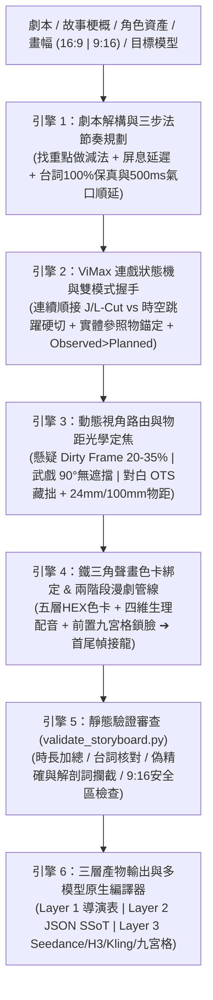
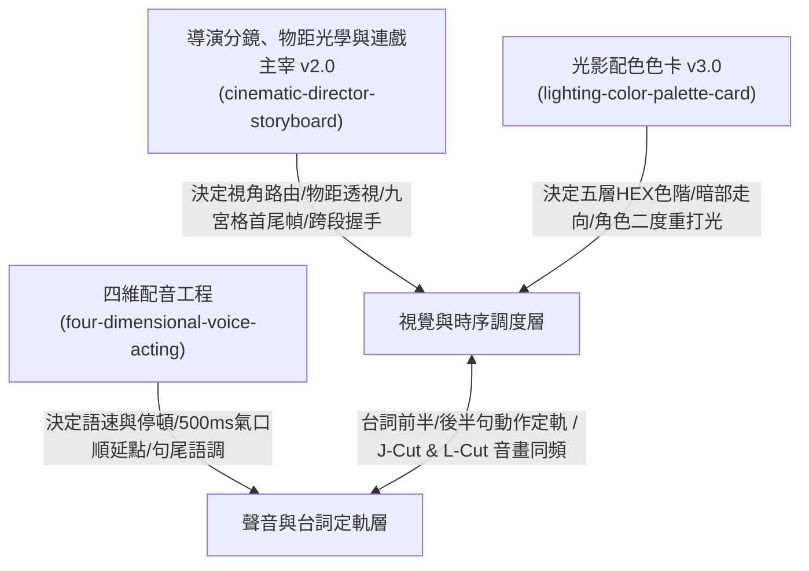

# 導演分鏡體系（cinematic-director-storyboard v2.0）— 本技能階段 4 的完整規範

> **適用範圍**：本文包含通用導演方法與歷史模型／專案案例，具體工具能力、stage gate、H3 Ref2VA 編譯和工作流程以本 repo 的 `../../SKILL.md` 與 `../pipeline.md` 為準。不得把單一作品或舊模型測試數字當成普遍硬規則。需要圖片時，stage 4 構圖可由 Qwen、手繪或其他工具提供並按同一 shot 對應規範審核；純文字分鏡可直接交付 draft。

> **本 repo 的裁定**：色卡 HEX 用於內部色彩記錄與驗收；餵 H3 時改寫成「色名＋物體」（見 `../consistency.md` §0）。Ref2VA 的場景圖是場景／畫風參考，不代表首幀鎖定。首幀、尾幀或續接模式只在指定模型和當前 adapter 確實支援時採用。音色與情緒以可聽描述為主，不寫不可驗證的生理數值。

> 上游來源：E:\MinimaxH3\影片分鏡大師\cinematic-director-storyboard v2.0。
> 本 repo 對應說明：《四維配音法》（four-dimensional-voice-acting）與《光影配色色卡》（lighting-color-palette-card）未收錄於本 repo。本 repo 的對應為：聲音 → `references/h3/audio-and-dialogue.md` + `references/h3/audio-pipeline.md`；光影配色 → `references/h3/lighting-and-color.md`。

# 影視與 AI 漫劇雙棲導演分鏡、鏡頭光學與連戲主宰體系 (Cinematic Director Storyboard v2.0)

> **導演的核心真理（v2.0 鐵律）**：
> 1. **分鏡不是流水帳，而是替觀眾決定「看什麼」與「什麼時候看」**：減去冗餘只留戲核（找重點）➔ 水杯/鏡面倒影延遲滿足（找節奏）➔ 動態視角路由（懸疑用 `Dirty Frame 20%~35% 前景遮擋`；武戲碰撞瞬間強制切 `90° 垂直軸線無遮擋`；高風險對白用 `過肩反應鏡頭 Reaction OTS 藏拙`）。
> 2. **焦距的本質是「物理物距」**：AI 不懂抽象的「大片感」，但嚴格服從「鏡頭焦距 + 攝影機物理物距（`<0.5m` vs `>6m`）+ 光圈景深 + 五層 HEX 色卡錨點」。
> 3. **兩階段資產鎖定與實測連戲閉環**：前置關鍵幀階段善用「九宮格/四宮格同 Latent Space 一次出圖鎖臉 + 角色二度重打光」；最終影片階段嚴禁分屏，採「首尾幀接龍（FL2VA）」與 **`Observed End State > Planned State`（實測尾幀覆蓋規劃尾幀）**。
> 4. **三層產物分離，拒絕語義污染**：人類審閱看結構化表格與六要素卡（Layer 1），系統校驗用 JSON SSoT（Layer 2），餵給影片模型則必須剔除所有審計標籤、醫學解剖詞（如眼輪匝肌）與毫米級偽精確數值（如 3mm），編譯為目標模型的高信噪比原生語法（Layer 3）。

---

## 一、何時調用本 Skill (Trigger Scenarios)

當使用者或上游智能體（Agent）面臨以下創作場景時，必須啟動本 Skill：
- **劇本拆分鏡 / 小說改編 AI 短劇或動態漫**：需要從劇本生成不漏情節、台詞 100% 保真、具備電影呼吸節奏與跨片段連戲的分鏡腳本。
- **AI 視頻分鏡流水帳、平淡無奇或等長碎剪**：需要運用「分鏡三步法」重構戲劇張力與懸念。
- **無焦點、空間扁平像 2D 貼紙**：寫了 `24mm` 或 `100mm` 卻無透視感，需補齊物理物距與前景層次。
- **角色跨鏡頭變臉、換裝或口型融化崩壞**：需要啟動「九宮格鎖臉 + 首尾幀接龍 + 防禦性藏拙調度（Reaction Shot / 2.5D 微動態）」。
- **高速戰鬥與動作碰撞穿模**：需要「武戲四步走（蓄力→出擊→接觸→反應 ≤5 階段）+ 90° 接觸點垂直無遮擋法則」。
- **多模型提示詞編譯與三位一體聯動**：需輸出適配 **Seedance 2.0、MiniMax H3、Kling、Runway** 的原生 Prompt，並與 `four-dimensional-voice-acting` 及 `lighting-color-palette-card` 深度協同。

---

## 二、v2.0 端到端六大核心引擎與 9 級規則優先級



### 規則衝突 9 級優先級（Authority Order，由高至低）
當規則發生衝突時，低優先級規則必須讓渡並顯式說明，絕不可靜默覆蓋高優先級規則：
1. **Tier 1｜安全與合規底線**
2. **Tier 2｜目標模型的硬性技術邊界**（單次時長上限、FL2VA 與 Ref2VA 互斥、無獨立 Negative 欄等）
3. **Tier 3｜使用者的顯式不可妥協指令**
4. **Tier 4｜劇本核心事件與台詞 100% 一字不差保真**（超載必走氣口順延，嚴禁刪詞或倍速）
5. **Tier 5｜資產契約與跨片段連戲**（`Observed End State > Planned State`、角色特異性錨點、五層色卡鎖定）
6. **Tier 6｜物理因果與動作清晰度**（武戲接觸瞬間 `90° 無遮擋` 優先於 `Dirty Frame 遮擋` 與花哨運鏡！）
7. **Tier 7｜攝影調度與畫幅幾何語法**（180° 軸線、30° 變化、9:16 前後景縱深交錯與 UI 安全區）
8. **Tier 8｜可見五官微表演與動作尾韻微物理**（衣角下墜、髮絲微動、同框非主體呼吸保活）
9. **Tier 9｜Skill 預設習慣**

---

## 三、標準執行作業程序 (SOP v2.0)

### 步驟 1：劇本解構、戲核減法與台詞氣口切分
1. **廢除等長碎剪**：不再機械式強迫「15 秒 ≥6 鏡」，依節奏檔位動態分配：
   - `Slow_Cinematic（懸疑/文藝）`：15s 分配 2–4 鏡（交代動作 1.5s 極速掠過，戲核與屏息拉長至 4.5–7s）。
   - `Standard_Narrative（標準敘事）`：15s 分配 4–6 鏡（2.5–4.0s/鏡）。
   - `Fast_ShortDrama（直式短劇/高燃打鬥）`：15s 分配 6–8 鏡（1.5–2.5s/鏡，0.0s 首幀即衝突 Hook）。
2. **台詞 100% 保真與氣口順延**：原封不動保留劇本台詞。若台詞字數超出語速上限（常速 $\le 3.8$ 字/秒，壓抑慢速 $\le 2.5$ 字/秒），自動在《四維配音法》定義的**「關鍵詞前 500ms 窒息停頓點」或標點處切斷**，順延至下一切片首鏡以 `J-Cut` 接續。

### 步驟 2：跨切片雙模式握手與實體空間錨定
1. **檢測場景邊界**：
   - **同場連續 (`SEAMLESS_CONTINUATION`)**：首鏡承接上段尾幀（若有實測影片，強制以 `Observed End State` 覆蓋規劃態），使用 `J-Cut / L-Cut` 橋接聲音，並以**場景實體家具/道具**錨定站位（如：`站在【紅木辦公桌】右側邊角`）。
   - **時空跳躍 (`HARD_CUT_ESTABLISH`)**：遇到「三天後 / 另一邊」，自動解除動作順接，首鏡改用廣角建立鏡頭重立空間，僅繼承角色外觀錨點與色卡。
2. **連戲狀態相依圖（State Graph）**：任何不可逆狀態變化（水杯碎裂、信封捏皺、角色受傷）強制寫入持久化狀態並傳遞給後續所有鏡頭。

### 步驟 3：心理節奏延遲與「視角/遮擋三路動態路由」
1. **心理預期延遲（找節奏）**：在關鍵揭示前插入 1~1.5 秒「心理屏息載體」（如水杯震顫倒影、茶水滿溢、落葉撕扯）。
2. **視角與遮擋三路動態路由（找關係）**：
   - **路線 A（懸疑/窺視/密談）** ➔ 啟用 **`Dirty Frame POV`**：前景門框/百葉窗/杯沿劇烈失焦遮擋畫面 **20% ~ 35%（黃金面積比）**。
   - **路線 B（武戲碰撞/關鍵道具交接）** ➔ 啟用 **`90° 垂直軸線無遮擋（Clear Impact Frame）`**：強制撤除前景遮擋！機位與發力軸線垂直（正側面/斜 45°），按 `蓄力 ➔ 出擊 ➔ 接觸瞬間 ➔ 受力回饋`（單鏡 $\le 5$ 階段）完整呈現打擊點、火花與地面摩擦。
   - **路線 C（長句對白/漫劇防崩臉）** ➔ 啟用 **`防禦性藏拙調度`**：改用過肩拍聽者反應（Reaction OTS）、器物/陰影遮嘴，並為同框未說話角色加上**呼吸保活微動作（Idle Life）**與**閉唇鎖（`lips remain completely closed`）**。
3. **畫幅幾何適配（`16:9` vs `9:16`）**：`9:16` 嚴禁水平寬幅並排，強制改為「前後景縱深交錯（Depth Stacking）」、中近景/特寫 $\ge 70\%$，並避開底部 20% 字幕與右側 15% UI 安全區。

### 步驟 4：焦距 × 物理物距光學精確配對
嚴禁單寫焦段毫米數，必須同時寫入**物理物距与透視幾何**（詳見 [`lens-optics-physics.md`](./lens-optics-physics.md)）：

| 目標戲劇氛圍與靈魂站位 | 鏡頭焦距 | 攝影機物理物距 | 光圈景深與防呆邊界 | 畫面透視本質 |
| :--- | :--- | :--- | :--- | :--- |
| **【參與者】環境壓迫、肉搏衝擊、空間拉伸** | **24mm** | **`< 0.5 公尺`（極近貼近）** 或 **`> 10 公尺`** | f/8~f/11 大景深；**主角臉部嚴格鎖在內圈 60% 防邊緣拉臉** | 近大遠小極致誇張，地表/牆面幾何線條向遠方劇烈匯聚延伸 |
| **【見證者】客觀敘事、沉浸對話、真實比例** | **35mm / 50mm** | **`1.5 ~ 2.5 公尺`（自然社交距離）** | 中等景深，適度柔和虛化 | 符合人眼自然透視，無畸變，前後景比例真實協調 |
| **【觀察者】心理緊繃、暗處窺探、空間壓縮** | **85mm / 100mm** | **`6 ~ 10 公尺`（遠距離退後望遠）** | 極淺景深刀鋒焦平面；**光斑保留色卡琥珀/暗綠色階防泛白** | 遠處背景被巨幅放大並拉平緊貼在主體腦後，如平面幕布般無處可逃 |

### 步驟 5：三層產物輸出與多模型原生編譯
1. **去偽精確度與解剖學淨化**：遠景/全景零五官描述；近景/特寫嚴禁出現「眼輪匝肌、降口角肌、嘴角下垂 3mm、折射率」等詞，一律轉譯為可見五官變化（詳見 [`combat-physics-and-model-adapters.md`](./combat-physics-and-model-adapters.md)）。
2. **按需輸出三層產物**：
   - **Layer 1（人類導演審閱層）**：輸出 9 欄 Markdown 分鏡表或六要素光學卡片。
   - **Layer 2（結構化資料層 SSoT）**：輸出符合 [`templates/layer2-storyboard.schema.json`](./templates/layer2-storyboard.schema.json) 的 JSON 結構。
   - **Layer 3（生成模型執行層）**：依目標模型與 adapter 實際支援編譯；本 repo 的 MiniMax H3 Ref2VA CLI 使用官方六段式與 `<d>` 對白。其他模型的運鏡、首尾幀或九宮格輸入須依其媒體契約確認。

---

## 四、命令列輔助與自動化驗證工具 (CLI & Linter v2.0)

本 repo 的提示詞與靜態檢查以 Python 標準庫為主；部分圖片 review 需要 Pillow，影片 QA／組裝需要 FFmpeg 與 ffprobe。多模型生成需另有相容且可用的後端：

```bash
# 1. 查看所有內建電影與漫劇預設配置 (懸疑密室 / 廢土史詩 / 王家衛綠金 / 武戲90度破盾 / 漫劇九宮格鎖臉)
python scripts/storyboard/director_storyboard_assistant.py --list-presets

# 2. 一鍵生成「懸疑密室」分鏡範例；不同模型輸出格式依其 adapter 契約
python scripts/storyboard/director_storyboard_assistant.py --preset suspense_interrogation --target-model all

# 3. 針對高速武戲生成「90度垂直無遮擋 + 24mm近距衝擊」之 Seedance 2.0 自然流 Prompt
python scripts/storyboard/director_storyboard_assistant.py --preset combat_impact_90deg --target-model seedance-v8

# 4. 生成 AI 漫劇「3x3 九宮格同空間鎖臉關鍵幀」生圖 Prompt
python scripts/storyboard/director_storyboard_assistant.py --preset anime_grid_9panel --target-model grid-9panel

# 5. 自訂台詞與 9:16 豎屏短劇模式，自動計算語速氣口並輸出 MiniMax H3 格式
python scripts/storyboard/director_storyboard_assistant.py --focal 85mm --pov dirty_frame --aspect 9:16 --speaker "女主" --dialogue "我不該來的。" --action "停在紅木辦公桌角旁，五指猛然收緊將白色信封捏出折痕" --target-model minimax-h3

# 6. 執行靜態分鏡驗證器 (檢查時長加總、台詞100%保真、偽精確詞黑名單攔截、武戲遮擋衝突、9:16安全區)
python scripts/storyboard/validate_storyboard.py --demo
```

---

## 五、三位一體影視工程黃金鐵三角 (The Filmmaking Triad)



---

## 六、參考文件與延伸資源導航 (References & Templates)

- **導演分鏡三步法核心手冊**：[`director-three-step-method.md`](./director-three-step-method.md)
- **焦距與物距物理光學手冊**：[`lens-optics-physics.md`](./lens-optics-physics.md)
- **【v2.0 新增】漫劇九宮格鎖臉、首尾幀接龍與 ViMax 連戲狀態機**：[`anime-drama-grid-and-continuity.md`](./anime-drama-grid-and-continuity.md)
- **【v2.0 新增】武戲 90° 防遮擋調度、去偽精確翻譯與多模型編譯器**：[`combat-physics-and-model-adapters.md`](./combat-physics-and-model-adapters.md)
- **底層教學影片深度偵察報告**：[`source-analysis.md`](./source-analysis.md)
- **三層產物與多模型提示詞標準模板庫 (v2.0)**：[`templates/director-storyboard-templates.md`](./templates/director-storyboard-templates.md)
- **Layer 2 結構化分鏡 JSON Schema (SSoT)**：[`templates/layer2-storyboard.schema.json`](./templates/layer2-storyboard.schema.json)
- **24mm vs 100mm 對比實驗案例庫**：[`examples/focal-length-contrast-case.md`](./examples/focal-length-contrast-case.md)
- **測試案例與驗收評估報告**：[`tests/test-cases.md`](./tests/test-cases.md) 與 [`tests/evaluation-results.md`](./tests/evaluation-results.md)
- **高清晰教學關鍵影格資產**：`assets/keyframes/`（未收錄於本 repo，見上游 `E:\MinimaxH3\影片分鏡大師\cinematic-director-storyboard\assets\keyframes\`）
