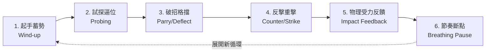
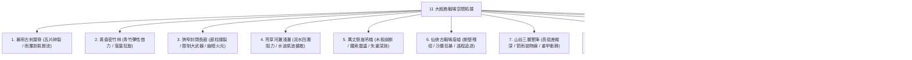

# 高階武戲編排、冷兵器徒手連招與仙俠玄幻大招特效庫 (Combat and VFX Library)

> **版本**：v3.3.1 專家整合版  
> **適用標準**：繁體中文（台灣影視工業與教育部標準字）+ 中英雙語 Prompt（MiniMax H3 / Seedance 2.0 / Qwen-Image 2.1）  
> **系統對齊**：Layer 2 結構化 `action_stages` JSON 規範、`clear_impact_90deg` 垂直無遮擋調度、單鏡 ≤5 動作階段物理約束。

---

## §1 武戲攻防因果鏈鐵律 (Combat Causality & Staging Laws)

### 1.1 核心公理：因果連續性高於動作堆砌
影視動態生成與分鏡拆解的核心原則是：**「動作是重心與力量傳導的必然結果，嚴禁寫空泛的情緒形容詞」**。
在編寫劇本、分鏡腳本或向 AI 生成模型（如 MiniMax H3、Seedance 2.0）下達提示詞時：
- **❌ 絕對嚴禁使用無效形容詞**：例如「兩人激烈交手」、「刀光劍影打得難解難分」、「身手矯健地對攻十幾招」。此類提示詞只會導致模型隨機抽幀、角色肢體抽搐與武器憑空穿模。
- **✅ 強制落實具體物理因果鏈**：每一個鏡頭動作必須交代「力量從何而起、重心如何偏移、兵刃接觸幾何面為何、承受方產生何種位移反饋」。

### 1.2 六步攻防因果鏈 (The 6-Step Combat Causality Chain)
完整的武打攻防段落必須由以下六個物理節點構成循環，單個鏡頭可截取其中 2–4 個節點連續完成：



1. **起手蓄勢 (Wind-up / Preparation)**：
   - 體態下沉，後腳蹬地抓牢地面，重心後移或下盤旋擰，內力或肌肉動能沿「足底 → 膝胯 → 腰椎 → 肩肘 → 腕部」逐級傳導。
2. **試探逼位 (Probing & Feinting)**：
   - 前腳滑步突進，虛晃刺探對手中線防區，利用兵刃長度或身法假動作迫使對方暴露空隙、封鎖撤退路線。
3. **破招格擋 (Parry / Deflect / Intercept)**：
   - 防守方絕非靜止挨打。以刀脊斜切、劍鍔掛格、手臂內滾化勁（如膀手、掤勁），切斷對手發力軸線，將衝擊力沿切線導引開。
4. **反擊重擊 (Counter & Strike)**：
   - 順應卸力慣性，近身搶入內門或中線空檔，腰腹二次爆發，刃口或拳肘直擊要害（咽喉、心口、側肋、關節）。
5. **受力物理反饋 (Impact Feedback & Deformation)**：
   - **人體反饋**：肌肉劇烈震顫、下頜抽動、護甲向內凹陷碎裂、雙腳向後滑退在地面犁出深溝、嘴角溢血或重心徹底失控後仰。
   - **環境反饋**：腳下青石磚網狀龜裂、衝擊波將周圍雨滴或落葉震成環形真空區、空氣受熱/受壓產生短暫折射微震。
6. **節奏斷點與收勢 (Breathing Pause & Reset)**：
   - 連續高速招式後必須設置「急停節奏斷點」：雙方兵刃咬合角力對峙、或錯身而過後單膝微屈滑停、胸口劇烈起伏喘息、髮絲與衣擺隨慣性回落飄動（`micro_physics_tail`）。嚴禁無節制連續加速。

### 1.3 90° 側面無遮擋機位原則 (`clear_impact_90deg`)
- **致命錯誤**：打鬥碰撞瞬間若採用「背後過肩（OTS）」或「重度前景遮擋（Dirty Frame）」，受擊者身體或防禦盾牌會直接遮擋「攻擊武器與身體碰撞點」，AI 模型失去接觸幾何參照，必然產生武器穿模穿透肉體或空氣揮空的嚴重瑕疵。
- **黃金調度法則**：
  在打擊接觸瞬間（Impact Instant），機位必須強制切換至與攻擊發力軸線呈 **90° 正側面（Profile Shot）或 45° 側前方無遮擋機位**。
  確保「攻擊端發力手臂/刃口 → 接觸瞬間幾何擠壓點（火花/氣浪爆發） → 受擊端護甲凹陷/身體向後彎折」三大元素在同一焦平面上完整展開，無任何前景阻隔。

### 1.4 單鏡動作階段限制 (≤5 Stages)
在 2–4 秒的單個分鏡中，動作階段嚴格限制在 ≤5 個物理節點之內，避免 AI 模型的 Latent Space 崩潰或肢體融化：
- `Stage 1`: 起始體態與重心下沉 (Stance & Center of Gravity)
- `Stage 2`: 發力位移與軌跡加速 (Acceleration Vector)
- `Stage 3`: 接觸瞬間形變與火花/氣浪迸發 (Contact Point Impact)
- `Stage 4`: 動能穿透與受力後退位移 (Kinetic Transfer & Recoil)
- `Stage 5`: 滑步止動與微物理尾韻 (Deceleration & Physics Tail)

---

## §2 冷兵器與徒手武學連招速查表 (Weapons & Unarmed Martial Arts Codex)

供分鏡師在撰寫 Layer 2 結構化 JSON 之 `action_stages`，以及生成 Layer 3 MiniMax H3 / Seedance 2.0 / Qwen 提示詞時直接查表調用。

### 2.1 刀劍類武學 (Blades & Swords)

#### 1. 唐刀 / 橫刀 (Tang Dao / Horizontal Sabre)
*風格特性：剛猛凌厲、直來直往、講究以直節突刺破甲、以弧刃劈砍借力。*

- **連招 A：拔刀豎劈接斜撩 (Draw-Cut into Reverse Diagonal Slash)**
  - **攻防因果**：左手拇指頂刀鐔出鞘一寸 → 側身滑步踏進中線 → 雙手握柄由右上向下力劈 → 對方長兵格擋碰撞迸出火花 → 借碰撞反彈力反向自左下往右上迅猛斜撩對方肋下。
  - **Layer 2 `action_stages`**：
    ```json
    [
      {"stage": 1, "description": "左手拇指彈開刀鐔，雙腳重心下沉滑步突進"},
      {"stage": 2, "description": "雙手握唐刀自右上向左下狂暴豎劈，破空風壓激盪"},
      {"stage": 3, "description": "刀刃與對手鐵棍相撞，接觸點迸發熾烈火花 (clear_impact_90deg)"},
      {"stage": 4, "description": "借反震力旋轉刀柄，刀刃自左下向右上逆勢挑撩"},
      {"stage": 5, "description": "刀尖劃破對手衣襟，後腳踏地制動，刀尖斜指地面滴血"}
    ]
    ```
  - **Layer 3 Prompt 視覺關鍵詞**：
    - 中文：`90度側面全開機位，唐刀出鞘雷霆劈砍，刀刃與鐵器碰撞劇烈金屬火花迸射，順勢借力反手斜撩，刀光劃出青白弧線，碎布與血珠飛濺，重心滑步止動`
    - English: `90-degree profile view, clear unobstructed impact framing, Tang Dao drawn with lightning speed, furious downward vertical slash, sharp metal collision sparks erupting, leveraging rebound force into reverse diagonal upward slash, glowing cyan blade trail, fabric and blood droplets flying, sliding foot deceleration`

- **連招 B：正側格擋反切頸 (Perpendicular Parry Spark into Neck Slice)**
  - **攻防因果**：橫刀橫架胸前接住敵刀力劈 → 刀身微傾卸力讓敵刀滑開 → 轉身踏入內門貼身 → 反手刀刃沿對手頸側平抹。
  - **Prompt 關鍵詞**：
    - 中文：`無遮擋側面特寫，唐刀橫架格擋重擊，刀面滑移火星四濺，側身卸力切入內門，反手橫刀寒光掠過對手頸部，對手後仰狼狽躲閃`
    - English: `Unobstructed side close-up, Tang Dao horizontal parry blocking heavy blow, sliding sparks raining across blade, pivoting inside guard, reverse horizontal blade slicing throat line, opponent dodging backward in panic`

- **連招 C：收刀入鞘卡榫合璧 (Mechanical Click Blade Resheathing)**
  - **攻防因果**：戰鬥結束，反手挽刀花甩去血漬 → 刀刃貼入鞘口 → 拇指推刀鐔咔噠一聲閉合 → 對手在背景處跪地倒下。
  - **Prompt 關鍵詞**：
    - 中文：`特寫鏡頭，手腕反轉挽刀花，血珠呈拋物線甩落地面，刀尖準確滑入黑漆刀鞘，拇指用力推按刀鐔發出清脆卡榫合璧，背景對手轟然倒地`
    - English: `Close-up shot, wrist flicking sword in circular flourish, blood droplets spraying in arc to ground, blade tip smoothly sliding into black scabbard, thumb snapping tsuba shut with crisp mechanical lock, defeated opponent collapsing in blurred background`

#### 2. 長劍 (Chinese Longsword / Jian)
*風格特性：輕靈飄逸、走輕靈快準、刺撩點崩、劍氣如霜。*

- **連招 A：流體劍氣穿刺 (Fluid Qi-Empowered Piercing Thrust)**
  - **攻防因果**：單手挽劍花蓄積青色流體劍芒 → 弓步探身劍出如毒蛇吐信 → 劍尖精準刺向對手咽喉 → 對方側身避開但劍氣擦破面具 → 劍尖點地彈起順勢旋身橫斬。
  - **Prompt 關鍵詞**：
    - 中文：`長劍單手疾刺，青色流體劍氣如游龍纏繞劍身，極速直貫咽喉，劍風撕裂空氣產生微波折射，對方面具碎裂半邊，劍身借力彈動橫斬`
    - English: `Single-hand Chinese longsword rapid thrust, fluid cyan sword Qi wrapping around blade like a dragon, extreme high-speed piercing toward throat, sword wind tearing air with optical distortion, opponent mask shattering half, blade rebounding into sweeping horizontal cut`

#### 3. 雙刀 / 雙唐刀 (Dual Sabres)
*風格特性：疾風驟雨、左右互搏、十字交叉絞殺、連環封鎖。*

- **連招 A：十字旋轉絞殺 (Cross-Spin Twin Blade Whirlwind)**
  - **攻防因果**：雙手反握短刀滑步突進 → 雙刃交叉呈 X 形切入對手架勢 → 旋身帶動雙刀連環輪砍 → 絞開敵方重兵刃 → 左右雙刀反切兩肋。
  - **Prompt 關鍵詞**：
    - 中文：`雙唐刀交叉十字斬擊，高速旋身帶動雙重銀白色刀輪，絞開敵方重兵器，刀刃撕裂護甲布帛，火星狂飆，身形如旋風急停`
    - English: `Dual Tang Dao cross slash, high-speed spin creating double silver circular blade trails, wrenching open opponent heavy weapon, blades tearing through armor fabric, fiery sparks blasting outward, cyclone-like sudden stop`

#### 4. 居合拔刀斬 (Iaido Quick-Draw Strike)
*風格特性：極靜轉極動、一瞬爆發、生死一剎。*

- **連招 A：低位極速居合破防 (Low-Stance Instant Flash Slash)**
  - **攻防因果**：極度壓低重心下沉，左手握鞘微昂，右手虛懸刀柄 → 視線鎖定敵方前足 → 腳掌猛蹬石面爆裂 → 一毫秒拔刀出鞘帶出一道冷月光弧 → 錯身而過背向敵方收刀入鞘。
  - **Prompt 關鍵詞**：
    - 中文：`正側面無遮擋機位，極低重心居合蓄勢，腳底石板崩裂，一瞬間拔刀極速踏步斬出，半月形白色真空弧光撕裂雨水，錯身滑行五米，拇指合刀入鞘`
    - English: `90-degree clear side framing, ultra-low stance Iaido preparation, stone floor cracking underfoot, instantaneous draw slash in explosive forward step, crescent white vacuum shockwave slicing falling raindrops, sliding 5 meters past target, thumb snapping blade shut`

---

### 2.2 長柄與重兵器類 (Polearms & Heavy Weapons)

#### 1. 長槍 (Six-Harmony Spear / Lance)
*風格特性：百兵之王、扎點如梅花、橫掃萬夫莫敵、桿身彈性蓄能。*

- **連招 A：攔拿扎六合破穹刺 (Block-Hold-Thrust into Vaulting Downward Smash)**
  - **攻防因果**：槍尖畫圓化開敵方箭矢 (攔拿) → 雙手握桿猛送直扎中門 (扎) → 槍尖震顫出七朵槍花 → 順勢下壓槍桿借彈力騰空而起 → 雙手持槍凌空劈落砸碎地面。
  - **Prompt 關鍵詞**：
    - 中文：`紅纓長槍高速抖動化出螺旋槍花，攔開暗器順勢前扎，槍尖紅纓如火烈烈作響，藉助柔韌槍桿受壓反彈騰空躍起，雙手倒持長槍凌空下劈，地面石柱粉碎坍塌`
    - English: `Red-tasseled spear whipping in spiral trajectories, deflecting projectiles before explosive straight thrust, red tassel fluttering furiously, leveraging bending spear shaft to vault airborne, two-handed overhead downward spear smash shattering stone pillars`

#### 2. 陌刀 / 大刀 (Mo Dao / Great Broadsword)
*風格特性：步戰之神、專破重甲騎兵、沉凝如山、翻身力劈。*

- **連招 A：旋身劈馬勢碎石斷金 (Spinning Cavalry Cleave with Shattered Stones)**
  - **攻防因果**：雙手緊握陌刀長柄，旋轉半周蓄積離心力 → 跨步力劈如泰山壓頂 → 刀刃破風下砸斬斷迎面重裝巨盾 → 刀氣劈裂石板三米長溝。
  - **Prompt 關鍵詞**：
    - 中文：`雙手陌刀旋身橫掄轉為怒劈，刀風狂嘯震散塵埃，重刃斬碎鋼盾火星漫天，刀鋒直貫地面犁出三米碎石溝壑，持刀者長鬚飄揚虎目圓睜`
    - English: `Two-handed Mo Dao spinning swing transitioning into furious downward cleave, wind howling dispersing dust, heavy blade shattering steel shield with blazing sparks, blade edge embedding into stone floor plowing 3-meter trench, warrior eyes blazing`

#### 3. 重錘 / 巨劍 (Warhammer / Greatsword)
*風格特性：重力加速度、碎骨破甲、撼地衝擊波、強大後坐反饋。*

- **連招 A：過頂撼地碎裂波 (Overhead Ground Slam with Radial Shockwave)**
  - **攻防因果**：全身肌肉繃緊將巨錘舉過頭頂 → 全身重力壓下重錘砸地 → 鋼錘撞擊地面爆發環形衝擊氣浪 → 地面呈放射狀網狀碎裂 → 對手被地面彈起的碎石與氣浪掀翻倒飛。
  - **Prompt 關鍵詞**：
    - 中文：`90度側面全景，全身肌肉隆起雙手巨錘高舉過頂，雷霆砸地，錘頭接觸地面瞬間爆發360度環形肉眼可見氣浪衝擊波，石板巨浪般掀起，對手受衝擊離地倒飛`
    - English: `90-degree profile wide shot, bulging muscles raising colossal warhammer overhead, thunderous ground slam, hammerhead impact unleashing 360-degree visible ring shockwave, stone tiles ripping upward like waves, opponent blasted backward airborne`

---

### 2.3 徒手內外家拳腳 (Unarmed Martial Arts)

#### 1. 詠春拳 (Wing Chun Kuen)
*風格特性：守中用中、連消帶打、短橋窄馬、日字衝拳連環寸勁。*

- **連招 A：膀手化勁接日字連環衝拳 (Bong Sao Deflection into Chain Punches)**
  - **攻防因果**：二字鉗羊馬定盤 → 提肘成膀手化解對手直拳衝力 → 轉身成攤手封住外門 → 另一手日字衝拳連續轟擊心窩與面門 → 寸勁爆發震得對手連退三步。
  - **Prompt 關鍵詞**：
    - 中文：`近景無遮擋，詠春膀手提肘卸開重拳，下盤不動切入內門，雙拳如機槍般連續打出日字連環衝拳，拳面在空氣中留下殘影，寸勁重重轟擊胸膛，對手劇烈嗆咳後退`
    - English: `Close-up unobstructed, Wing Chun Bong Sao elbow deflection diverting incoming punch, sliding into inner guard without losing stance, dual fists delivering rapid-fire Sun-Character chain punches with motion blur, one-inch punch exploding on sternum, opponent coughing and stumbling backward`

#### 2. 太極拳 (Tai Chi Chuan)
*風格特性：以柔克剛、借力打力、聽勁黏隨、四兩撥千斤。*

- **連招 A：掤捋擠按隨勢推掌 (Grasp Sparrow's Tail: Rollback into Explosive Palm)**
  - **攻防因果**：雙手畫弧搭上對手猛力前衝之手臂 (聽勁) → 側身後坐將對手猛勁向側後方牽引 (捋) → 待對手重心失控向前傾倒瞬間 → 雙手合抱反身踏步向前雙掌齊推 (擠/按) → 將對手整個人凌空震飛出數丈外。
  - **Prompt 關鍵詞**：
    - 中文：`太極雙手畫圓柔和牽引對手狂暴拳勢，步法後撤畫弧卸力，對手重心向前失控，雙掌驟然凝聚旋轉氣流向前猛推，螺旋內勁轟發，對手騰空倒飛撞碎木柵欄`
    - English: `Tai Chi circular hand motions fluidly guiding opponent furious strike, stepping back in arc to dissipate momentum, opponent overextending forward off-balance, twin palms condensing swirling vortex of Qi in sudden explosive push, spiral kinetic wave blasting opponent flying into shattered wooden fences`

#### 3. 八卦掌 (Baguazhang)
*風格特性：走圈繞背、以動制靜、游身換影、穿掌拿穴。*

- **連招 A：扣擺步走圈繞背切頸 (Circle-Walking扣擺步 into Behind-the-Back Strike)**
  - **攻防因果**：行步如淌泥走圈切入對手死角 → 扣步擺步變向避開直攻 → 游身滑行至對手身後盲區 → 右手穿掌如蛇探出自下而上切中後頸大椎穴。
  - **Prompt 關鍵詞**：
    - 中文：`八卦掌步法靈動走圈滑行，殘影般繞至對手身後死角，身法貼背穿行，右手如靈蛇吐信般自腋下穿出，掌沿狠狠切中對手後頸，對手眼神渙散膝蓋跪地`
    - English: `Baguazhang circle-walking fluid footwork, ghost-like dodging into opponent blind spot from behind, gliding close to back, right palm piercing through armpit like a striking serpent, palm edge chopping base of neck, opponent eyes glazing over collapsing to knees`

#### 4. 八極拳 (Bajiquan)
*風格特性：文有太極安天下，武有八極定乾坤。剛猛暴烈、寸步震腳、貼山靠硬開硬打。*

- **連招 A：寸步震腳貼身鐵山靠 (Tremor-Step Iron Mountain Shoulder Strike)**
  - **攻防因果**：猛烈跺腳震碎地磚 (震腳發勁) → 屈膝沉襠如弓 → 沉肩如山猛烈撞入對手胸膛 (貼山靠) → 接順勢起肘撞擊下頜 (頂肘) → 沉重骨骼碎裂聲與氣浪擴散。
  - **Prompt 關鍵詞**：
    - 中文：`90度側面特寫，八極拳重踏震腳地面石屑飛濺，身形前竄如出膛砲彈，沉肩側身以背部與肩膀狠狠撞入對手胸口，接一記凶暴頂肘向上挑飛下頜，肋骨與牙齒碎裂飛濺`
    - English: `90-degree profile close-up, Bajiquan heavy stomp vibrating floor with flying stone chips, body launching forward like a cannonball, heavy shoulder slamming brutally into opponent chest (Tie Shan Kao), followed by explosive upward elbow spike to jaw, shattering teeth and ribs in visible shockwave`

#### 5. 泰拳 (Muay Thai)
*風格特性：八肢的藝術。雙拳、雙腿、雙膝、雙肘，極具殺傷力之骨骼重擊。*

- **連招 A：低掃踢接箍頸連環膝撞 (Bone-Cracking Low Kick into Plum Clinch Knee Spike)**
  - **攻防因果**：前手刺拳遮擋對手視線 → 旋腰重鞭腿低掃對手支撐腿膝關節內側 → 對方跪地失衡 → 雙手箍住對手後頸下拉 → 提膝如錐狠狠撞擊面門。
  - **Prompt 關鍵詞**：
    - 中文：`泰拳低掃踢重重抽擊在對手大腿內側，肌肉劇烈凹陷變形，對手失衡下跪，雙手立刻死死箍住對手後頸向下拉扯，右膝猛烈上提爆頭膝撞，鼻骨碎裂鮮血噴濺`
    - English: `Muay Thai brutal low roundhouse kick chopping inner thigh, muscle visibly deforming under impact, opponent dropping to knee, hands clamping tightly around opponent neck in plum clinch dragging head down, driving razor-sharp right knee directly into facial bones, blood bursting outward`

#### 6. 摔跤與擒拿 (Qin-Na & Judo/Wrestling)
*風格特性：近身纏鬥、鎖定關節、利用槓桿原理破壞人體力學平衡。*

- **連招 A：抓腕別臂背負投過肩摔 (Wrist-Seize into Ippon Seoi-Nage Shoulder Throw)**
  - **攻防因果**：左手刁抓住敵方刺拳手腕 → 右步踏入對手兩腿之間轉身背向 → 右肩切入對手右腋下拉扯槓桿 → 弓腰弓腿蹬地翻身 → 將對手整個人凌空掀起重重背砸在石階上。
  - **Prompt 關鍵詞**：
    - 中文：`雙人近身搏殺，迅猛反手抓死敵腕，轉身背部貼實對手胸膛，沉腰爆發將高大敵軀凌空掀起，教科書式過肩摔重重砸在石階上，石階碎裂，受擊者後背劇烈抽搐反彈`
    - English: `Close-quarters combat, swift reverse wrist lock, pivoting back flush against opponent chest, lowering hips and exploding upward to vault heavy opponent airborne, textbook shoulder throw slamming opponent spine-first onto stone steps, stone fracturing, body bouncing with violent shockwave`

---

## §3 仙俠／玄幻大招「五段鏈」標準公式 (Ultimate 5-Stage Standard)

> 每個特效寫到什麼程度（觸發、錨點、範圍、形態、受光、結束邊界）與生完怎麼判，見 `vfx-design-and-review.md`；戰鬥分支、動作成立條件、衝擊三層見 `xuanhuan-combat-contract.md`。

### 3.1 五段鏈標準結構
仙俠與玄幻大招嚴禁一瞬間憑空爆炸，必須遵循嚴格的「能量守恆與空間對抗」五段進程：

1. **Stage 1 · 前搖蓄力 (Wind-up / Pre-Cast)**：
   - 角色體態改變（沉膝、騰空、法訣變幻、手印交錯）。
   - 內在能量湧動：經脈金光遊走、周身氣息如漩渦倒灌、衣袍無風狂舞。
2. **Stage 2 · 聚能異象 (Anomaly / Gathering)**：
   - 環境介質受到能量牽引逆向運動：周圍雨滴/碎石反重力浮空、烏雲形成漏斗漩渦、符文法陣在虛空中層層疊加點亮。
   - 光影突變：天地色調急劇冷卻或變暗，焦點匯聚在蓄能核心。
3. **Stage 3 · 爆發釋放 (Burst & Launch)**：
   - 蓄力點突破臨界值，核心能量動線以超音速激射而出。
   - 伴隨音爆環、真空破空錐、鏡頭被衝擊力震動（Camera Shake）、亮芯短閃（臉部保持可辨；全屏過曝閃白在 H3 是否可接受尚未實測，見 `vfx-design-and-review.md` §3）。
4. **Stage 4 · 空間對抗 (Spatial Clash & Collision)**：
   - 雙方能量或攻擊面撞擊在防禦護盾/肉身之上，形成扁平對抗截面。
   - 斥力衝擊波呈環形排開天地間的雲霧、雨絲或泥沙，防禦層浮現蛛網狀裂紋。
5. **Stage 5 · 衝擊結果 (Aftermath & Impact)**：
   - 能量貫通爆發，地貌永久改變（巨型焦黑深坑、整座山頭被削平、海水被蒸乾露出海底）。
   - 餘燼、光塵與碎屑緩緩飄落，施法者落地微喘收手，敵方崩潰消散或受創跪地。

---

### 3.2 九大屬性視覺詞庫表 (Nine Elemental Visual Codex)

| 屬性 | 核心視覺意象 | 前搖與聚能異象 (Stage 1-2) | 爆發與空間對抗 (Stage 3-4) | 衝擊結果 (Stage 5) | 中英雙語 Prompt 關鍵詞 |
|---|---|---|---|---|---|
| **1. 飛劍 / 劍氣** | 萬劍歸宗、金屬劍陣、螺旋流體劍氣 | 劍指並攏直指南天，身後萬柄青鋼飛劍如孔雀開屏展開，劍鳴撕裂空氣，金屬冷光與藍色流體微粒在劍尖震顫 | 萬劍破空化作銀河金屬巨龍，呼嘯俯衝，劍尖激撞能量光盾，萬千劍氣如暴風雨穿透防禦撕裂真空 | 劍雨插滿千米方圓焦土，廢墟中插滿微顫的斷劍，青煙與劍光微粒緩緩消散，施法者長袍緩落 | `萬劍歸宗劍陣破空，金屬飛劍匯聚成光芒銀河，凌厲劍氣撕裂雲層俯衝，萬劍暴雨穿透護盾，焦土插滿劍刃殘光 / Ten thousand flying swords forming cosmic silver river, razor-sharp sword Qi tearing clouds in supersonic dive, sword storm shattering barrier, ground impaled with glowing blades` |
| **2. 雷電系** | 九天紫霄神雷、電漿球、雷霆法相 | 雙掌合十雷紋在手臂皮膚劇烈炸裂，頭頂烏雲密布形成黑紫漩渦，無數雷蛇狂暴跳躍，空氣電離發出高頻爆鳴 | 雙掌推出一道粗大如巨柱的紫金雷霆，撕裂長空，雷暴直接貫穿對手防禦，在身後引發核爆級環形雷光波紋 | 地面徹底焦黑玻璃化晶體化，周圍升騰藍白等離子電弧餘震，空氣中瀰漫焦糊臭氧氣息 | `九天紫霄神雷天罰降臨，狂暴紫金雷電巨柱撕裂烏雲直貫大地，刺目光芒照亮天地，地面焦黑晶化電弧跳躍，等離子衝擊波 / Purple celestial lightning pillar tearing stormy sky, apocalyptic thunderbolt striking earth, blinding radiant flash, ground vitrified into black obsidian, crackling plasma arcs` |
| **3. 烈火系** | 金烏真火、地獄炎獄、熔岩巨龍 | 雙手結紅蓮法印，背後升起三足金烏巨大神鳥虛影，赤紅烈焰高溫將四周空間空氣折射扭曲，腳下草木瞬間碳化成灰 | 金烏展翅咆哮化為千米熔岩火龍狂暴撲殺，火舌吞噬天地，烈焰衝擊波排開雨水形成百米真空烈火通道 | 地面化為翻滾的赤紅岩漿湖，焦炭廢墟中火星餘燼飛舞，熱浪滾滾蒸騰 | `三足金烏赤紅真火爆發，千米熔岩火龍怒吼撲殺，極致高溫扭曲空氣蒸乾一切，烈焰風暴橫掃戰場，熔岩地裂餘燼飛舞 / Three-legged Golden Crow sun-fire eruption, colossal magma dragon roaring through battlefield, extreme heat distorting atmosphere, sea of flames incinerating barriers, molten lava lake` |
| **4. 寒冰系** | 極幽九霜、冰魄寒晶、萬丈玄冰刺 | 腳尖輕點水面，冰霜以幾何結晶紋路瞬息蔓延數百米，周身浮現萬道懸浮透明冰錐，極度深寒讓呼吸凝成白霜霜花 | 拂袖一揮，極寒冰風暴呼嘯向前，所經之處空氣中的水分瞬間凝結成巨大冰晶巨峰，將對手生生凍結在透明萬載玄冰之中 | 巨大冰山矗立天地，冰面折射冷冽藍白光暈，極寒白霧在冰隙中緩緩流動，冰渣碎屑漫天飄落 | `極寒九幽冰魄瞬間凍結，空氣水分凝華萬丈冰晶巨峰，幽藍寒霜風暴吞噬一切，絕對零度晶瑩冰封，冰屑紛飛折射冷光 / Absolute zero glacial frost freezing environment in milliseconds, crystalline ice spikes erupting into monumental glacier, frozen in eternal ice, falling sparkling ice snow` |
| **5. 水靈系** | 萬龍歸海、狂瀾怒濤、高壓水神法相 | 纖指引動水流，江河倒灌升空，萬頃碧波圍繞施法者狂暴旋轉形成巨型水球，水體內部流動幽藍神紋符篆 | 雙手猛壓，九條高壓水真龍長嘯自九天俯衝砸落，水壓撕裂鋼鐵，無窮巨浪拍碎城牆與岩壁 | 海嘯過後化為千米平靜水鏡，水霧漫天形成七色彩虹，水波倒映天邊殘月 | `萬龍歸海江流倒灌，九條幽藍水真龍長嘯俯衝拍擊，高壓水流撕裂巨石，滔天巨浪吞沒防線，七色彩虹水霧氤氳 / Nine celestial water dragons diving from turbulent heaven, immense hydraulic pressure crushing fortress, colossal tidal tsunami, lingering rainbow mist over tranquil water mirror` |
| **6. 狂風系** | 九天罡風、真空風刃、撕天風暴眼 | 旋身騰空，四方狂風匯聚，無形風壓將周圍百米樹木壓成水平，青色真空氣流在雙掌指尖極速旋轉壓縮成超密光球 | 風球炸裂化作數萬道半透明青色真空風刃暴雨，風刃如鍘刀削平山頭，中心形成狂暴風暴龍捲拔地而起 | 風眼中心死寂無風，外圍數十米高風牆消散，滿地皆是切口平滑如鏡的被斬斷岩石與殘枝 | `九霄罡風青色龍捲拔地而起，無數真空風刃風暴如剃刀切割一切，山峰被齊齊削平，風眼真空死寂，空氣被撕裂爆鳴 / Azure hurricane tornado erupting, millions of vacuum wind blades slicing through terrain, razor-sharp wind storm decapitating peaks, calm eye of the storm` |
| **7. 土岩系** | 山崩地裂、地龍翻身、磐石金剛法相 | 重足踏地，土黃色地脈之氣狂湧入體，身後凝聚十丈巍峨岩石巨人法相，大地深處傳來沉悶心跳與地殼擠壓轟鳴 | 法相雙拳合砸地面，大地劇烈撕裂出深不見底的百米地裂峽谷，尖銳巨型石筍自地底狂暴突刺破土而出 | 戰場地貌徹底崩解改寫，巨大岩石林立，殘破巨石在斜陽下拉出斑駁陰影，塵土久久不散 | `山崩地裂大地崩塌，巨型石筍自地底狂暴突刺破土，土系巍峨法相撼地一擊，百米深淵峽谷撕裂，漫天土石塵埃 / Cataclysmic earthquake tearing earth open, colossal stalagmites erupting from abyss, titanic earth golem ground slam, canyon fissure, billowing dust and shattered boulders` |
| **8. 神聖金光系** | 金光普照、梵天法輪、神佛降世 | 雙手結無畏印，眉心金色神紋綻放璀璨光芒，腦後升起十二重燃燒金色烈焰的神聖法輪，莊嚴梵音在天地間共鳴迴盪 | 金色法輪如神明巨眼睜開，萬道金色破魔極光如天基雷射貫穿雲層，光芒所及之處邪祟黑霧蒸發化為白煙 | 金色光羽自天際紛紛揚揚飄落，整座廢墟被沐浴在一片溫暖神聖的淡金色晨曦之中，生機復甦 | `十二重梵天金色法輪普照，神聖破魔金光如天基雷射穿透雲霧蒸發邪祟，金色光羽漫天飄散，神明降世威壓 / Twelve-fold sacred golden halo spinning, divine purifying light beams piercing gloom, evaporating miasma, golden light feathers drifting gently, sublime godly presence` |
| **9. 暗影魔氣系** | 深淵黑炎、魔煞血霧、吞噬黑洞 | 雙瞳化為純黑無白，周身升騰黏稠如墨的黑紫色魔煞血氣，空間被腐蝕發出滋滋聲，植物瞬間枯萎，光線被黑洞吸扯 | 虛空中撕開一隻數十丈巨大的暗影魔爪或黑炎漩渦，帶著無盡怨魂嚎叫，將對手防禦連同光線一同碾碎吞噬 | 地面留下一片焦黑腐爛的死寂領域，暗影觸手如液體般緩緩退回虛空裂縫，留下一片絕對真空黑暗 | `深淵暗影魔煞血氣狂湧，黑紫色黏稠黑洞漩渦吞噬一切光線，巨型暗影魔爪撕裂空間抓碎防禦，空間腐蝕與虛空裂縫 / Abyssal shadow miasma surging, viscous black-violet black hole devouring light, titanic shadow claw tearing fabric of space, decaying void rifts` |

---

## §4 戰場空間拓撲與環境互動 (11 Classic Battlefield Topologies)

環境不是靜止的綠幕，而是武打的「第三參戰者」。高階武戲必須利用環境介質放大打擊反饋與視覺奇觀：



### 1. 暴雨古剎屋脊 (Rainstorm Ancient Temple Rooftop)
- **空間特徵**：傾斜高低差的黑色琉璃瓦屋脊、飛簷鬥拱、極度濕滑表面。
- **介質互動**：
  - 急促踏步踩碎琉璃瓦，瓦片滑落墜地摔碎。
  - 狂風暴雨中，出劍瞬間劍風將密集的雨簾一分為二，斬出一條短暫的乾燥真空通道。
  - 被擊退滑行時，雙腳在濕滑瓦片上犁出兩道水花與碎瓦白線，最後以刀插瓦面緊急剎停。

### 2. 黃昏密竹林 (Dusk Bamboo Forest)
- **空間特徵**：密集縱向立體青竹、遮天竹葉、斜射夕陽丁達爾光柱。
- **介質互動**：
  - 借力彈跳：腳踏青竹，竹身受重壓劇烈彎曲蓄能，彈起瞬間整個人如利箭射向敵方。
  - 武器破壞：橫刀掠過，三根合抱青竹被斜向切斷，青竹緩緩滑移倒塌，竹葉如綠色暴雨狂旋。
  - 聽風辯位：微風掠過竹葉沙沙作響，突然竹葉靜止一瞬，殺手自竹冠破空凌空刺下。

### 3. 狹窄封閉長廊 (Narrow Enclosed Corridor)
- **空間特徵**：寬度僅 1.5–2 米、兩側木雕窗欞與朱紅木柱、天花板壓抑、火把昏暗。
- **介質互動**：
  - 空間限制：長槍與大刀無法大範圍揮舞，被迫改為直線突刺或貼身短打。
  - 碰撞反饋：身體被重重砸向木柱，木柱崩裂出巨大木刺，天花板瓦礫與灰塵簌簌掉落。
  - 光影變化：長廊火把被氣浪震熄，光線驟暗，刀刃交鋒時迸射的金屬火星瞬間照亮對手猙獰面孔。

### 4. 黃昏荒草河灘淺灘 (Dusk Marshy River Shoal)
- **空間特徵**：漫至腳踝的泥水淺灘、枯黃蘆葦蕩、夕陽倒映在波光粼粼的水面。
- **介質互動**：
  - 水花四濺：快速奔跑踩踏泥水炸起半米高白浪，阻礙腳步機動性。
  - 氣浪排空：重拳或掌風擊出，水面被雄渾內勁向兩側分開，露出泥濘河床數秒。
  - 血色夕照：刀刃落水，鮮血在清澈泥水中如絲綢般迅速擴散，與夕陽血色熔鑄一體。

### 5. 萬丈懸崖吊橋 (Abyssal Cliff Suspension Bridge)
- **空間特徵**：搖晃不定的粗麻鐵索木板橋、腳下萬丈深淵雲霧翻滾、劇烈山谷強風。
- **介質互動**：
  - 平台動態失衡：一人跳躍落橋，整座吊橋劇烈起伏擺動，考驗對戰雙方下盤平衡。
  - 結構斷裂：一劍削斷右側主鐵索，吊橋瞬間側翻 45 度，木板紛紛脫落墜入深淵，二人單手攀索懸空死鬥。
  - 失重下墜：失足跌落者伸手抓緊邊緣，被勝者一腳踏碎指骨，翻滾墜入無底雲海。

### 6. 仙俠古戰場廢墟 (Xianxia Battlefield Ruins)
- **空間特徵**：巨大風化神魔骸骨、傾斜倒塌的百丈巨劍殘兵、荒涼戈壁與漫天黃沙。
- **介質互動**：
  - 掩體借力：踩踏巨大的神魔頭骨借力凌空變向，法寶碰撞直接擊碎百噸風化巨石。
  - 風沙流動：狂風掀起黃沙，腳步快速移動在沙丘留下深陷腳印，劍氣將沙塵切出整齊壕溝。

### 7. 仙俠山谷三層軍陣 (Three-Tier Valley Fortress Formations)
- **空間特徵**：由低至高三層梯田狀防禦工事、重裝盾陣、弓弩箭塔、狹窄咽喉道。
- **介質互動**：
  - 縱深推進：強者自谷底突破第一層重盾，衝擊波將重甲甲士成排掀飛砸向二層工事。
  - 箭雨拋物線：數千黑羽箭矢如烏雲蔽日覆蓋天空，被護體罡氣在頭頂三尺全部撞碎震落。

### 8. 雪山雲海天地開界 (Snow Mountain Sea of Clouds Frontier)
- **空間特徵**：極寒萬丈雪峰頂端、腳下是翻騰無邊的白色雲海、積雪深厚且堅冰如鏡。
- **介質互動**：
  - 輕功與踏雪：身形輕盈者踏雪無痕，重裝者踏冰破裂形成冰窟。
  - 雲海被撕開：大招爆發瞬間，巨大的劍氣或法相如天刀切豆腐，將下方的萬里雲海生生劈出一條十里寬的深淵裂谷。

### 9. 雷雨殘破法相祭壇 (Thunderstorm Broken Altar of Avatar)
- **空間特徵**：八根雕刻古老符文的通天斷裂石柱、中央太極八卦青銅祭台、暴雨積水池。
- **介質互動**：
  - 引雷天罰：通天石柱吸引天雷劈落，石柱通體通電發光，戰鬥者借柱上高壓電弧灌入兵器。
  - 反重力浮空：法相升起時，祭壇所有積水與碎石違背重力，化為無數懸浮水珠與石塊懸停在半空。

### 10. 極暗古鎮積水夜戰 (Pitch-Black Flooded Ancient Town Alley)
- **空間特徵**：狹長幽暗古巷、黑色徽派高牆、青石板路淺積水、微弱紅色燈籠。
- **介質互動**：
  - 倒影獵殺：鏡頭拍水窪倒影，水中倒映出刺客自屋簷倒掛拔刀的瞬間，隨後一隻靴子踏碎倒影。
  - 突襲破障：破門破窗而入，木製窗欞碎裂成千百木屑，屋內燭火被疾風吹滅回歸純粹剪影對決。

### 11. 上古殘垣雙能量洪流對沖戰場 (Ancient Megalith Twin Elemental Clash)
- **空間特徵**：上古巨石陣中央，左側被烈火灼燒成赤紅焦土，右側被極寒凍結為幽藍堅冰。
- **介質互動**：
  - 冷暖對撞：冰系與火系招式在中央接觸，形成劇烈的水蒸氣爆炸，白霧瞬間籠罩戰場。
  - 介質互換：火球砸中冰壁引發蒸汽暴鳴，冰錐穿過火浪化作沸水箭矢，環境隨著能量此消彼長而動態重構。
