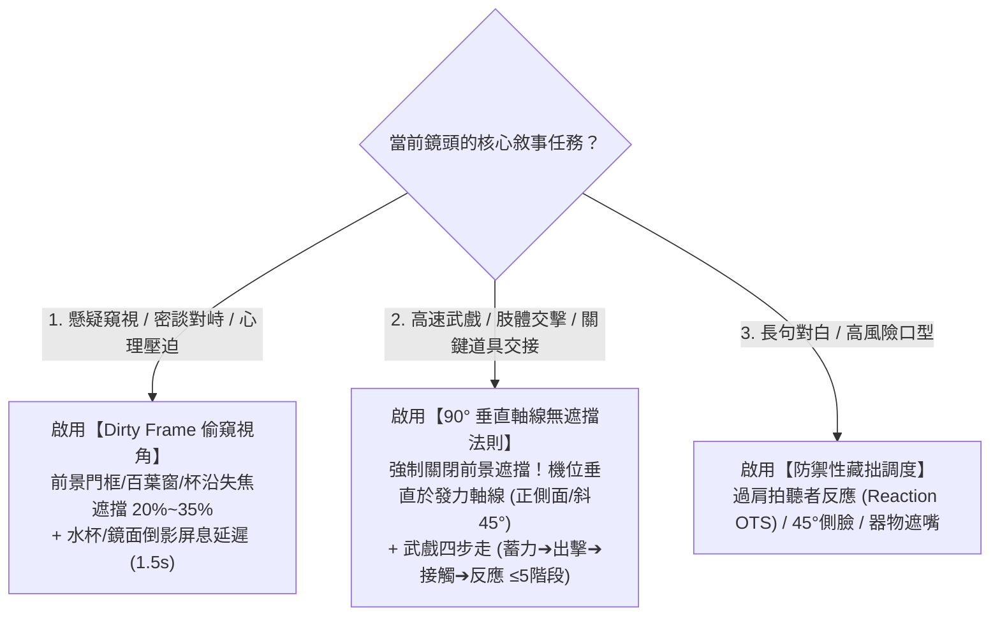

# 武戲物理防遮擋調度、可見微表演與多模型原生編譯器 (v2.0)

本手冊解決三大核心工程問題：
1. **如何解決「前景遮擋（Dirty Frame）」與「高速武戲打擊點清晰度」之間的衝突？**
2. **如何將醫學解剖學偽精確詞彙（如「眼輪匝肌、嘴角下垂 3mm」）轉譯為 AI 模型真正聽得懂的可見視覺表徵？**
3. **如何將同一份六要素分鏡規劃，零損耗編譯為 Seedance 2.0、MiniMax H3、Kling 與漫劇九宮格的原生最優提示詞？**

---

## 一、視角與遮擋動態路由器：Dirty Frame vs 90° 垂直無遮擋法則

`cinematic-director-storyboard` v1.0 的招牌技法是「前景遮擋主觀偷窺視角（Dirty Frame POV，遮擋面積 20%–35%）」。然而，在實戰中必須根據**戲劇動作類型**進行動態路由，嚴禁在所有鏡頭中無腦套用遮擋：

### 1. 武戲高速碰撞：「蓄力 ➔ 出擊 ➔ 接觸 ➔ 反應」四步走與 90° 防遮擋鐵律
- **為什麼打鬥戲不能用背後過肩（OTS）或重度 Dirty Frame？**
  當表現「A 右拳轟中 B 的盾牌」或「刀劍交鋒」時，若機位在 A 背後或 B 盾牌背後，身體與盾面會直接擋住「拳頭接觸盾面」的物理瞬間，導致 AI 模型因看不見接觸幾何而發生**穿模（Clipping）**或**軟綿無力打空**。
- **【接觸點垂直軸線法則（Perpendicular Impact Framing）】**：
  - 在打擊接觸瞬間（Impact Shot），攝影機必須切換至與攻擊發力軸線呈 **90° 的正側面（Profile）或 45° 斜側面全開無遮擋機位**，讓「施力端（拳/刃）➔ 接觸點（火花/凹陷/氣浪）➔ 受力端（盾牌後偏/身體後仰）」在同一焦平面上 100% 清晰展開！
- **單鏡動作拆解 ≤5 階段上限（防果凍化融化）**：
  單個鏡頭（2–4 秒）內最多包含 5 個物理因果節點，嚴禁塞入超過 5 個劇烈轉折：
  1. `起始姿態与重心`（如：前腳蹬地、重心前傾 45°）
  2. `發力與加速軌跡`（如：轉腰帶肩，右拳沿水平線極速轟出，帶起破空微塵）
  3. `接觸瞬間幾何形變`（如：拳面垂直轟中金屬盾心，迸發火星與環形氣浪）
  4. `動能傳導與受力回饋`（如：盾牌受衝擊向後偏移，防守者雙腳戰靴摩擦石地後滑半米犁出白痕）
  5. `收勢與尾韻微物理`（如：收拳回防降低重心，胸口劇烈喘息，衣擺隨慣性回落）

---

## 二、畫幅幾何自適應規則：`16:9 橫屏院線` vs `9:16 直式短劇`

| 空間調度維度 | `16:9` 橫屏電影/番劇模式 | `9:16` 直式短劇/漫劇模式 |
|---|---|---|
| **雙人同框構圖** | **水平展開（Left-Right Blocking）**：利用左/中/右三分線拉開橫向心理距離，支援寬幅橫移跟拍（Truck）。 | **前後景縱深交錯（Depth Stacking）**：9:16 橫向極窄，嚴禁左右遠距並排！改為**前景左下方虛化肩背（佔寬 35%）+ 中後景右上方清晰主體**，利用焦點切換（Rack Focus）敘事。 |
| **景別分佈權重** | 遠/全景 (25%) + 中景 (35%) + 近景/特寫 (40%)。 | **中近景與特寫（MCU / CU / ECU）佔比 $\ge 70\%$**；全景僅作 1.5 秒極短定場。 |
| **UI 與字幕安全區** | 預留上下遮幅或底部 10% 單行字幕區。 | **強制避讓區**： 1. **底部 20%–25% 字幕區**：關鍵手部道具動作（如捏信封、拔匕首）必須抬高至腰胸以上或單切微俯拍特寫，嚴禁貼底被字幕遮擋。 2. **右側 15% 互動圖標區**：主體五官與眼神焦點避開最右邊緣。 |

---

## 三、去偽精確度：「解剖學肌群 ➔ 可見視覺表徵」翻譯字典

AI 影片模型的 Text Encoder 是在自然視覺描述上訓練的，**嚴禁在最終生成提示詞（Layer 3）中出現醫學解剖學名詞或毫米/折射率等偽精確數值**。必須按景別過濾並轉譯：

- **【遠景 / 全景 (ELS / LS) 鐵律】**：人物臉部像素極小，**100% 禁止描寫任何五官微表情或眼神**（寫了只會導致遠處人臉扭曲），僅描寫全身剪影姿態與大肢體位移。
- **【中近景 / 特寫 (MCU / CU / ECU) 翻譯表】**：

| ❌ 嚴禁輸出的偽精確/解剖學黑名單詞 | ✅ 強制轉譯之 AI 高服從度「可見外顯視覺描述」 |
|---|---|
| `眼輪匝肌收縮` | `眼角微微擠出細紋，雙眼微彎流露笑意 (eyes crinkling at the corners)` |
| `降口角肌微動 / 嘴角下垂 3mm` | `嘴角微微下撇抽動，下唇緊抿微顫 (corners of mouth pulling down slightly, lower lip trembling)` |
| `咬肌不自覺隆起 / 下頜骨發力` | `腮幫與下頜線條驟然咬緊繃直 (jawline clenching tightly)` |
| `額肌輕微上提 / 眉間肌收縮` | `眉頭猛然緊蹙，眉心擠出深紋 (brows furrowing deeply)` |
| `向右微轉 15 度 / 流體折射率 1.33` | `上半身向側面微轉 / 清澈水面倒映出扭曲的冷光倒影` |

---

## 四、Layer 3 多模型原生提示詞編譯器規範 (Model Adapters)

當完成 Layer 1（人類導演表）與 Layer 2（結構化 JSON）規劃後，必須根據目標生成平台，剔除所有 `【光學設定】`、`[潛台詞]` 等內部標籤，編譯為高信噪比（單鏡 70–140 字）的原生提示詞：

### 1. 即夢 Seedance 2.0 編譯器（高階自然語言動作流 `seedance-v8`）
- **格式鐵律**：純文本自然段落，一段代表一鏡，空一行代表切鏡頭；**嚴禁任何表格、Markdown 列表或冒號標籤**。
- **段落熔鑄公式**：
  > `[焦段 + 物理物距與透視特徵 + 運鏡] + [左中右/前後景 Dirty Frame 或 90°無遮擋構圖 + @角色A/@角色B 實體參照物站位] + [開幅狀態 ➔ 屏息延遲/觸發動作 ➔ 台詞前半句/後半句定軌動作：「台詞原文」] + [色卡五層光影一致性鎖定聲明] + [動作尾韻微物理（衣角下墜/髮絲微動/肩膀起伏）]`

### 2. MiniMax H3 編譯器（官方三欄 / 六段結構 `minimax-h3`）
- **格式鐵律**：
  - `T2VA / I2VA / FL2VA` 採用官方三欄：`integrated_multimodal_description` / `overall_soundscape` / `non_diegetic_music`（I2VA/FL2VA 首行必須為官方對齊行並空一行）。
  - `Ref2VA`（鎖角色/風格/音色）採用官方六段，使用 `<Subject 1>` 綁定角色資產。
  - **鏡號與時間碼**：`[Shot 1]` 不加時間戳；後續鏡頭嚴格使用 `[Shot N] At MM:SS.mmm, ...`。
  - **對白與閉唇鎖**：對白使用 `<d>[Chinese] 原文台詞</d>`；旁白（Voiceover）或不說話的角色必須緊跟 `while his/her lips remain completely closed` 防止亂動嘴。
  - **零 Negative 欄**：H3 為 CFG-distilled 架構，不輸出獨立 Negative 欄，將所有防呆要求轉為正向可觀測描述。

### 3. 可靈 Kling / 通用首尾幀編譯器（`kling-fl2va`）
- **格式鐵律**：分為 `First Frame Keyframe Prompt`、`Last Frame Keyframe Prompt` 與 `Motion Transition Prompt`；運動提示詞專注描述「攝影機物距變化 + 主體從首幀姿態過渡至尾幀姿態的物理軌跡 + 環境流體/粒子動態」。
