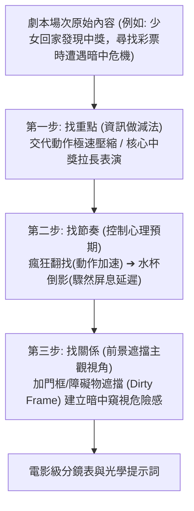

# 導演萬能分鏡三步法：從雜亂碎剪到電影級敘事節奏

本手冊提煉《04.導演分鏡.mp4》的核心導演心法，建立一套標準化、可被 Agent 自主運算的分鏡重構與節奏編排 SOP。

---

## 一、分鏡核心痛點：資訊冗餘與等長節拍 (Information Redundancy & Monotony)

新手在編寫分鏡時，最常犯的兩大致命錯誤：
1. **等長剪輯（Equal-duration Pacing）**：每個鏡頭都在 3~4 秒左右，節奏如節拍器般呆板無波瀾。
2. **資訊重疊（Redundant Shots）**：推門一個鏡頭、邁腿進門一個鏡頭、關門一個鏡頭、拉椅子坐下一個鏡頭——這 4 個鏡頭在戲劇資訊上只傳達了一件事：「她回家了」。

---

## 二、導演萬能分鏡三步法 SOP

---

### 第一步：找重點（做減法）
- **原則**：每場戲都有一個「不可替代的戲核（Dramatic Core）」。
- **操作**：
  - **交代性資訊（Expository Action）**：如走路、開門、掏鑰匙，用單一快速運鏡（如背影跟隨）在 1~2 秒內掠過，甚至採用省略剪輯（Ellipsis Cut）。
  - **戲核事件（Dramatic Climax）**：如看手機發現中一千萬、得知背叛、驚恐發現屍體，必須拉長鏡頭時間（5~8 秒），給予演員充分的呼吸、微表情瞳孔放大、動作停滯等細膩表演空間。

---

### 第二步：找節奏（控制心理預期）
- **真諦**：**節奏不是切得快或慢，而是導演在精準調度觀眾大腦中的「多巴胺與腎上腺素」！**
- **預期曲線設計**：
  1. **提問與焦慮上升期**：女主角在客廳各處瘋狂翻找彩票，鏡頭隨動作急促切換（1.5s 一剪），觀眾跟著急迫：「到底在哪？」
  2. **預期臨界點（Critical Suspense）**：當觀眾最迫切想得到答案的瞬間，**絕不能立刻給出答案**！
  3. **蓄意降速與屏息（The Breath-holding Delay）**：鏡頭突然拉長至慢動作，聚焦於桌上的水杯，水面輕微震顫，水杯反光中緩緩浮現出另一個人的倒影！觀眾心跳驟停，心理張力拉至滿格。

---

### 第三步：找關係（前景遮擋主觀視角 - Dirty Frame POV）
- **客觀視角 vs 心理主觀視角**：
  - 平拍女主角翻找抽屜 = 客觀紀錄片視角，觀眾毫無危機感。
  - **前景遮擋（Dirty Frame）**：將攝影機置於半掩的門後、窗欞、走廊暗處或家具縫隙，讓門框或陰影遮擋住畫面側邊 30%，鏡頭隔著障礙物窺視女主角。
- **戲劇效果**：
  - 觀眾潛意識立刻警覺：「這是誰的視角？有人在暗中偷窺她！」
  - 不需要台詞，甚至不需要怪物露面，空間的致命危機感已經深入骨髓。
