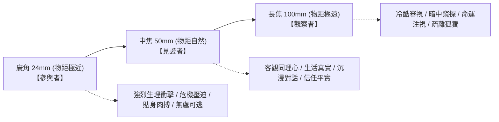

# 焦距、景深與視覺運動物理學：破解 AI 光學控制的黑盒密碼

本手冊提煉《05.焦距景深視覺運動.mp4》的核心光學心法，建立一套將真實攝影機光學特性（焦距、物距、空間透視與景深）精準翻譯為 AI 模型可執行特徵的工程協議。

---

## 一、焦距與物距的光學真理 (Focal Length & Subject Distance)

```text
┌─────────────────────────────────────────────────────────────────────────────┐
│ 誤區：24mm 自帶廣角透視，100mm 自帶背景壓縮                                 │
│ 真相：透視變形源於【物距（攝影機與主體的距離）】，焦距只決定視角截取範圍！  │
└─────────────────────────────────────────────────────────────────────────────┘
```

當我們在同一景別（例如同一個人物半身特寫）下拍攝時：
1. **24mm 廣角鏡頭**：
   - 為了讓人物半身填滿畫面，攝影機必須**極度靠近主體（物距縮短至 0.3 米 ~ 0.5 米）**！
   - 由於物距極短，主體的鼻尖到耳朵、肩膀到背景的距離比例被劇烈放大，產生強烈的「近大遠小」透視變形，遠處背景顯得極其微小且無限深遠，空間被撕裂拉伸。
2. **100mm 長焦鏡頭**：
   - 為了讓人物半身保持同樣大小，攝影機必須**大幅度後退（物距拉遠至 4 米 ~ 6 米）**！
   - 由於物距極遠，主體與背景之間的距離比例被大幅縮小，近大遠小被抹平，遠處的樓房、樹木被巨幅放大並拉至主體腦後，前景與背景緊緊貼合，產生「空間壓縮感（Spatial Compression）」。

---

## 二、AI 提示詞光學特徵補充矩陣 (Acoustic & Optical Alignment Matrix)

| 鏡頭分類 | 光學焦段 | 物理物距狀態 | AI 提示詞必備補充詞彙 (Essential Optical Modifiers) |
|---|---|---|---|
| **超廣角** | 14mm ~ 18mm | 貼臉極致微距 (<0.3m) | `攝影機極度貼近主體面孔，極致近大遠小，邊緣強烈桶形畸變，天花板與地板劇烈收縮，空間失真拉伸` |
| **經典廣角** | 24mm ~ 28mm | 近身逼近 (0.5m~1m) | `攝影機靠近主體，強化近大遠小，背景更小更遠，空間快速向遠處延伸，輕微邊緣透視拉伸，動態視覺衝擊` |
| **標準中焦** | 40mm ~ 50mm | 自然社交距離 (1.5m~2.5m) | `人眼自然透視，無畸變，前後景比例真實協調，中等景深，客觀自然的視覺呈現` |
| **人像長焦** | 85mm ~ 105mm | 遠距退後 (3m~5m) | `攝影機遠離主體，背景相對放大並強烈靠近主體，極致壓縮前景與背景的空間，淺景深虛化，輪廓柔和分離` |
| **望遠長焦** | 135mm ~ 200mm | 極遠狙擊視角 (>8m) | `極遠距離望遠觀察，背景如幕布般緊貼人物身後，強烈空間扁平化壓縮，大光斑焦外奶油虛化` |

---

## 三、心理距離模型：焦距決定觀眾的「靈魂站位」 (The Psychological Distance)

焦距不直接製造情緒，焦距是導演在無形中為觀眾安排的**「物理與心理座席」**：



1. **廣角 = 參與者（The Participant）**：
   - 攝影機幾乎頂在角色臉上。刀尖向鏡頭刺來時，觀眾會本能地後仰躲閃；怪物撲來時，觀眾感到窒息壓迫。
2. **中焦 = 見證者（The Witness）**：
   - 相當於站在一旁安靜觀看一場對話。毫無變形的真實人眼視角，最適合深情告白或日常情感交流。
3. **長焦 = 觀察者（The Voyeur / Observer）**：
   - 觀眾站在幾十米外的草叢、車內或窗後，用長焦鏡頭暗中鎖定目標。極致的背景壓縮與淺景深，傳達出「命運已被鎖定、暗處殺機湧動、無人能救」的冷血疏離感。
