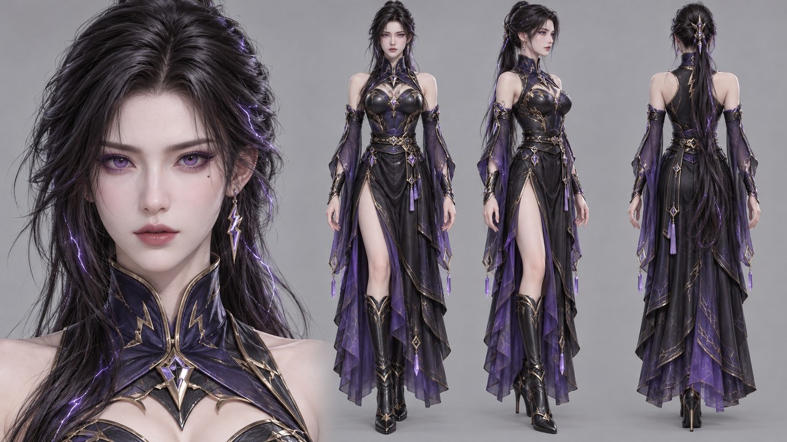
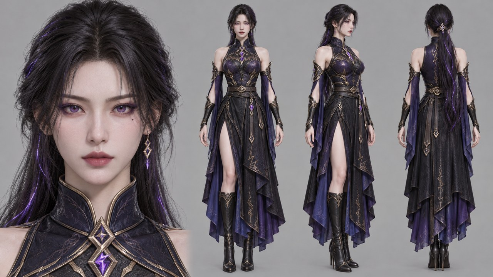

# 漫劇風格鎖定錨（Style Lock Anchors）

整部漫劇只選**一套**錨（最多疊兩套，再多會漂移）。選定後把「風格鎖定錨」原文貼在每個圖像提示詞**結尾**，「負面錨」帶進負面提示詞，並寫進 `assets.md` 最前面的全域鎖與 Layer 2 的 `style_lock`（見 `consistency.md` §2）。改風格只改這一處再同步，不要逐鏡改。

## 證據等級（請先讀）

- 十一種風格由子代理調查歸納（2025–2026 的 AI 工具教學、動態漫文章與平台報導）。**各平台實際占比沒有找到公開數據**，「主流」是依題材與工具選項歸納，不是排行榜。
- 錨定詞與色盤是依風格慣例**蒸餾推斷**，再用 ChatGPT 網頁版以**同一角色**各出一張**角色設定板**校準；樣圖證明「這組詞能出這個風格」，不證明在其他模型（即夢、可靈、Seedance、Midjourney）同樣有效，換模型先出 3–5 張測試圖。
- 同角色設定板樣圖：長直黑髮、金蓮花髮簪配紅寶石流蘇、深紅金繡立領漢服；版面為 16:9 四格（面部特寫＋正／側／背全身）、單色平光背景。風格錨的用途就是鎖定設定板，所以樣圖直接用設定板呈現；風格以外的設定刻意不變，方便橫向比較。背景描述在設定板階段被覆蓋成單色，錨內的場景詞到分鏡圖階段才生效。
- 校準紀錄：第一輪用單張半身像與 Codex 驗證時，「3D 國漫」出成半寫實厚塗、「韓漫」與「日系電影感」撞圖，已改寫錨；後來改成設定板並全數以 ChatGPT 網頁版重生（Codex 影像額度逾時無法使用）。3D 國漫的 CG 感在設定板上仍偏溫和，要更明顯可再加 `render engine look`；賽博在該模型上偏霓虹光而非純平塗，要更平可加 `flat color, no gradients`。

## 總覽

| # | 風格 | 樣圖 | 適合題材 | 一句話辨識 |
|---|---|---|---|---|
| 1 | 3D 國漫（CG 質感） |  | 玄幻、仙俠、霸總 | 平滑 3D 模型感、髮絲絲綢有高光 |
| 2 | 2D 動態漫（分層少動作） |  | 霸總、甜寵、逆襲 | 扁平線稿＋色塊，靠運鏡不靠動作 |
| 3 | 日系賽璐璐 TV 動畫 |  | 校園、熱血、日常 | 硬邊陰影、固定線寬、平塗 |
| 4 | 日系電影感 |  | 治癒、青春、情感 | 黃金時刻逆光、細緻天空背景 |
| 5 | 韓漫條漫 |  | 都市、財閥、復仇 | 細線＋柔和賽璐璐、大眼、粉彩光 |
| 6 | 新國風水墨／工筆 |  | 古風、文化題材 | 宣紙、墨色濃淡、留白、朱砂印 |
| 7 | 仙俠古風厚塗 |  | 仙俠、修真、穿越 | 厚塗筆觸、絲帶、雲海山門 |
| 8 | 都市霸總半寫實厚塗 |  | 霸總、豪門、甜寵 | 接近真人比例、室內質感、香檳金光 |
| 9 | Q 版二頭身喜劇 |  | 沙雕、搞笑 | 大頭小身、粗描邊、高彩度色塊 |
| 10 | 美漫／硬派線稿 |  | 動作、末世、懸疑 | 粗墨線、網點、強對比 |
| 11 | 賽博科幻平塗霓虹 |  | 末世、科幻、機甲 | 霓虹色塊、硬邊陰影、雨夜招牌 |

使用規則：同一部片的所有圖像提示詞結尾逐字貼同一套錨；3D 與 2D 錨不可混用（互為負面詞）；9:16 構圖詞（`vertical 9:16 composition`）在階段 5 依實際比例替換。

---

## 角色設定板預設風格（`export_asset_prompts.py --style`）

角色設定板提示詞用「四視圖母版」排版，風格可選下面兩個預設，或改用本檔 1–11 號的鎖定錨。同一部片只選一個，並與全片風格鎖一致。

| 選項 | 樣圖 | 一句話 | 與相近風格的差別 |
|---|---|---|---|
| `master` |  | 3D 漫劇寫實厚塗，偏插畫、髮絲與服飾精緻 | 比 1 號「3D 國漫」更寫實、有皮膚次表面散射；仍帶插畫感 |
| `semi-real` |  | UE5 半寫實東亞，毛孔級皮膚、接近真人 | 比 8 號「都市霸總半寫實厚塗」更偏 3D CG 渲染而非手繪厚塗 |

- 樣圖為同一角色（雷系女法師）以 ChatGPT 網頁版生成（原圖 1672×941，縮為 1280×720）。每種風格僅各出 1 張，是方向性參考。
- 題材推薦：奇幻／玄幻／科幻／動作 → `semi-real` 或 `master`；仙俠 → 7 號或 `master`；都市豪門 → 8 號或 `semi-real`；古風文化 → 6 號；搞笑 → 9 號。這只是起點，最終由使用者決定。
- 提示詞組裝時，風格自帶的場景背景詞會被「背景以四格共用的浅灰纯色背景为准」覆蓋。

---

## 1. 3D 國漫（CG 質感）

- **色盤（推斷）**：`#1E2A3A` 夜藍／`#E8C47C` 暖金光／`#B23A48` 朱紅／`#F2EDE4` 亮面膚／`#4B7F8C` 青灰玉
- **風格鎖定錨**：`3D donghua CG character model render, visible smooth 3D mesh surfaces, glossy skin shader, cel-like shading, specular highlights on hair and silk, real-time 3D game cinematic look, clean studio gradient backdrop with soft glowing particles, soft rim lighting`
- **負面錨**：`flat 2D line art, sketchy, hand-painted texture, watercolor paper, blurry, distorted face, extra fingers, text watermark`
- **中文**：立體國漫 CG 角色模型渲染，平滑 3D 表面，光澤皮膚材質，帶卡通陰影，髮絲與絲綢高光，即時渲染遊戲過場質感，乾淨漸層攝影棚背景配發光粒子，柔和輪廓光。
- **翻車**：臉塑膠化、五官變形、服裝紋理糊、多角色風格不一。要寫「材質與光」，不要只寫「3D 風」。

## 2. 2D 動態漫（分層少動作）

- **色盤（推斷）**：`#F7E7D3` 米白／`#2B2D42` 墨線／`#EF8A62` 暖橘／`#7FB7BE` 淺青／`#D9A5B3` 粉霧
- **風格鎖定錨**：`flat 2D donghua illustration, clean vector lineart, unlit flat color fills, simple cel shadow blocks, minimal background with soft solid tones, character sheet consistency, static medium shot, single clear action, vertical 9:16 composition, graphic and readable composition, limited palette`
- **負面錨**：`3D render, photorealistic, volumetric light, glossy plastic, motion blur, extra limbs, warped outline`
- **中文**：扁平 2D 國漫插畫，乾淨向量線稿，平塗無光源陰影，簡單色塊陰影，背景純色淡化，中景靜態，單一清楚動作，構圖圖形化易讀，色數受限。
- **製作要點**：每鏡只做一個動作；複雜動作拆「準備、衝擊、反應」；對白鏡保持靜止，大運鏡只用於揭示。「角色、背景、特效拆圖層做位移縮放」的做法為推斷，未找到平台流程佐證。
- **翻車**：角色換裝、側臉背面比例錯、同鏡多動作糊成一團。

## 3. 日系賽璐璐 TV 動畫

- **色盤（推斷）**：`#1B1F3B` 深靛／`#F4D9B0` 膚色暖光／`#E4572E` 熱血紅／`#76B5C5` 天空青／`#FFF3D6` 奶白高光
- **風格鎖定錨**：`traditional anime cel-shading, 2D animation look, flat color fills with hard-edged shadows, clean vector lineart with constant line weight, sakuga-style dynamic pose, high-contrast composition, simple background with flat tone, limited animation feel, consistent character model sheet`
- **負面錨**：`3D render, CGI texture, Unreal Engine, ambient occlusion, subsurface scattering, volumetric light, photorealistic skin`
- **中文**：傳統日系賽璐璐動畫感，平塗色塊搭硬邊陰影，線寬固定，動態姿勢強烈，高對比構圖，背景平面淡色，角色模型前後一致。
- **翻車**：陰影變漸層、線寬不一、臉型漂移。避免 `cinematic lighting`、`4K render` 這類會把輸出推向 3D 的詞。

## 4. 日系電影感

- **色盤（推斷）**：`#8FB8DE` 晴空藍／`#F6C27A` 夕照金／`#3D5A80` 暮色藍／`#EFE6DA` 雲白／`#6B8F71` 草綠
- **風格鎖定錨**：`Japanese anime background art, golden-hour backlight, detailed sky with soft clouds, subtle lens flare, cel-shaded character with soft lineart, detailed street and window background, gentle slow push-in camera feel, warm nostalgic color grade, calm atmospheric mood`
- **負面錨**：`oversaturated, excessive light particles, blurry background, photorealistic, 3D render, extra fingers`
- **中文**：日系動畫背景美術感，黃金時刻逆光，細緻雲天，光暈輕微，賽璐璐人物線條柔和，街景窗景細緻，暖色懷舊調色，氛圍平靜。
- **翻車**：光斑過多、背景糊、人物縮小失真。光感詞要具體，限定背景細節數量。

## 5. 韓漫條漫

- **色盤（推斷）**：`#15161E` 夜黑／`#C9A36B` 琥珀燈／`#5D7BA6` 冷藍／`#E0B9A4` 膚色柔光／`#8E2B3A` 酒紅
- **風格鎖定錨**：`Korean webtoon manhwa style, clean digital lineart with soft cel coloring, large glossy expressive eyes, pastel highlights, delicate thin outlines, soft gradient background with simple panel-like framing, no detailed city backdrop`
- **負面錨**：`3D render, photorealistic, low-poly, blurry line, mismatched hair color, extra fingers, watermark`
- **中文**：韓漫條漫風，乾淨數位細線搭柔和賽璐璐上色，大而有光澤的表情眼，粉彩高光，細薄輪廓，柔和漸層背景配簡單分格框，不畫繁複城市背景。
- **製作要點**：縱向滾動、全彩上色是條漫主流；整章保持同一角色與光源方向是最大痛點，用參考圖鎖髮色、服裝、光向。
- **校準**：第一版錨寫了「厚重陰影＋城市窗光」，與第 4 條無法區分，改為上列。若要「財閥夜景」感，另外在場景主圖處理，不放進風格錨。

## 6. 新國風水墨／工筆

- **色盤（推斷）**：`#E9E4D8` 宣紙白／`#2E2A26` 墨黑／`#8C9A8B` 灰青／`#B5563C` 朱砂／`#C9B07A` 舊金
- **風格鎖定錨**：`Chinese ink wash painting style, xuan paper texture, gradated sumi ink tones, generous negative space, fine gongbi line work on robes, muted ochre and sage palette, vermilion seal accent, mist-covered mountain backdrop, poised figure`
- **負面錨**：`photorealistic, 3D render, neon colors, heavy digital gloss, oversaturated, cluttered background`
- **中文**：中國水墨畫風，宣紙肌理，墨色濃淡漸層，大量留白，工筆細線勾勒衣紋，赭石與灰綠配色，朱砂印章點綴，雲霧山景，人物端正。
- **翻車**：水墨變水彩、留白被填滿、衣紋過密。寫墨色與留白，避免「精美 4K」。動態上宜用慢推與淡入淡出，不宜快切。

## 7. 仙俠古風厚塗

- **色盤（推斷）**：`#1F3A4D` 寒江青／`#D8C9A3` 絹色／`#7B5EA7` 靈氣紫／`#A34A3A` 硃砂／`#EAF2F0` 雲白
- **風格鎖定錨**：`painterly xianxia fantasy illustration, visible thick brushwork on robes, soft cel-like skin, flowing silk ribbons, subtle glowing qi particles, misty mountain peaks and cloud sea, Chinese palace architecture, heroic low-angle composition, muted jade and vermilion palette`
- **負面錨**：`3D render, CGI, plastic skin, overexposed glow, cluttered pattern, distorted face, text`
- **中文**：仙俠厚塗插畫，衣袍厚重筆觸，柔和賽璐璐感膚色，飄動絲帶，靈氣粒子點到為止，雲海山峰，中式宮殿，仰角英雄構圖，玉青與硃砂配色。
- **翻車**：服飾紋樣過碎、特效遮臉、山景透視亂。與第 1 條易混，要明寫 `painterly brushwork` 並禁 `CGI`。

## 8. 都市霸總半寫實厚塗

- **色盤（推斷）**：`#1C1C24` 夜景黑／`#C7A76B` 香檳金／`#E8DCCB` 米色／`#5B6F8A` 灰藍／`#9C3D4F` 暗紅
- **風格鎖定錨**：`semi-realistic painted urban romance illustration, refined proportions, soft painterly skin shading, warm champagne rim light, modern penthouse interior, subtle lineart, restrained muted palette`
- **負面錨**：`photorealistic skin, photograph, plastic face, distorted hands, extra fingers, cartoon exaggeration`
- **中文**：都市甜寵半寫實厚塗，比例接近真人，柔和繪畫感膚色，香檳金輪廓光，現代頂層公寓，細線勾勒，配色克制。
- **翻車**：皮膚過度照片化、西裝摺痕錯、手部失真。寫實詞要配 `painted`、`lineart`，並用負面詞擋照片感。（〔單源未核實〕調查只讀到搜尋摘要）紅果 2026 年 4 月曾公告規範 AI 角色創作並降低「高頻 AI 臉」，臉部設計仍建議避免千篇一律的網紅臉。

## 9. Q 版二頭身喜劇

- **色盤（推斷）**：`#FFD23F` 明黃／`#FF6B6B` 珊瑚紅／`#4ECDC4` 薄荷／`#2D3142` 墨線／`#FFF8E7` 奶白
- **風格鎖定錨**：`chibi comedic donghua style, big head small body two-head-tall proportions, exaggerated expressive faces, bold flat color blocks, thick uniform outlines, simple cel shadow, bright playful palette, static punchline framing, consistent character proportions`
- **負面錨**：`realistic proportions, photorealistic, 3D render, detailed skin pores, blurry, extra limbs`
- **中文**：Q 版搞笑國漫，大頭小身二頭身，誇張表情，鮮明平塗色塊，粗細一致描邊，簡單賽璐璐陰影，明亮活潑配色，靜態定格笑點，角色比例前後一致。
- **翻車**：五官擠一起、比例每鏡不同。必須明寫 `two-head-tall`，否則會漂回寫實比例。

## 10. 美漫／硬派線稿

- **色盤（推斷）**：`#0E0E12` 近黑／`#E63946` 警示紅／`#F1FAEE` 紙白／`#457B9D` 冷藍／`#FCA311` 警示黃
- **風格鎖定錨**：`American comic book style, bold black ink lineart, halftone dot shading, high-contrast hard shadows, dynamic foreshortening, flat primary color accents, dramatic action pose, graphic panel composition, gritty textured background`
- **負面錨**：`3D render, photorealistic, soft gradient, watercolor, blurry lines, extra fingers, unreadable text`
- **中文**：美式漫畫風，粗黑墨線，網點陰影，高對比硬陰影，誇張透視動態構圖，少量原色點綴，分格構圖，粗糙紋理背景。
- **翻車**：線條過密成黑團、臉部陰影吃五官、氣泡文字亂碼（文字交後期）。

## 11. 賽博科幻平塗霓虹

- **色盤（推斷）**：`#0B0F1A` 深夜藍／`#FF2E88` 霓虹粉／`#00E5FF` 霓虹青／`#2A2F45` 金屬灰／`#FFD166` 警示黃
- **風格鎖定錨**：`cyberpunk donghua illustration, flat neon color blocks with hard-edged shadows, cel-shaded characters, rigid mecha armor with clean panel lines, rain-slick city street with signage, high-contrast neon boundaries, low-angle hero shot, restrained palette of night blue and magenta`
- **負面錨**：`volumetric light, ray tracing, 3D render, photorealistic, glossy plastic, unreadable signage text, deformed mecha joints`
- **中文**：賽博科幻國漫插畫，平面霓虹色塊搭硬邊陰影，賽璐璐角色，硬朗機甲與乾淨分面線，雨夜街道與招牌，高對比霓虹邊界，仰角英雄鏡頭，夜藍與洋紅克制配色。
- **翻車**：霓虹溢到臉上、機甲關節錯位、招牌亂碼。用 `flat neon blocks` 而非 `volumetric glow`。

---

## 套用與驗收

1. 階段 0 讓使用者從總覽表選一套（或指定兩套疊加），寫入 `project.md` 與 `assets.md`。
2. 先用該錨出角色設定板與一張場景圖，使用者確認風格對味，才大量生成。
3. 影片模型（H3 等）不吃這些英文錨時，改用中文版或 `references/h3/scenarios-world-and-styles.md` 的對應風格寫法，但**畫面風格仍以設定板為準**，靠參考圖鎖定。
4. 發現風格漂移：先查是否有人混入第二套錨或「cinematic、4K、render」類詞，再依 `consistency.md` §9 修復階梯處理。

## 來源

調查來源（多數僅讀到搜尋摘要，細節未逐頁核實）：Atlas Cloud Seedance 動漫提示詞指南、anikuku 動態漫指南、網易 3D 動態漫案例、新華網漫劇報導、tusiart 水墨 LoRA、ComfyUI FLUX 水墨工作流、可靈動漫提示詞部落格、紅果下架公告報導。不確定項（色盤、錨定詞、各平台占比、「PPT 式分層」做法）已在上文逐項標註。
